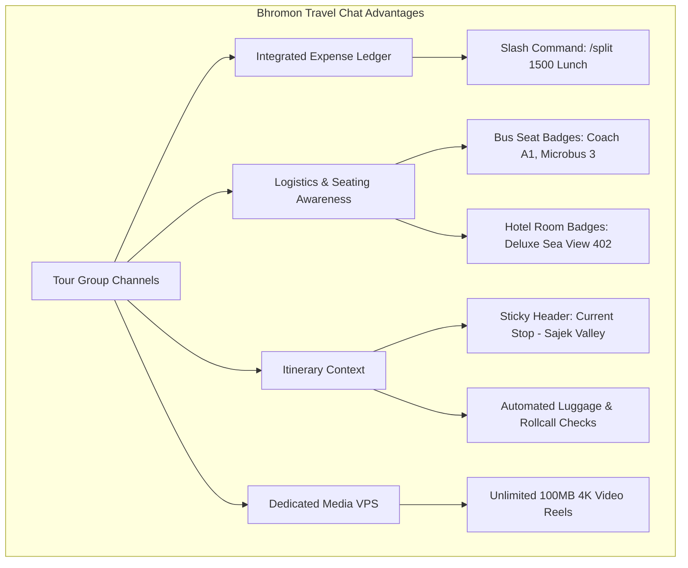

# Bhromon Chat vs. Official WhatsApp: Ultra-Deep Forensic Feature & Architectural Gap Analysis

This document provides an exhaustive, engineering-grade, architectural, protocol-level, and UX-forensic gap analysis comparing **Bhromon's Chat subsystem** (`lib/features/chat/`, WebRTC calling, and `lib/features/tour_group/` channels) against the production **WhatsApp platform** (Android, iOS, Web/Desktop, Erlang backend, and Signal Protocol architecture).

---

## 1. Executive Summary & High-Level Architectural Contrast

```mermaid
flowchart LR
    subgraph Bhromon Chat Subsystem (Current State)
        A[Flutter Mobile Client] -->|Plaintext gRPC over HTTP/2| B[Firebase Firestore]
        B -->|Unencrypted JSON Docs /chats/chatId/messages| A
        A -->|Single Public Google STUN| C[Direct P2P WebRTC]
        A -->|Uncached Network Stream| D[Firebase Storage / VPS]
        A -->|In-Memory Filtering| E[No Local Relational DB]
    end

    subgraph Official WhatsApp Real-Time Architecture
        F[WhatsApp Native Client] -->|Noise Pipes / TLS TCP:443| G[Erlang Chat Gateway Cluster]
        G -->|Ephemeral Encrypted Ciphertext Buffer| H[Zero-Knowledge Media Store]
        F -->|Signal Protocol E2EE| F2[Double Ratchet + X3DH Keys]
        F -->|Global STUN / TURN / SFU Mesh| I[Carrier-Grade Opus/H.264 VoIP]
        F -->|Encrypted SQLite Engine| J[Local msgstore.db.crypt14 + FTS5]
    end
```

### Architectural Comparison Matrix

| Architectural Dimension | Bhromon Chat (Current Implementation) | WhatsApp Production Architecture | Severity / Risk |
| :--- | :--- | :--- | :--- |
| **End-to-End Encryption (E2EE)** | **Zero E2EE**. All messages, media URLs, audio notes, and caller IDs are stored in plaintext JSON in Firestore (`chats/{chatId}/messages/`). Visible in Firebase Console. | **Strict E2EE by default** (Signal Protocol: Double Ratchet, Curve25519, AES-256-CBC, HMAC-SHA256). Servers are zero-knowledge relays. | 🚨 **Critical** |
| **Storage & Offline Engine** | **Remote-first Firestore live streams (`snapshots()`)**. No local relational database for direct chat. 150 simultaneous Firestore streams on 50 chats in `ChatsListScreen`. | **Offline-first SQLite local database** (`msgstore.db.crypt14`). Instant local indexed search (FTS5). Zero server read cost on chat list rendering. | 🚨 **Critical** |
| **Delivery State Machine** | 2-state in practice (`sent` $\rightarrow$ `seen`). `'delivered'` status code exists in UI but is **dead code** (never written to Firestore). | 4-state lifecycle: Clock (queued) $\rightarrow$ Single grey tick (server ACK) $\rightarrow$ Double grey tick (device delivered) $\rightarrow$ Double blue tick (read). | 🔴 **High** |
| **VoIP / Video Infrastructure** | P2P WebRTC with Google STUN only (`stun.l.google.com:19302`). **Zero TURN relay**. Incoming call listener only runs if user is in `ChatScreen`! | Global low-latency STUN/TURN/SFU relay mesh. Full OS integration (CallKit / Android ConnectionService / TelecomManager). Group calls up to 32 users. | 🚨 **Critical** |
| **Media & Attachments** | Single photo or video only via `image_picker`. No image editor, no crop, no captions, no documents (PDF/Office), no audio files, no location pins, no contact vCards. | Multi-send (up to 100), full media editor (crop, rotate, annotate, stickers), HD toggle, docs up to 2 GB, Live/Static Location, vCard contacts, voice transcription. | 🔴 **High** |
| **Voice Messaging** | Basic `.m4a` recording. Sine-wave dummy animation (not audio decibels). No preview before send, no pause/resume, no earpiece proximity sensor, stops on screen pop. | Real-time audio waveform amplitudes, pause/resume, preview before send, continuous playback across sequential notes, proximity sensor (earpiece mode), background playback. | 🔴 **High** |
| **Message Interactivity** | Plain text only. No swipe-to-reply, no quoted reply, no message edit, no emoji reactions, no message pin, no starred messages, no forwarding. | Swipe-to-reply, 15-minute edit window, full emoji reactions with participant breakdown, pin messages (24h/7d/30d), starred messages, anti-spam forwarded tags. | 🔴 **High** |
| **Message Deletion** | **Broken in production rules**. Calling `.delete()` throws Firestore `permission-denied` (`allow delete: if false;`). "Delete for me" (`deletedFor`) is also blocked by rules. | Local tombstone for "Delete for me"; protocol control frame replacing message with "This message was deleted" tombstone for "Delete for everyone" within 60 hours. | 🚨 **Critical** |
| **Group Chat Capability** | **Zero group chat in `lib/features/chat/`**. Group channels are strictly restricted to formal Tour packages in `lib/features/tour_group/`. No ad-hoc friend groups. | Ad-hoc groups up to 1,024 members, granular admin roles, invite links, QR codes, Communities organizing multiple sub-groups, broadcast lists. | 🔴 **High** |
| **Privacy & Ephemerality** | None. No disappearing messages, no View Once media, no Chat Lock (biometrics/passcode), no read receipt privacy toggle, no online status visibility control. | Disappearing messages (24h/7d/90d), View Once media (screenshot-blocked), Chat Lock (biometric hidden folder), granular privacy for Last Seen, Profile Photo, Read Receipts. | 🟡 **Medium** |
| **Multi-Device & Sync** | Direct Firebase client on web. No companion device QR-code pairing, no companion session management, no multi-device cryptographic key management. | Companion Device Architecture (Web/Desktop/iPad/Secondary phone) using pairwise Signal ratchet; primary phone can be completely offline. | 🟡 **Medium** |

---

## 2. Line-by-Line Code Forensic Findings in Bhromon

### 1. The "Delete for Everyone" and "Delete for Me" Rule Denial Bug
In [`chat_screen.dart`](file:///d:/Software_and_Apps/Apps/Bhromon/lib/features/chat/presentation/pages/chat_screen.dart#L964-L1005):
```dart
// Delete for Me:
await FirebaseFirestore.instance
    .collection('chats')
    .doc(widget.chatId)
    .collection('messages')
    .doc(doc.id)
    .update({'deletedFor': FieldValue.arrayUnion([currentUid])});

// Delete for Everyone:
await FirebaseFirestore.instance
    .collection('chats')
    .doc(widget.chatId)
    .collection('messages')
    .doc(doc.id)
    .delete();
```
However, in [`firestore.rules`](file:///d:/Software_and_Apps/Apps/Bhromon/firestore.rules#L366-L371):
```firestore
allow update: if isParticipant()
              && request.resource.data.diff(resource.data)
                 .affectedKeys().hasOnly(['seen', 'status', 'deliveredAt', 'readAt'])
              && request.auth.uid != resource.data.senderId;
allow delete: if false;
```
- **Finding**: Calling `.delete()` is blocked by `allow delete: if false;`.
- **Finding**: Updating `'deletedFor'` is blocked because `affectedKeys().hasOnly(['seen', 'status', ...])` rejects `deletedFor`, and `request.auth.uid != resource.data.senderId` prevents the sender from ever updating their own message document!
- **Result**: In production, both delete buttons fail with `FirebaseException: permission-denied`.

---

### 2. The Dead `'delivered'` Status State Machine
In [`chat_screen.dart`](file:///d:/Software_and_Apps/Apps/Bhromon/lib/features/chat/presentation/pages/chat_screen.dart#L319):
```dart
batch.set(msgRef, {
  'senderId': currentUid,
  'type': 'text',
  'text': text,
  'seen': false,
  'status': 'sent', // delivery states: sent → delivered → read
  'timestamp': FieldValue.serverTimestamp(),
});
```
And in [`chat_screen.dart`](file:///d:/Software_and_Apps/Apps/Bhromon/lib/features/chat/presentation/pages/chat_screen.dart#L1257):
```dart
} else if (status == 'delivered') {
  return const Icon(Icons.done_all, size: 14, color: Colors.white54);
}
```
- **Finding**: While UI code exists to render double grey ticks for `'delivered'`, `'delivered'` is **never written anywhere in the entire codebase**.
- **Result**: Messages jump directly from single tick (`'sent'`) to double blue ticks (`'read'`) upon the recipient opening the screen. If the recipient receives the message while their phone is locked or in background, the sender still sees a single tick.

---

### 3. Read Amplification Catastrophe in `ChatsListScreen`
In [`chats_list_screen.dart`](file:///d:/Software_and_Apps/Apps/Bhromon/lib/features/chat/presentation/pages/chats_list_screen.dart#L609-L630):
```dart
void _subscribe() {
  final messages = FirebaseFirestore.instance
      .collection('chats')
      .doc(chatId)
      .collection('messages');

  // Stream 1: Latest message snippet
  lastMsgStream = messages.orderBy('timestamp', descending: true).limit(1).snapshots();

  // Stream 2: Unread badge counter
  unreadStream = messages.where('senderId', isEqualTo: otherUserUid).where('seen', isEqualTo: false).limit(_kUnreadCap).snapshots();

  // Stream 3: Contact profile details
  profileStream = FirebaseFirestore.instance.collection('explorer_profiles').doc(otherUserUid).snapshots();
}
```
- **Finding**: For a user with 50 conversations, `ChatsListScreen` instantiates **150 simultaneous Firestore stream subscriptions** ($50 \times 3$).
- **Impact**: Heavy mobile battery drain, socket contention, frame drops during list scrolling, and explosive billing reads on every app foreground.
- **WhatsApp Contrast**: In WhatsApp, a single indexed SQL query against local SQLite retrieves all conversations, latest message snippet, unread counter, and contact details in $< 2$ milliseconds with zero network requests.

---

### 4. Critical WebRTC Calling Blindspots
In [`call_signaling_service.dart`](file:///d:/Software_and_Apps/Apps/Bhromon/lib/features/chat/data/call_signaling_service.dart#L32-L39):
```dart
static const Map<String, dynamic> _iceConfig = {
  'iceServers': [
    {
      'urls': ['stun:stun.l.google.com:19302'],
    },
  ],
  'sdpSemantics': 'unified-plan',
};
```
And in [`chat_screen.dart`](file:///d:/Software_and_Apps/Apps/Bhromon/lib/features/chat/presentation/pages/chat_screen.dart#L800-L823):
```dart
_incomingCallSub = FirebaseFirestore.instance
    .collection('calls')
    .where('calleeId', isEqualTo: currentUid)
    .where('status', isEqualTo: 'calling')
    .snapshots()
    .listen((snap) { ... });
```
- **Finding 1 (STUN-only NAT failure)**: Without a TURN relay (e.g. Coturn / Twilio), WebRTC calls fail across symmetric NATs, cellular data carriers (Grameenphone, Banglalink, Robi, Teletalk), and corporate/hotel Wi-Fi.
- **Finding 2 (Foreground-in-Chat only)**: The call listener is inside `_ChatScreenState`! If the callee is on the Feed, Exploring Tours, in the Game Zone, or the app is closed, **the call never rings**.
- **Finding 3 (Zero OS Telephony integration)**: No CallKit (iOS) or ConnectionService / FullScreenIntent (Android).
- **Finding 4 (Security Hole)**: In `firestore.rules` line 375, `match /calls/{callId} { allow read, write: if isAuth(); }`. Any authenticated user can read, intercept, or tamper with any other user's active call signaling!

---

### 5. Mock AI Advisor & Missing Capabilities
In [`chat_screen.dart`](file:///d:/Software_and_Apps/Apps/Bhromon/lib/features/chat/presentation/pages/chat_screen.dart#L408-L450):
```dart
String _generateAiReply(String message) {
  final query = message.toLowerCase();
  if (query.contains('sajek')) return "Sajek Valley is located in Rangamati district...";
  if (query.contains('cox') || query.contains('beach')) return "Cox's Bazar Beach...";
  ...
}
```
- **Finding**: The AI Guide in direct chat is a hardcoded 12-entry substring if-else block inside the presentation widget. It does not use the Gemini API, Cloud Functions, or an LLM runtime.

---

## 3. Exhaustive Forensic Breakdown: 10 Subsystems

```
                                  WHATSAPP VS. BHROMON CHAT GAP
┌────────────────────────────────────────────────────────────────────────────────────────┐
│ 1. Cryptography & Security   │ Signal Protocol (E2EE) vs. Plaintext Firestore          │
│ 2. Local Database & Sync     │ SQLite (msgstore) vs. 150-Stream Firestore Listeners    │
│ 3. Messaging Interactivity   │ Quotes, Edits, Reactions, Pins, Star vs. Plain Text     │
│ 4. Media & Attachments       │ Editor, Docs (2GB), HD, Contacts, Location vs. 1 Image  │
│ 5. Voice Messaging Engine    │ Amplitudes, Preview, Earpiece vs. Mock Waveform         │
│ 6. Calling & Telephony       │ CallKit/Telecom, SFU, Group 32 vs. P2P STUN-Only Dialog │
│ 7. Group Architecture        │ Ad-hoc Groups (1024), Roles, Links vs. Tour-Only Groups │
│ 8. Privacy & Ephemerality    │ Disappearing, View Once, Chat Lock vs. Zero Controls    │
│ 9. Companion & Multi-Device  │ Independent Companion Ratchet vs. Monolithic Web Client │
│ 10. System OS Integration    │ Direct Share, Inline Reply, Shortcuts vs. None          │
└────────────────────────────────────────────────────────────────────────────────────────┘
```

---

### Part 1: Architecture, Protocol & Cryptography

| Feature / Capability | WhatsApp Production | Bhromon Chat (Current) | Gap Severity |
| :--- | :--- | :--- | :--- |
| **End-to-End Encryption** | Signal Protocol (Curve25519, AES-256-CBC, HMAC-SHA256, Double Ratchet, X3DH). | None. Messages, media URLs, audio URLs stored in plaintext Firestore documents. | 🚨 Critical |
| **Forward Secrecy & Break-in Recovery** | Ephemeral ratchet keys updated per message. Leaking one key compromises only one message. | None. Access to Firebase Console or bearer token exposes entire chat history. | 🚨 Critical |
| **Server Knowledge Profile** | Zero-knowledge. Servers never hold private keys or plaintext payloads. | Full knowledge. All text, audio, images, and user interactions readable by database administrators. | 🚨 Critical |
| **Cryptographic Verification** | 60-digit safety numbers and QR code scanning to verify identity key fingerprint. | None. No public key exchange or identity verification. | 🔴 High |
| **Media Encryption at Rest** | Media files uploaded to CDN as AES-256 ciphertext blobs; decryption keys sent via E2EE message. | Media files uploaded as public or bearer-authenticated raw files to Storage/VPS. | 🔴 High |

---

### Part 2: Offline-First Engine & Database

| Feature / Capability | WhatsApp Production | Bhromon Chat (Current) | Gap Severity |
| :--- | :--- | :--- | :--- |
| **Local Relational Storage** | High-performance SQLite engine (`msgstore.db.crypt14`) stored locally on device. | No local database for direct chat. Relies strictly on Firestore remote documents and cache. | 🚨 Critical |
| **In-Chat Message Search** | SQLite FTS5 (Full Text Search) index enabling instantaneous search across years of messages. | No in-chat message search. Search in list screen only filters currently loaded threads. | 🔴 High |
| **Offline Send Queue** | Outbound messages persisted to SQLite `messages_ready` queue with guaranteed sequential flush. | Firestore optimistic writes without ordered background queue handling. | 🟡 Medium |
| **Read Amplification & Cost** | 0 server reads to render chat list, search history, or view old conversations. | 3 real-time stream subscriptions per chat tile. 150 live queries for 50 chats. | 🚨 Critical |
| **Pagination Engine** | Bidirectional windowed SQL pagination (`LIMIT 30 OFFSET n`) around jump targets. | Reverse timestamp snapshot cursor. Scrolling up triggers manual page increments. | 🟡 Medium |

---

### Part 3: Core Messaging, Delivery States & Interactivity

| Feature / Capability | WhatsApp Production | Bhromon Chat (Current) | Gap Severity |
| :--- | :--- | :--- | :--- |
| **Delivery Receipts** | 4 states: Clock (sending) $\rightarrow$ Single grey (server) $\rightarrow$ Double grey (delivered) $\rightarrow$ Double blue (read). | Only 2 states (`sent` $\rightarrow$ `read`). `'delivered'` status is dead code. | 🔴 High |
| **Swipe-to-Reply / Quoting** | Swipe right to quote any message with sender tag, snippet, and smooth scroll jump to source. | Completely missing in direct chat. (Only Tour Group channels have basic reply). | 🔴 High |
| **Message Editing** | Edit message within 15 minutes of sending; shows "(edited)" badge and timestamp. | Completely missing. Sent messages cannot be edited. | 🟡 Medium |
| **Emoji Reactions** | 6 quick emojis + full emoji picker. Tap pill to see list of who reacted. | Completely missing in direct chat. (Only Tour Group channels have reactions). | 🔴 High |
| **Message Pinning** | Pin up to 3 messages to top of chat with duration (24 hours, 7 days, 30 days). | Completely missing in direct chat. | 🟡 Medium |
| **Starred Messages** | Star important messages for quick access in chat info or global Starred Messages screen. | Completely missing. | 🟡 Medium |
| **Message Forwarding** | Forward text or media to up to 5 chats with "Forwarded" or "Forwarded many times" tag. | Completely missing. Users must manually copy text or re-download media. | 🔴 High |
| **Delete for Everyone** | Replaces message with "This message was deleted" tombstone; strict time limit (~60 hrs). | Attempts hard `.delete()`, which breaks in Firestore rules. No tombstone UI. | 🚨 Critical |
| **Delete for Me** | Removes message locally from current user's view while keeping it for recipient. | Attempts arrayUnion on `deletedFor`, which is blocked by Firestore rules. | 🚨 Critical |
| **Rich Text Formatting** | Bold (`*`), Italic (`_`), Strike (`~`), Monospace (`` ` ``), bullet lists, quotes, inline code. | Plain text rendering in direct chat. (Markdown only supported in Tour channels). | 🟡 Medium |
| **Rich Link Previews** | Fetches OpenGraph metadata (title, thumbnail, description) when URL is pasted. | URLs rendered as plain clickable text without preview cards. | 🟡 Medium |
| **Multi-Selection Action Bar** | Long press to enter multi-select mode: bulk copy, bulk star, bulk forward, bulk delete. | Long press opens a basic single-message delete dialog. No multi-selection. | 🔴 High |

---

### Part 4: Media, Documents & Voice Messaging

| Feature / Capability | WhatsApp Production | Bhromon Chat (Current) | Gap Severity |
| :--- | :--- | :--- | :--- |
| **Batch Media Sending** | Pick and send up to 100 photos and videos in a single batch with reordering. | Single file pick only via `image_picker`. | 🔴 High |
| **In-App Media Editor** | Crop, 90° rotate, doodle brush with RGB picker, text annotations, stickers, blur tool. | None. Media is sent as raw camera capture or gallery file without editing. | 🔴 High |
| **Media Captions** | Attach descriptive text caption to photos, videos, and documents. | Photos and videos are sent with empty text; captions cannot be attached. | 🔴 High |
| **HD Photo & Video Quality** | Toggle between Standard (compressed) and HD (original high-resolution) quality. | Fixed compression ratio or raw upload; no user-facing resolution control. | 🟡 Medium |
| **Document Sharing** | Share any file type (PDF, DOCX, XLSX, ZIP, APK) up to 2 GB with page previews. | Completely missing. Attachment sheet only has Camera, Gallery, and Video. | 🔴 High |
| **Audio File Sharing** | Share audio files (MP3, WAV, M4A) with in-bubble waveform scrubber. | None. Can only record live voice notes; cannot send pre-existing audio tracks. | 🟡 Medium |
| **Location Sharing** | Live Location (real-time GPS tracking for 15m/1h/8h) + Static POI via Maps API. | Completely missing in direct chat. | 🔴 High |
| **Contact Card Sharing** | Send vCard (`.vcf`) contact cards with direct "Save Contact" and "Message" actions. | Completely missing. | 🟡 Medium |
| **Chat Media Gallery** | Dedicated gallery screen with tabs for Media, Docs, and Links exchanged in that chat. | None. Users must scroll through entire chat stream to find historical media. | 🔴 High |
| **Voice Note Recording** | Live sound amplitude visualization, pause & resume recording, preview before sending. | Fixed sine-wave dummy animation, no pause/resume, no preview before sending. | 🔴 High |
| **Voice Note Playback** | Continuous playback across sequential notes, proximity sensor (earpiece), background audio. | Manual play per note, loudspeaker only (no earpiece sensor), terminates on screen pop. | 🔴 High |
| **Voice Transcription** | On-device AI speech-to-text converting voice notes into readable transcripts. | None. | 🟡 Medium |

---

### Part 5: Audio & Video Calling (WebRTC & Telephony)

| Feature / Capability | WhatsApp Production | Bhromon Chat (Current) | Gap Severity |
| :--- | :--- | :--- | :--- |
| **NAT Traversal Relays** | Carrier-grade TURN servers (relay packets when P2P direct hole punching fails). | Google STUN only (`stun.l.google.com:19302`). Fails on cellular CGNAT / symmetric NATs. | 🚨 Critical |
| **Incoming Call Ringing** | Native OS VoIP integration: iOS CallKit & Android TelecomManager / FullScreenIntent. | In-app dialog only! Only rings if user is actively viewing that specific `ChatScreen`! | 🚨 Critical |
| **Group Calling** | Up to 32 participants simultaneously with active speaker grid and spotlight views. | Strictly 1-on-1 P2P. No group calling capability. | 🔴 High |
| **Screen Sharing** | Share mobile device screen during video calls with system audio pass-through. | None. | 🟡 Medium |
| **Low-Bandwidth Mode** | Adaptive Opus bitrate reduction (down to 6–12 kbps) for 2G/3G connections. | Fixed WebRTC bitrate profile. | 🟡 Medium |
| **Call Links** | Generate shareable URL for users to join scheduled or ad-hoc group calls. | None. | 🟡 Medium |
| **Call History Tab** | Dedicated Calls tab logging all incoming, outgoing, and missed calls with durations. | None. No call history screen or call records displayed anywhere in the app. | 🔴 High |

---

### Part 6: Group Chatting, Communities & Social Hierarchy

| Feature / Capability | WhatsApp Production | Bhromon Chat (Current) | Gap Severity |
| :--- | :--- | :--- | :--- |
| **Ad-Hoc Group Creation** | Create custom groups anytime with up to 1,024 members without preconditions. | Direct chat is strictly 1-on-1. Group chat exists only inside formal Tour Packages. | 🔴 High |
| **Granular Admin Controls** | "Only admins can send messages", "Only admins can edit info", "Approve members". | Tour Group has basic owner/admin/member roles, but no casual group permissions. | 🟡 Medium |
| **Group Invite Links & QR** | Shareable group invite URLs and QR codes with instant revoke capability. | Tour Group uses 8-char invite codes. No direct deep links or QR codes for chat groups. | 🟡 Medium |
| **Communities** | Organize multiple related topic channels under an umbrella Community (e.g. Club). | None. | 🟡 Medium |
| **Broadcast Lists** | Send a single message to up to 256 contacts individually without creating a group. | None. | 🟡 Medium |

---

### Part 7: Privacy, Ephemerality & Security

| Feature / Capability | WhatsApp Production | Bhromon Chat (Current) | Gap Severity |
| :--- | :--- | :--- | :--- |
| **Disappearing Messages** | Auto-delete messages after 24 hours, 7 days, or 90 days across both devices. | None. Messages persist forever in Firestore unless manually deleted. | 🟡 Medium |
| **View Once Media** | Photos/videos disappear immediately after being viewed once; screenshots blocked. | None. All sent media remains permanently viewable and downloadable. | 🟡 Medium |
| **Chat Lock & Biometrics** | Lock sensitive individual chats into a hidden folder unlocked via biometric/passcode. | None. Anyone with unlocked phone can read all Bhromon chats. | 🟡 Medium |
| **Granular Privacy Controls** | Toggle visibility of Last Seen, Online Status, Profile Photo, and Read Receipts. | None. Hardcoded presence and unread indicators with zero privacy settings. | 🟡 Medium |
| **Two-Step Verification** | 6-digit PIN required when registering phone number to prevent SIM-swap hijacking. | Relies on Firebase Auth SMS/Email; no application-level secondary PIN. | 🟡 Medium |

---

### Part 8: Multi-Device & Companion Sync

| Feature / Capability | WhatsApp Production | Bhromon Chat (Current) | Gap Severity |
| :--- | :--- | :--- | :--- |
| **Companion Architecture** | Link up to 4 companion devices (Web, macOS, Windows, iPad) via QR code pairing. | Web build connects as an independent Firebase client; no QR companion pairing. | 🟡 Medium |
| **Phone-Independent Web** | WhatsApp Web runs seamlessly even when primary phone is turned off or has no internet. | Web works independently because it uses Firestore, but lacks companion sync security. | 🟢 Low |
| **Device Management** | View list of all active linked sessions with OS, browser, last active time, and remote logout. | None. No linked device management screen. | 🟡 Medium |

---

### Part 9: Chat Management, Backups & Migration

| Feature / Capability | WhatsApp Production | Bhromon Chat (Current) | Gap Severity |
| :--- | :--- | :--- | :--- |
| **Encrypted Cloud Backups** | Automated backups to Google Drive / iCloud protected with 64-digit encryption key. | None. Relies purely on Firebase cloud storage without exportable user backups. | 🟡 Medium |
| **Local Device Backups** | Daily local backup written to internal storage (`/sdcard/Android/media/com.whatsapp/`). | None. | 🟡 Medium |
| **Chat Export** | Export conversation history as a `.txt` file with or without attached media. | None. | 🟡 Medium |
| **Direct Chat Transfer** | Transfer complete chat history between phones over local Wi-Fi without cloud backup. | None. | 🟡 Medium |
| **Archived Chats Folder** | Mute and tuck away conversations into an Archived section that doesn't clutter main list. | None. All active chats stay in one flat list. | 🟡 Medium |
| **Pin Chats** | Pin up to 3 priority chats to the very top of the chat list. | None. Chat order is strictly determined by `lastMessageTime`. | 🟡 Medium |

---

### Part 10: System & OS-Level Integration

| Feature / Capability | WhatsApp Production | Bhromon Chat (Current) | Gap Severity |
| :--- | :--- | :--- | :--- |
| **Direct Share Targets** | Surface top recent chat contacts in Android / iOS system share sheet. | None. Sharing content into Bhromon requires opening the app manually. | 🟡 Medium |
| **Inline Notification Reply** | Type and send reply directly from notification banner without opening the app. | None. Notifications are written to Firestore `notifications` subcollection; no OS reply action. | 🔴 High |
| **App Shortcuts** | Long-press app launcher icon to jump directly into recent chats or camera. | None. | 🟢 Low |
| **Automotive Integration** | Android Auto and Apple CarPlay messaging and voice readout. | None. | 🟢 Low |

---

## 4. Bhromon's Domain Superpowers (What WhatsApp Lacks)

While Bhromon has architectural and feature gaps compared to general-purpose WhatsApp, **Bhromon possesses specialized travel superpowers** that WhatsApp cannot match:



1. **Travel Expense Ledger Integration (`/split`)**:
   - In Bhromon Tour Channels, typing `/split 1200 Biryani Feast` instantly records an immutable split in the group ledger, computing paisa-accurate balances per family. WhatsApp requires external third-party apps like Splitwise.
2. **Logistics & Seating Context in Avatars**:
   - Every message in Tour Channels automatically displays the member's assigned coach seat (e.g. `[A1]`) and hotel room number (e.g. `[Room 304]`). WhatsApp has zero awareness of travel logistics.
3. **Live Sticky Itinerary Tracker**:
   - Pinned above the group channel is the live tour milestone (`meta/itinerary.currentStopId`), showing the group's current waypoint, ETA, and route progress.
4. **Coordinated Checklists & Roll Calls**:
   - Group notices feature mandatory interactive roll calls ("Got it" / "I'm here") to ensure no traveler is left behind at highway checkpoints.
5. **Private Media VPS Streaming**:
   - Video reels and photos bypass commercial cloud storage rate limits via Bhromon's self-hosted VPS streaming microservice with native HTTP 206 byte-range seeking.

---

## 5. Phased Engineering Remediation Roadmap

### Phase 1: Critical Stability & Bug Fixes (Immediate)
- [ ] **Fix Message Deletion in Firestore Rules**: Update [`firestore.rules`](file:///d:/Software_and_Apps/Apps/Bhromon/firestore.rules#L366-L371) to allow soft-tombstoning (`type: 'deleted'`, `text: 'This message was deleted'`) and allow updating `deletedFor` array for participants.
- [ ] **Activate `'delivered'` Delivery Receipts**: Add a lightweight FCM data message handler that acknowledges receipt and transitions message state from `'sent'` to `'delivered'`.
- [ ] **Fix VoIP Incoming Call Listener**: Move WebRTC incoming call listener out of [`chat_screen.dart`](file:///d:/Software_and_Apps/Apps/Bhromon/lib/features/chat/presentation/pages/chat_screen.dart) into top-level app lifecycle (`App` or `HomeShell`) so calls ring from any screen.
- [ ] **Deploy TURN Relay**: Configure Coturn on the Hostinger VPS (`148.135.137.245`) with credentials injected into [`call_signaling_service.dart`](file:///d:/Software_and_Apps/Apps/Bhromon/lib/features/chat/data/call_signaling_service.dart) to guarantee WebRTC call completion over cellular networks.

### Phase 2: Performance & Read Amplification Elimination
- [ ] **Denormalize Chat Metadata**: Embed `unreadCount` and `lastMessage` (with sender details) directly inside `/chats/{chatId}` to replace the $3 \times N$ stream storm with a single stream query.
- [ ] **Wire Real AI Guide Backend**: Replace the 12-line hardcoded string matching in `_generateAiReply` with a real Gemini 1.5 Flash streaming call.
- [ ] **Implement Share & Media Actions**: Replace empty placeholder callbacks in [`full_screen_media_viewer.dart`](file:///d:/Software_and_Apps/Apps/Bhromon/lib/features/chat/presentation/pages/full_screen_media_viewer.dart#L126) and [`chats_list_screen.dart`](file:///d:/Software_and_Apps/Apps/Bhromon/lib/features/chat/presentation/pages/chats_list_screen.dart#L76).

### Phase 3: Core UX Parity with WhatsApp
- [ ] **Swipe-to-Reply & Quoted Messages**: Implement horizontal drag gesture on chat bubbles with quote preview header and jump-to-original scroll.
- [ ] **Real Audio Waveforms & Earpiece Proximity**: Use `record`'s decibel amplitude stream for true waveform rendering; integrate `proximity_sensor` to switch audio to earpiece when held to ear.
- [ ] **Expanded Attachment Sheet**: Add Document Picker (PDF/Office files), Location Picker (Google Maps GPS pin), and Contact Card sharing.
- [ ] **Emoji Reactions & Message Pins**: Add long-press reaction bar with 6 quick emojis and 24h/7d pin capability.

### Phase 4: Modern Privacy & Architecture
- [ ] **Drift (SQLite) Offline Database for Direct Chat**: Unify direct chat with Bhromon's existing Drift database for instant local FTS search and offline queue.
- [ ] **CallKit & FullScreenIntent Integration**: Integrate `flutter_callkit_incoming` to display native incoming call screens when phone is locked.
- [ ] **End-to-End Encryption (E2EE)**: Implement `libsignal-protocol-dart` for zero-knowledge cryptographic privacy.
