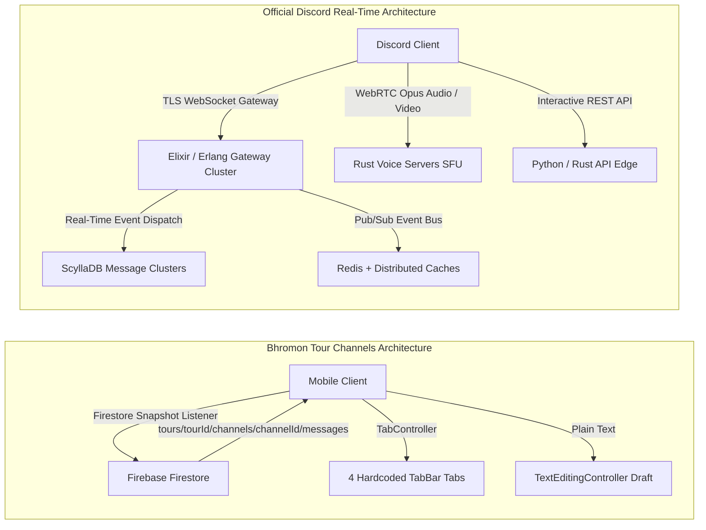
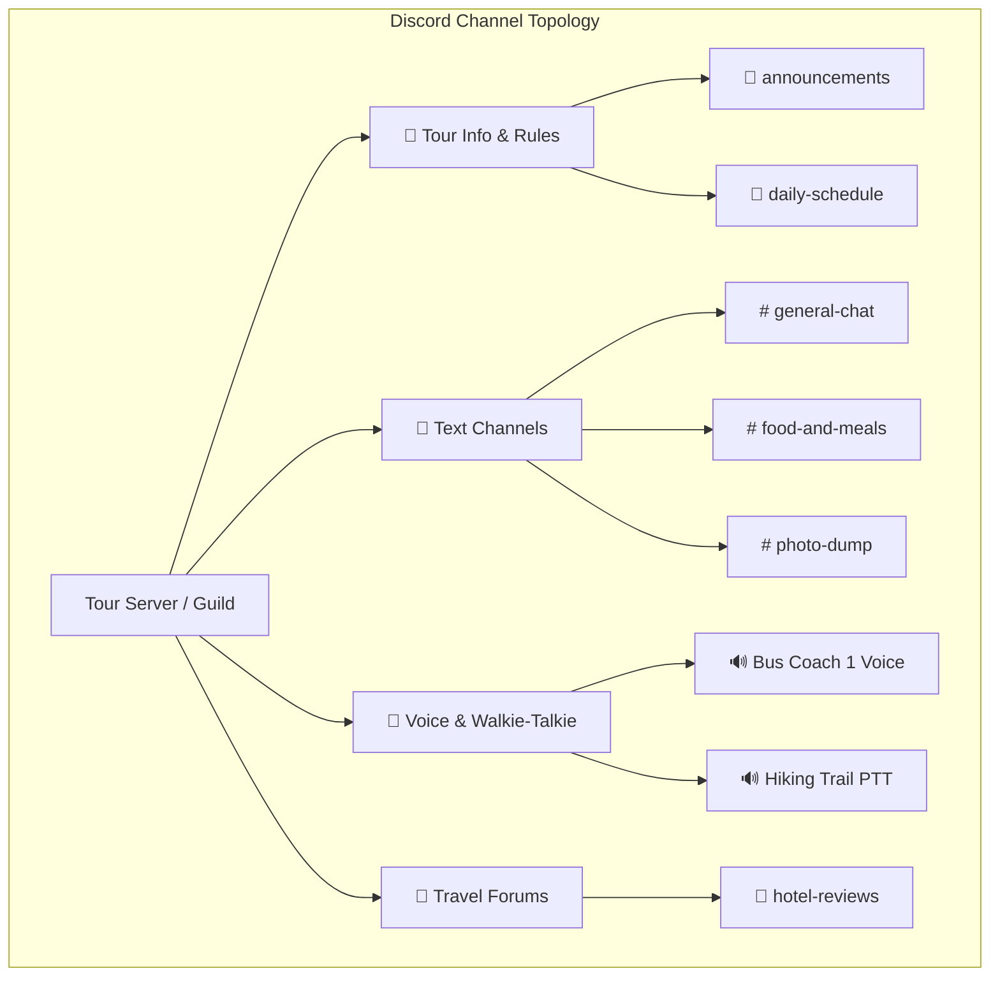
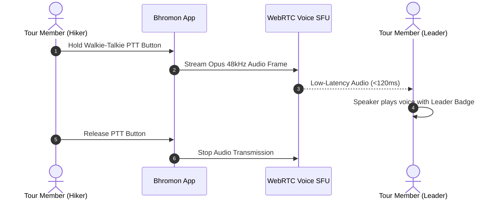
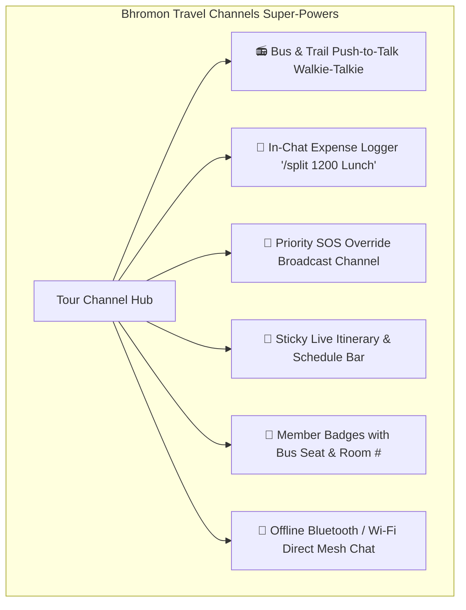
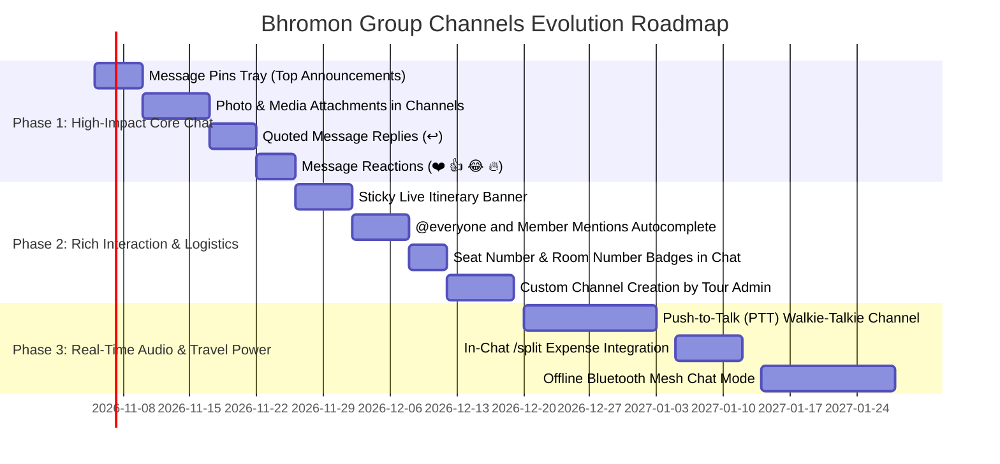

# Bhromon Group Channels vs. Official Discord: Ultra-Deep Forensic Feature & Architectural Gap Analysis

This document provides an exhaustive, engineering-grade, and UX-forensic gap analysis comparing **Bhromon's Group Channels and Chat subsystem** (`lib/features/tour_group/presentation/pages/group_channels_screen.dart`, `lib/features/chat/`, `TourGroupRepository`) against the production **Discord platform** (Discord Desktop, Web, iOS, Android, and Gateway architecture).

---

## 1. Executive Summary & High-Level Architectural Contrast



### Architectural Comparison Matrix

| System Dimension | Bhromon Group Channels (Current State) | Official Discord Production Architecture |
| :--- | :--- | :--- |
| **Real-Time Protocol** | Firebase Firestore Document Stream (`snapshots()`) over HTTP/2 gRPC. | Stateful WebSocket Gateway (Elixir/Erlang) with binary packing (ETF/Zlib) + WebRTC Voice. |
| **Channel Hierarchy** | 4 hardcoded string tabs (`general`, `food`, `sightseeing`, `emergency`) inside a `TabBar`. | Dynamic Guild Channels: Categories, Text (`#`), Voice (`🔊`), Forum (`💬`), Announcement (`📢`), Stage (`🎭`). |
| **Media & Attachments** | **Zero attachments**. Plain string text only (`m.text`) up to 1000 characters. | Multi-media uploads, image/video compression, inline audio waveforms, PDF/file embeds, spoiler tags. |
| **Voice & Audio** | **Completely absent**. No audio communication. | WebRTC low-latency Voice (Opus 96-384kbps), Krisp AI Noise Suppression, Screen share (1080p 60fps), Soundboard. |
| **Message Threading** | Monolithic flat reverse `ListView`. No branching. | Nested Public & Private Threads branching off any message with auto-archive policies (24h/3d/1w). |
| **Permissions & RBAC** | Binary tour membership (`owner`, `admin`, `member`). Every member sees all 4 channels. | Multi-Role Hierarchy (30+ granular bitwise permissions, custom role colors, channel-specific overrides). |
| **Rich Interactions** | Static text bubbles. No reactions, no edits, no deletes, no pins. | Rich Markdown, Spoilers, Embeds, Custom Emojis, Animated Reactions, Message Pins, Slash Commands (`/`). |
| **Firestore Cost Profile** | 1 document read per message per connected tour member (high read amplification during active chatter). | Sub-50ms distributed cache clusters (ScyllaDB + Redis); near-zero marginal cost per active chatter. |

---

## 2. Forensic Module-by-Module Feature Breakdown

### Module 1: Channel Organization & Guild Structure

#### Current Bhromon Implementation:
- Implemented in `group_channels_screen.dart` (lines 18–115).
- Fixed list of 4 channels:
  ```dart
  static const List<String> _channels = ['general', 'food', 'sightseeing', 'emergency'];
  ```
- Rendered via a horizontal scrolling `TabBar` and `TabBarView`.
- Titles translated to Bengali labels (`# সাধারণ আড্ডা`, `# খাবার ও রেস্তোরাঁ`, `# ঘোরাঘুরি ও স্পট`, `# জরুরি ও নিরাপত্তা`).

#### Gap Analysis vs. Official Discord:



| Feature | Official Discord Capability | Bhromon Channels Gap | Engineering Severity |
| :--- | :--- | :--- | :--- |
| **Custom Channel Creation** | Server admins can create, rename, reorder, delete, and group unlimited custom channels. | **Hardcoded**. Cannot add a new channel (e.g. `#photos`, `#budget-queries`, `#roommates`). | **Critical** |
| **Channel Categories** | Collapsible category folders (e.g. "LOGISTICS", "CHAT", "VOICE") with syncable permissions. | Flat horizontal tabs with no categorization or grouping. | **High** |
| **Specialized Channel Types** | Text, Voice, Forum (Reddit-style tagged posts), Announcement (broadcast feed), Stage channels. | Single text-only TabBarView. | **Critical** |
| **Channel Topics & Guidelines** | Channel topic bar at top with clickable links, rules, and pinned guidelines. | No channel description, purpose statement, or guidelines. | **Medium** |
| **Unread Badges & Mentions** | Unread white pill indicator, red numbered badge for unread `@mentions` per channel. | No unread indicator; user has to click into each tab to check for new messages. | **High (UX)** |
| **Mute & Notification Settings**| Mute channel for 15m, 1h, 8h, 24h, or until unmuted; notify on "All Messages" vs "Only @mentions". | All channels behave identically; no notification granular control. | **High** |

---

### Module 2: Rich Messaging, Formatting & Markdown

#### Current Bhromon Implementation:
- Handled by lines 161–197 of `group_channels_screen.dart`.
- Renders `Text(m.text, style: TextStyle(color: Colors.white, fontSize: 14))` directly.
- Maximum length 1000 characters (`maxLength: 1000`).

#### Gap Analysis vs. Official Discord:

| Feature | Official Discord Capability | Bhromon Channels Gap | Engineering Severity |
| :--- | :--- | :--- | :--- |
| **Markdown Parsing** | Bold `**text**`, Italic `*text*`, Strikethrough `~~text~~`, Underline `__text__`, Code ` `code` `, Multi-line Code blocks with syntax highlighting ` ```dart `, Blockquotes `> quote`. | Raw text string only. No markdown parsing or styled formatting. | **High** |
| **Spoiler Tags** | `||hidden text||` or spoiler image covers requiring a tap to reveal sensitive spoilers or surprises. | Absent. | **Medium** |
| **Rich Embeds** | Structured cards with colored accent sidebars, author avatars, title, description, key-value fields, footer, and timestamps. | Absent. Links display as plain raw text strings. | **High** |
| **Link Unfurling / OpenGraph**| Automatic rich preview cards for web URLs (YouTube player embed, Google Maps location card, news preview). | Links are plain unclickable text strings. | **High** |
| **Interactive Message Buttons**| Interactive UI buttons and dropdowns directly inside messages (e.g., "Confirm Bus Seat", "Vote Dinner"). | Absent. Messages are static text. | **High (Tour Core)** |
| **Message Length & Editing** | Up to 2000 chars (4000 with Nitro); full message editing with `(edited)` indicator and edit history. | Hardcoded 1000 chars; messages cannot be edited after sending. | **Medium** |

---

### Module 3: Message Management (Pins, Search & Threads)

#### Current Bhromon Implementation:
- Reverse `ListView.builder` displaying messages in chronological order.
- No context menu on messages (no tap, double-tap, or long-press handlers).

#### Gap Analysis vs. Official Discord:

```mermaid
flowchart TD
    subgraph Discord Message Context Menu
        MSG[User Long-Presses Message] --> ACT_REPLY[↩️ Reply with Quote]
        MSG --> ACT_REACT[❤️ Add Quick Emoji Reaction]
        MSG --> ACT_THREAD[🧵 Create Discussion Thread]
        MSG --> ACT_PIN[📌 Pin to Channel Header]
        MSG --> ACT_COPY[📋 Copy Message Text / ID]
        MSG --> ACT_EDIT[✏️ Edit Message (Author)]
        MSG --> ACT_DELETE[🗑️ Delete Message (Author/Admin)]
    end
```

| Feature | Official Discord Capability | Bhromon Channels Gap | Engineering Severity |
| :--- | :--- | :--- | :--- |
| **Pinned Messages** | Pin up to 50 critical messages per channel with dedicated "Pins" tray (e.g. Hotel address, Itinerary times). | **Completely absent**. Critical announcements get buried under casual chatter. | **Critical (Tour Core)** |
| **Quoted Replies** | Tapping "Reply" quotes the original message with an inline reference preview and jumps to source on tap. | Replying cannot reference previous messages. | **High** |
| **Discussion Threads** | Spin off a dedicated thread from any message (e.g. `#dinner-plans` thread inside `#food`) to prevent clutter. | All chatter is forced into one linear stream. | **High** |
| **Full-Text In-Channel Search**| Powerful search with filters: `from:user`, `has:image`, `in:channel`, `before:date`, `during:date`. | No search bar; user must scroll through hundreds of messages manually. | **High** |
| **Message Deletion & Moderation**| Authors can delete own messages; Admins can delete any message or purge in bulk. | Messages once sent cannot be deleted from the UI. | **High (Safety)** |

---

### Module 4: Media, Attachments & File Sharing

#### Current Bhromon Implementation:
- `group_channels_screen.dart` has only a single text `TextField` with `TextInputAction.send`.
- There is **no media picker button**, no attachment icon, and no file handler in the UI.

#### Gap Analysis vs. Official Discord:

| Feature | Official Discord Capability | Bhromon Channels Gap | Engineering Severity |
| :--- | :--- | :--- | :--- |
| **Photo & Video Attachments** | Send photos and videos directly in chat with grid preview, full-screen lightbox, and pinch-to-zoom. | **Missing in Group Channels**. Members cannot share photos of food, tickets, or scenic spots in channels. | **Critical** |
| **Voice Notes / Audio Messages**| Hold mic button to record voice notes with dynamic audio waveform player and scrubber. | Absent. | **High** |
| **Document & PDF Sharing** | Send PDF vouchers, hotel booking receipts, train/air tickets with file size badge and download button. | Absent. | **High (Logistics)** |
| **Image Compression & CDN** | Client generates low-res progressive preview; image served via CDN with blurhash placeholder. | No image pipeline attached to channels. | **Medium-High** |
| **Multi-Media Grid Gallery** | When sending 4 photos, Discord lays them out in a clean 2x2 collage tile rather than 4 separate bubbles. | Absent. | **Medium** |

---

### Module 5: Real-Time Voice Channels & Walkie-Talkie (WebRTC)

#### Current Bhromon Implementation:
- **Zero voice communication infrastructure**.

#### Gap Analysis vs. Official Discord:



| Feature | Official Discord Capability | Bhromon Channels Gap | Engineering Severity |
| :--- | :--- | :--- | :--- |
| **Voice Channels** | Persistent rooms where users tap to connect and talk freely with low-latency WebRTC. | Completely absent. | **Critical (Differentiator)** |
| **Push-to-Talk (PTT) / Walkie-Talkie**| Hold button on phone/earphone to broadcast voice to all connected members; release to mute. | Absent. On bus rides or hill treks, members must make individual phone calls. | **Critical (Tour Core)** |
| **Noise Suppression (Krisp)** | AI-powered background noise removal (filters out bus engine noise, wind noise on mountain tops). | Absent. | **Medium-High** |
| **Speaker Indicator & Voice Overlay**| Green glowing ring around active speaker's avatar; floating overlay while browsing other screens. | Absent. | **High** |
| **Stage Channels** | Organized townhall format: Tour guide / Admin on stage with mic; members raise hand to speak. | Absent. | **Medium** |

---

### Module 6: Reactions, Emojis & Social Expression

#### Current Bhromon Implementation:
- No emoji reaction row on channel messages.
- Standard device keyboard emojis only.

#### Gap Analysis vs. Official Discord:

| Feature | Official Discord Capability | Bhromon Channels Gap | Engineering Severity |
| :--- | :--- | :--- | :--- |
| **Message Reactions** | Tap any emoji to react to a message; counter increments; tooltip shows who reacted. | Completely absent on channel messages. | **High** |
| **Custom Server / Tour Emojis** | Admins can upload custom emoji badges (e.g. `:bus_seat:`, `:sajek_cloud:`, `:chander_gari:`). | Only standard system unicode emojis. | **Medium** |
| **Interactive Emoji Picker Tray**| Searchable emoji & sticker modal with categories (Smileys, Travel, Food, Flags) and frequently used list. | Relies solely on OS keyboard. | **Medium** |
| **Super Reactions** | Animated physics burst effects for high-energy celebrations (e.g. "We reached the summit! 🎉"). | Absent. | **Low** |

---

### Module 7: Mentions, Push Notifications & Member Presence

#### Current Bhromon Implementation:
- Messages sent to Firestore. No client mention parser.
- Push notifications are mobile-only via `FCM`, with no granular channel routing.

#### Gap Analysis vs. Official Discord:

| Feature | Official Discord Capability | Bhromon Channels Gap | Engineering Severity |
| :--- | :--- | :--- | :--- |
| **Role & Group Mentions** | `@everyone` (all members), `@here` (active online members), `@admin` (organizers only), `@bus1`. | Absent. Writing `@name` is just plain static text; does not notify or highlight. | **Critical** |
| **Mention Autocomplete Popup** | Typing `@` brings up a filtered floating list of members with avatars and roles. | Absent. | **High** |
| **Real-Time Member Presence** | Online (Green), Idle (Orange), Do Not Disturb (Red), Offline (Grey) presence dots with custom status strings. | No presence awareness. Cannot see who is currently active or on the bus. | **High** |
| **Typing Indicator** | "Tanvir and 2 others are typing..." live debounce indicator at bottom of channel. | Absent in `GroupChannelsScreen` (only exists in 1-on-1 direct chat). | **Medium** |
| **Member Sidebar / Drawer** | Right-hand slide-out drawer showing categorized online member list with role headers. | No member list accessible within the channel interface. | **Medium-High** |

---

### Module 8: Bots, Automation & Tour Intelligence

#### Current Bhromon Implementation:
- Static channels relying solely on human typing.

#### Gap Analysis vs. Official Discord:

| Feature | Official Discord Capability | Bhromon Channels Gap | Engineering Severity |
| :--- | :--- | :--- | :--- |
| **Slash Commands (`/`)** | Built-in command dispatcher (e.g., `/poll`, `/remind`, `/roll`). | Absent. | **High** |
| **Automated Tour Bot Reminders**| Scheduled webhooks: "🌅 Sunrise at Tiger Hill in 30 mins!", "🚌 Bus departs in 15 minutes". | Absent. Organizers must manually type every reminder. | **High (Tour Core)** |
| **Incoming Webhooks** | HTTP endpoint to post messages programmatically (e.g. from weather API or flight tracker). | Absent. | **Medium** |
| **Auto-Moderation (AutoMod)** | Server rules blocking vulgarity, spam, invite links, or repeated flood messages. | Absent. | **Medium** |

---

## 3. Where Bhromon Can Leapfrog Discord (Specialized Travel Capabilities)

Discord is built for **gaming communities and desktop tech workers**. Bhromon is built for **people traveling together in the real world**. By integrating deep travel context, Bhromon's group channels can provide experiences Discord could never deliver:



### 1. In-Chat Travel Ledger Commands (`/split`)
- A member pays for dinner: typing `/split 2400 Dinner at Laboni` in `#food` automatically creates an expense entry in `trip_ledger_engine.dart` and distributes it among tour participants.
- Generates an interactive in-chat ledger card with **"View in Ledger"** button.

### 2. Walkie-Talkie / Push-to-Talk (PTT) for Bus & Trek
- Hikers on a trail or passengers on a 36-seat coach do not want to type text while moving.
- A floating **PTT Walkie-Talkie button** allows the tour leader or guide to broadcast low-latency voice instructions ("Everyone get ready, next stop in 5 mins") directly through passengers' phone speakers.

### 3. Emergency SOS High-Priority Broadcast
- In `#emergency`, when someone raises an SOS alert, the app **overrides silent mode**, sounds a localized siren, and displays the sender's live GPS coordinates with an **"Open in Map"** button.

### 4. Smart Member Badges (Logistics Context)
- In Discord, user tags show gamer tags.
- In Bhromon, channel messages display: **`Tanvir Ahmed [Seat: B2 | Room: 304]`**, providing instant real-world logistical clarity.

### 5. Sticky Live Itinerary Bar
- A collapsible sticky banner at the very top of `#general`:
  `📍 CURRENT: Himchori Waterfall (till 11:30 AM) ➔ NEXT: Inani Beach Lunch`
- Always keeps the group synchronized without repeatedly asking "Where are we going next?".

### 6. Offline Mesh Chat (BLE / Wi-Fi Direct)
- When trekking in network-dead hill tracts (e.g. Nafakhum or Amiakhum), cellular data is completely unavailable.
- Bhromon can fall back to peer-to-peer Bluetooth Low Energy (BLE) or Wi-Fi Direct mesh networking to pass short text messages between group members within 50–100 meters.

---

## 4. Prioritized Engineering Roadmap



### Milestone Specifications:

#### Phase 1: High-Impact Chat Upgrades (Next Sprint)
1. **Photo & Attachment Sharing**:
   - Add media attachment icon to `group_channels_screen.dart` input bar.
   - Upload via `TourMediaUploader` and render with `ChatMediaBubble`.
2. **Pinned Messages Tray**:
   - Add `isPinned` boolean and `pinnedAt` timestamp to channel message schema.
   - Pinned icon in AppBar opens a slide-over sheet showing all pinned messages.
3. **Quoted Replies**:
   - Swipe message right to reply; attaches quote reference banner above text field.
4. **Emoji Reactions**:
   - Long-press message brings up 6 quick reactions; updates Firestore map `reactions: { '❤️': ['user1', 'user2'] }`.

#### Phase 2: Logistics & Mentions (Sprint 2)
1. **Member Mentions (`@`)**:
   - Regex detection for `@name`; triggers notification highlighting.
   - Floating autocomplete list when typing `@`.
2. **Logistics Badges**:
   - Look up member's seat from bus seat collection and display `[Seat B2]` badge next to sender name.
3. **Sticky Itinerary Bar**:
   - Live activity ticker at the top of the channel screen showing current and upcoming tour milestones.
4. **Custom Channels**:
   - Replace static string list with Firestore collection `tours/{tourId}/channels` with CRUD operations for tour admins.

#### Phase 3: Voice & Specialized Travel Superpowers (Sprint 3)
1. **Push-to-Talk (PTT) Walkie-Talkie**:
   - WebRTC audio room with low-latency Opus streaming for real-time coach and trail communication.
2. **In-Chat Expense Logger (`/split`)**:
   - Command parser listening for `/split <amount> <title>`; hooks directly into `TripLedgerEngine`.
3. **Offline Mesh Mode**:
   - Local Bluetooth Low Energy (BLE) peripheral/central advertising to maintain emergency group messaging without internet.
