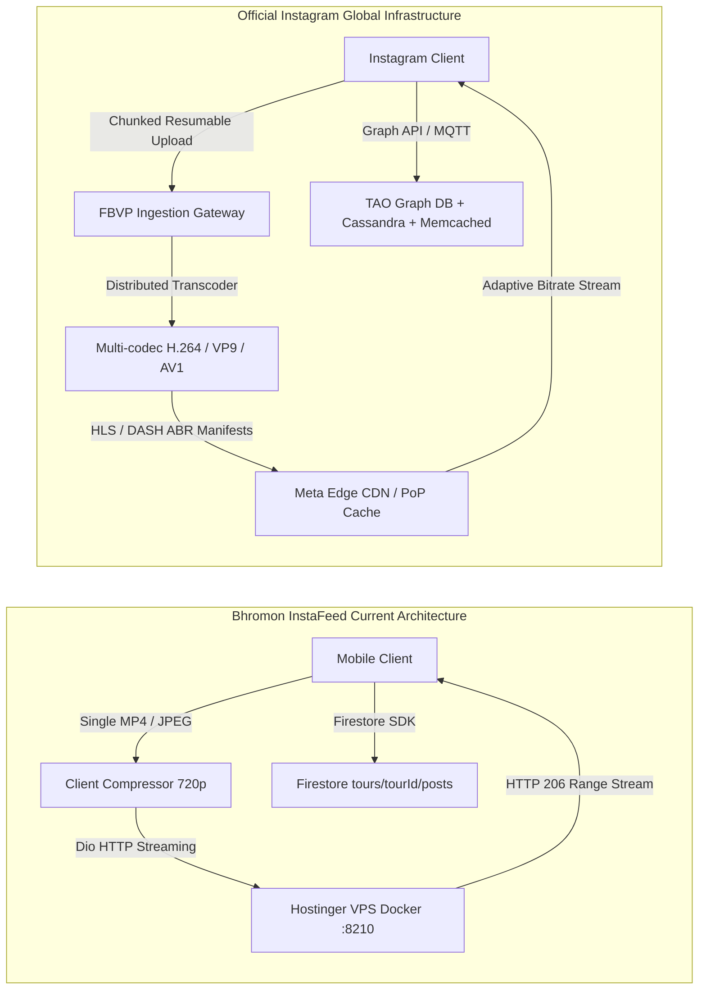
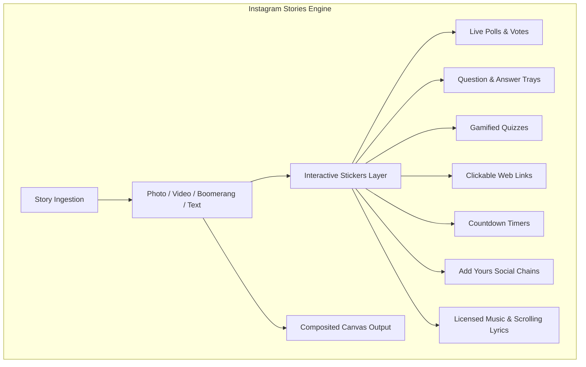
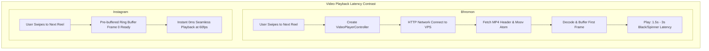
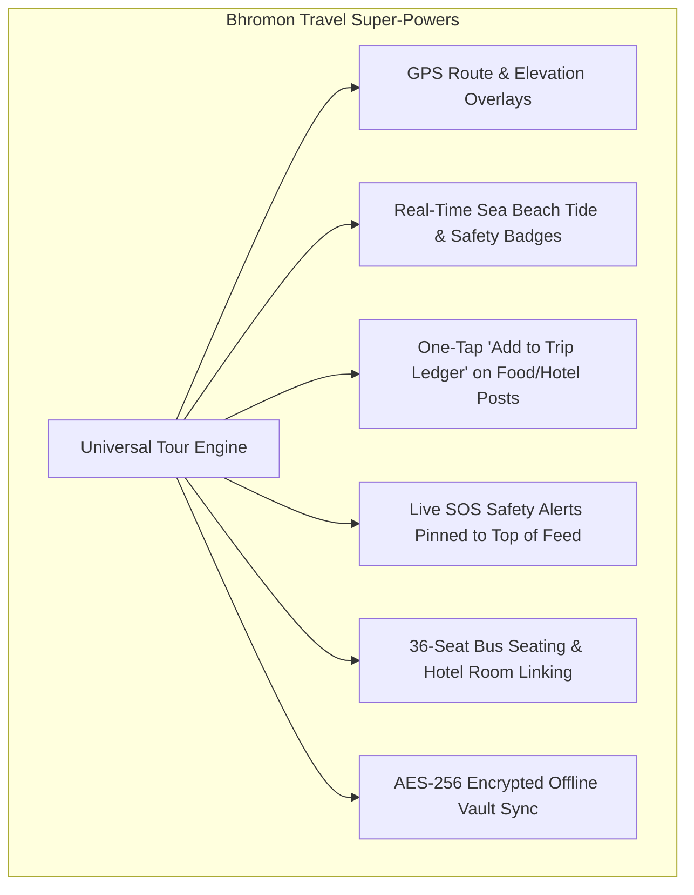
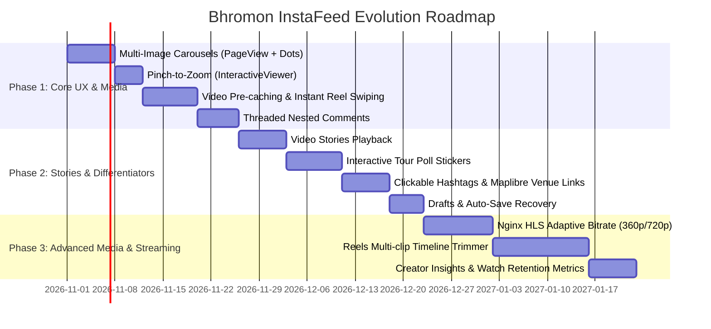

# Bhromon InstaFeed vs. Official Instagram: Ultra-Deep Forensic Feature & Architectural Gap Analysis

This document is an exhaustive, engineering-grade, and UX-forensic gap analysis comparing **Bhromon's InstaFeed implementation** (`lib/features/tour_group/presentation/pages/tour_instafeed_screen.dart`, `tour_post_models.dart`, `TourMediaUploader`, `TourVideoCompressor`) against the production **Instagram iOS and Android mobile platforms**.

---

## 1. Executive Summary & High-Level Architectural Contrast



### Architectural Comparison Matrix

| System Dimension | Bhromon InstaFeed (Current State) | Official Instagram Production Architecture |
| :--- | :--- | :--- |
| **Social Graph Model** | Closed, tour-scoped ACL (`memberships/{tourId}__{email}`). Strict membership boundary. | Hybrid: Asymmetric follow graph, bilateral close friends, global public discovery, bidirectional DMs. |
| **Media Hosting & Storage** | Single VPS server (`148.135.137.245`) with Docker volume `/var/www/bhromon-media`. | Geo-distributed Haystack / Meta FBOPS Object Store with multi-tier SSD edge caches. |
| **Streaming Protocol** | Progressive MP4 download over native HTTP with `Range: bytes=X-Y` (HTTP 206 Partial Content). | Dynamic Adaptive Streaming over HTTP (DASH) & HLS with 2-second sub-segment chunks and ABR algorithm. |
| **Video Transcoding Engine** | Client-side hardware/software encoding via `video_compress` (Fixed 720p, ~2-3 Mbps H.264 single track). | Multi-pass server-side distributed encoding producing 5+ ladder bitrates (360p, 480p, 720p, 1080p, 4K) in AV1, VP9, and H.264. |
| **Audio Pipeline** | Single raw audio channel embedded in MP4; no secondary audio mixing. | Dual/triple track mixing engine: Original Video Audio, Licensed Catalog Track, and Recorded Voiceover with loudness normalization (-14 LUFS). |
| **Local Cache Architecture** | Flutter `video_player` relying on OS-level HTTP caching; images cached via `cached_network_image`. | Custom LRU Disk Cache with SQLite metadata indexing, pre-allocated ring buffers, and byte-level pre-caching. |
| **Post Types Supported** | Single Image Post, Multi-Image Post (basic PageView), Single Reel. | Single Photo, Single Video, Multi-Media Carousels (up to 20 mixed items), Reels, Live Broadcasts, Guides. |

---

## 2. Forensic Module-by-Module Feature Breakdown

### Module 1: Main Feed & Feed Post Card UX

#### Current Bhromon Implementation:
- Handled by `_TourPostCard` (lines 1050–1670 of `tour_instafeed_screen.dart`).
- Displays author avatar, name, landmark tag, timestamp, and post type indicator.
- Media displayed inside a fixed aspect-ratio container with an index badge (`1/3`) for multi-images.
- Color matrix filters applied via `ColorFiltered(colorFilter: ColorFilter.matrix(matrix))`.
- Double-tap triggers a simple heart scale animation (`_animCtrl`, `elasticOut`).
- Comments button opens a modal sheet; Share button invokes system share (`share_plus`).

#### Gap Analysis vs. Official Instagram:

| Feature & UX Nuance | Official Instagram Capability | Bhromon InstaFeed Gap | Engineering Severity |
| :--- | :--- | :--- | :--- |
| **Pinch-to-Zoom** | Two-finger elastic zoom on any feed photo or video with smooth translation and auto-springback on release. | Completely absent. Media viewport is rigid. | **High (UX Core)** |
| **Mixed Carousels** | Seamless carousels containing both high-res photos and looping videos within the same post. | Only supports list of images (`List<String> images`) OR a single reel (`String? videoUrl`). | **High** |
| **Smooth Pagination Dots** | Interactive dynamic worm/dot indicator that expands and shrinks as the user swipes across cards. | Primitive static text pill (`1/3`) overlaid on the corner. | **Low-Medium** |
| **Aspect Ratio Flexibility** | Dynamic viewport matching: 1:1 (Square 1080x1080), 4:5 (Portrait 1080x1350), 1.91:1 (Landscape 1080x566). Carousels lock height to the first item. | Rigid height clamp that often leads to letterboxing or awkward center-crop (`BoxFit.cover`). | **Medium** |
| **Saved Collections** | Save to custom named folders (e.g. "Beach Cafes", "Packing Ideas") and collaborative folders shared with friends. | Flat boolean bookmark (`isBookmarked`) per user; no organization or sharing. | **Medium** |
| **Feed Slicing & Views** | Instant toggle between "For You" (ranked), "Following" (pure chronological), and "Favorites". | Single monolithic feed sorted by `createdAt DESC`. | **Medium** |
| **User Tagging Coordinates** | Interactive coordinate-anchored tag pills (`TagItem(x, y, userId)`) revealing user profiles on tap. | Missing. Users can only be mentioned via caption text strings. | **High (Social)** |
| **Audio Integration on Photos** | Feed photo posts can have an accompanying 30-90 second background song attached with a play/pause pill. | Photo posts are strictly silent. | **Medium** |
| **Translation Engine** | "See Translation" inline button beneath foreign or dialect captions with auto-detected source language. | Raw caption displayed as-is. | **Low-Medium** |
| **Post Options & Controls** | Granular post menu: "Hide Like Count", "Turn Off Commenting", "Edit Alt Text", "Archive Post", "Remix Post". | Basic delete button for post owner/admin only. | **Medium** |

---

### Module 2: Stories System (Story Tray, Viewer & Creator)

#### Current Bhromon Implementation:
- Handled by `_StoryBubble` (lines 800–950), `_StoryViewerScreen` (lines 3355–3670), and `_AddStorySheet` (lines 3138–3350).
- Horizontal avatar tray at the top of the feed with green border indicator for unread stories.
- Fixed 5-second automatic progression via `AnimationController` with tap-to-advance and press-and-hold to pause.
- Stories auto-expire after 24 hours (`TourStoryItem.lifetime = Duration(hours: 24)`).

#### Gap Analysis vs. Official Instagram:



| Feature | Official Instagram Capability | Bhromon InstaFeed Gap | Engineering Severity |
| :--- | :--- | :--- | :--- |
| **Video Stories** | Supports 15–60 second video clips with automatic segment chunking and progress bar synchronization. | **Photos only**. `_StoryViewerScreen` renders `CachedNetworkImage` / `Image.network` and does not support video playback. | **Critical** |
| **Interactive Stickers** | **Polls**, **Q&A Boxes**, **Quizzes**, **Emoji Sliders**, **Countdowns**, **Music**, **Add Yours**, **Links**, **Mention stickers**. | **Completely absent**. Stories only render raw media with an optional static bottom text string. | **Critical (Engagement)** |
| **Story Highlights** | Permanent profile-anchored story collections with custom circular covers that persist past 24 hours. | Absent. Stories vanish permanently after 24 hours without any archive or highlight feature. | **High** |
| **Inter-Author Story Gestures** | Horizontal swipe to transition between different users' story packs with a 3D cube rotation effect. | Swiping or finishing one author's stories immediately pops the screen back to the feed. | **High (UX)** |
| **Quick Emoji Reactions & DMs**| Swipe up to reveal 6 quick emoji fire/heart reactions and an inline DM reply text composer. | No reaction mechanism; viewer can only watch or close. | **High** |
| **Viewer List & Analytics** | Creator can swipe up on their own story to see exact avatars of who viewed it and how they voted on stickers. | No viewer tracking in data model or UI. Creator has no idea who viewed their story. | **Medium-High** |
| **Boomerang & Capture Modes**| In-app camera modes: Boomerang (forward-reverse loop), Hands-Free, Layout collage, Night mode. | Only delegates to the system file picker (`image_picker`). | **Medium** |
| **Typography & Creative Canvas**| 9 rich font engines (Typewriter, Neon, Modern) with animated reveals, background highlights, and neon draw brushes. | No text placement or drawing canvas. | **Medium-High** |
| **Close Friends Ring** | Green-ring selective audience filter for intimate/family-only stories. | Every member of the tour sees every story posted to that tour. | **Medium** |

---

### Module 3: Reels & Short-Form Video Feed

#### Current Bhromon Implementation:
- Handled by `_ReelsPlayerModal` and `_ReelVideoItem` (lines 3672–4260).
- Vertical PageView with full-screen 9:16 layout.
- Uses standard Flutter `video_player` initialized per item on demand.
- Right-hand vertical action stack: Double-tap like with heart burst, Comment button, Share button, Mute toggle, Close button.
- Video duration capped at 3 minutes (`kMaxReelSeconds = 180`).

#### Gap Analysis vs. Official Instagram:



| Feature | Official Instagram Capability | Bhromon InstaFeed Gap | Engineering Severity |
| :--- | :--- | :--- | :--- |
| **Pre-Caching & Zero-Lag Swipe**| Pipelined video pre-caching: While viewing reel $N$, reels $N+1$ and $N+2$ have their first 3 seconds pre-buffered in memory. | No pre-caching. Controller is only instantiated and initialized *after* the page becomes active, causing 1.5–3s spin lag. | **Critical (Performance)** |
| **Licensed Audio & Sound Hub** | Global audio catalog; audio detail page listing all reels using the same track; "Use Audio" CTA; spinning vinyl disc animation. | Only captures raw device microphone audio. No audio library, no sound attribution, no sound search. | **Critical (Discovery)** |
| **Multi-Track Audio Mixing** | Multi-channel audio balance: Original video audio volume slider vs. background music volume slider vs. recorded voiceover. | Single baked audio track inside the MP4 container. | **High** |
| **Multi-Clip Timeline Editor** | Full non-linear mobile editor: Add multiple video clips, trim in/out points, split clips, reorder, apply transitions. | Single file only. User must select a single pre-edited video file from their gallery. | **Critical (Creation)** |
| **Interactive Timeline Scrubber**| Dragging bottom progress bar shows micro-thumbnail scrubbing preview; haptic click on second markers. | Passive linear progress indicator; no interactive scrub seeking with preview frames. | **Medium** |
| **Hold-to-Pause & Clean Screen**| Holding down anywhere pauses playback and fades out all UI text, buttons, and captions for unobstructed viewing. | Tap toggles play/pause; UI buttons remain permanently visible on top of video. | **Medium (UX)** |
| **Auto-Generated Captions** | On-device speech recognition generating synchronized, animated text subtitles in real time. | Absent. Videos without spoken clarity or watched on mute lose comprehension. | **Medium** |
| **Remix & Collab** | Side-by-side or picture-in-picture video reaction recording ("Remix this Reel"); co-author credit. | Absent. | **Medium-High** |
| **Speed Controls & Align Tool** | 0.3x, 0.5x, 1x, 2x, 3x recording speed adjustments; transparent ghost overlay for jump-cut alignment. | Absent. | **Medium** |

---

### Module 4: Creation Studio, Camera & Media Processing

#### Current Bhromon Implementation:
- Handled by `_CreatePostStudioSheet` (lines 1932–3130).
- Bottom sheet picking from gallery or camera via `image_picker`.
- Color matrix filter selection (`kFilterMatrices`: Normal, Clarendon, Gingham, Juno, Lark, Reyes, Slumber, Valencia).
- Video compression via `TourVideoCompressor` (transcoding to 720p H.264 when > 100 MB with progress callback).
- Uploads directly to Hostinger VPS via `TourMediaUploader` (Dio chunked stream).

#### Gap Analysis vs. Official Instagram:

| Feature | Official Instagram Capability | Bhromon InstaFeed Gap | Engineering Severity |
| :--- | :--- | :--- | :--- |
| **Drafts & Auto-Recovery** | Background draft persistence with thumbnail gallery; unsaved edits automatically prompted on exit. | If sheet is dismissed or phone receives a call, all typed text and picked media are lost permanently. | **High (Data Loss)** |
| **Manual Photo Adjustments** | Granular post-processing sliders: Brightness, Contrast, Saturation, Warmth, Highlights, Shadows, Vignette, Tilt-Shift, Sharpen. | Only 8 preset color transformation matrices. No manual image tuning sliders. | **High** |
| **Crop, Straighten & Rotate** | Freeform and constrained aspect cropping (1:1, 4:5, 16:9), horizon straightening slider, horizontal/vertical perspective correction. | No cropping or horizon adjustment. Photos must be pre-cropped before selection. | **High** |
| **Thumbnail Selector for Videos**| Interactive video scrubber enabling user to pick exact frame for post/reel cover or upload custom image. | No cover selector. First frame of video is used automatically, often resulting in blurry/black covers. | **High** |
| **Tag Members on Media** | Tap on photo coordinates to place interactive `@mention` pills linked to member profiles. | Text-only caption mentions; no visual photo tagging. | **Medium-High** |
| **Location Geotagging & Autocomplete**| Live Foursquare/Meta Places GPS search with nearby venue suggestions and street addresses. | Predefined dropdown of 5 static landmark categories (`kTourLandmarks`). No GPS-based venue tagging. | **Medium-High** |
| **Scheduled Publishing** | Set exact future date and time for publication (up to 75 days in advance). | Immediate publication only. | **Low-Medium** |

---

### Module 5: Comments & Community Interaction

#### Current Bhromon Implementation:
- Handled by `_TourCommentsSheet` (lines 1672–1930).
- Flat Firestore collection stream (`tours/{tourId}/posts/{postId}/comments`).
- Comment item contains `authorEmail`, `authorName`, `authorPhoto`, `text`, `reaction`, `createdAt`.
- Emoji quick-picker tray (`❤️`, `👍`, `😂`, `🔥`, `👏`, `😍`).

#### Gap Analysis vs. Official Instagram:

| Feature | Official Instagram Capability | Bhromon InstaFeed Gap | Engineering Severity |
| :--- | :--- | :--- | :--- |
| **Threaded Hierarchical Replies**| 2-level nested conversation trees: clicking "Reply" indents comment under parent with collapsible "View 3 replies". | Flat list only. Replying merely prefixes `@AuthorName` in the text field; no visual threading. | **High (Clarity)** |
| **Comment Likes** | Small heart icon on every individual comment with public like counter and likers sheet. | Comments cannot be liked or upvoted. | **Medium** |
| **Pin Top Comments** | Post author can pin up to 3 important comments to the top with a distinct pin icon. | Comments sorted strictly by timestamp. | **Medium (Coordination)**|
| **Author Like Badge** | "Liked by author" badge attached to comments when post creator taps heart. | Absent. | **Low** |
| **GIF & Sticker Support** | Direct integration with Giphy for animated GIF search and posting within comment threads. | Text and standard unicode emojis only. | **Medium** |
| **Comment Moderation Tools** | Delete own comments, author can delete any comment on their post, bulk comment deletion, hide offensive comments. | Only owner can delete; no moderation controls or filtering. | **Medium** |

---

### Module 6: Direct Sharing, Messaging & Cross-App Distribution

#### Current Bhromon Implementation:
- Share button calls `Share.share()` from `share_plus`, passing a static string with the post URL or caption.

#### Gap Analysis vs. Official Instagram:

| Feature | Official Instagram Capability | Bhromon InstaFeed Gap | Engineering Severity |
| :--- | :--- | :--- | :--- |
| **In-App Quick Send Tray** | 1-tap bottom sheet showing avatars of recent chat contacts and groups to share post privately with custom message. | Absent. Bypasses in-app chat completely and opens external OS share sheet. | **High (Retention)** |
| **Reshare Post to Story** | Tap paper airplane -> "Add post to your story" creates an interactive sticker with tap-to-view link. | Posts cannot be shared into the Stories tray. | **High** |
| **Dynamic Rich Link Cards** | Custom Open Graph (`og:image`, `og:title`, `og:video`) tags generating interactive previews on WhatsApp/iMessage. | Shares raw URL or plain text without rich image cards. | **Medium** |
| **Custom QR Code Generator** | Generates styled QR codes with brand logo and color customization for instant physical camera scanning. | Absent. | **Low-Medium** |

---

### Module 7: Search, Discovery & Geolocation Curation

#### Current Bhromon Implementation:
- Simple chip bar at top of feed: `All`, `Photos`, `Reels`, and landmark names.

#### Gap Analysis vs. Official Instagram:

| Feature | Official Instagram Capability | Bhromon InstaFeed Gap | Engineering Severity |
| :--- | :--- | :--- | :--- |
| **Explore Masonry Grid** | Algorithmic 3-column staggered grid (combining 1x1 squares, 1x2 vertical video tiles, and 2x2 featured blocks). | Linear single-column feed list only. | **High (Visual Engagement)** |
| **Clickable Hashtag Feeds** | Clicking `#CoxsBazar` opens dedicated hashtag landing page with follower count, Top posts, and Recent posts. | Hashtags inside captions are static un-clickable text. | **High** |
| **Interactive Map Venue Hub** | Tapping a venue/landmark tag opens an interactive map showing all public photos/videos taken at that location. | Landmark chip only filters the current tour's local post list. Does not link with Bhromon's Maplibre map. | **High (Travel Core)** |

---

### Module 8: Video Streaming, Transcoding & Caching Infrastructure

#### Detailed Technical Pipeline Comparison:

```
┌─────────────────────────────────────────────────────────────────────────────────────────────────┐
│                                  VIDEO PIPELINE COMPARISON                                      │
├───────────────────────────────┬─────────────────────────────────────────────────────────────────┤
│ ASPECT                        │ BHROMON VPS MEDIA MICROSERVICE  │ OFFICIAL INSTAGRAM PIPELINE   │
├───────────────────────────────┼─────────────────────────────────┼───────────────────────────────┤
│ Delivery Protocol             │ Progressive MP4 over HTTP 206   │ Adaptive Bitrate (DASH / HLS) │
│ Ingestion Chunking            │ Single Dio Multipart Upload     │ Resumable Chunked Ingestion   │
│ Codec Ladder                  │ Single H.264 / AAC Stream       │ H.264 (Baseline), VP9, AV1    │
│ Bitrate Switching             │ None (fixed ~2.5 Mbps 720p)     │ Dynamic ABR (300 kbps - 6 Mbps)│
│ Audio Loudness Normalization  │ None (uncontrolled user audio)  │ -14 LUFS (EBU R128 compliance)│
│ Client Video Caching          │ Ephemeral OS Network Buffer     │ Two-tier Ring Buffer (Disk LRU)│
│ Pre-buffering Window          │ 0 seconds (waits for swipe)     │ 3-5 seconds across next 2 items│
│ Video Thumbnail Placeholder   │ None (black frame until moov)   │ WebP BlurHash / ThumbHash     │
└───────────────────────────────┴─────────────────────────────────┴───────────────────────────────┘
```

#### Detailed Deficiencies in Bhromon's Video Architecture:
1. **Network Stalling in Remote Areas**:
   - In Bangladesh's remote destinations (Sajek Valley, Keokradong, Tanguar Haor, remote parts of Inani), mobile connectivity frequently drops to 2G/3G speeds (300–800 kbps).
   - Bhromon's 720p MP4 requires ~2,500 kbps bandwidth. Under weak signals, video reels freeze and buffer indefinitely.
   - Instagram adapts instantly by shifting down to 360p (350 kbps) or 480p (650 kbps), maintaining 60fps uninterrupted playback.
2. **Moov Atom Placement & Buffering Latency**:
   - Progressive MP4 streaming requires the `moov` atom (metadata index) to be placed at the very beginning of the file (`faststart`).
   - If an uploaded video does not have its `moov` atom at the start, the mobile player must download the **entire file** before rendering frame 1.
3. **Bandwidth Waste on Re-Watching**:
   - Because `video_player` lacks a persistent local disk cache in Bhromon's current setup, re-watching a reel or scrolling back up re-fetches the video segments from the Hostinger VPS, consuming VPS bandwidth and mobile data repeatedly.

---

## 3. Where Bhromon Can Leapfrog Instagram (Unique Travel Opportunities)

Rather than merely building an inferior clone of Instagram, Bhromon has unique domain advantages as an **integrated travel operating system**. Instagram is a generic social platform; Bhromon is a **specialized travel engine**.



### 1. Dynamic Travel Telemetry Overlays
- **GPS Elevation & Trek Route Stickers**: Overlay dynamic elevation graphs, trail steepness, and GPX track lines directly onto Stories and Reels. Instagram has no native GPX integration.
- **Real-Time Tide & Beach Safety Badges**: Live dynamic badges showing "Safe to Swim • Low Tide (ভাটা)" or "Red Flag Danger • High Tide (জোয়ার)" pulled from Bhromon's coastal weather engine.

### 2. Social Ledger & Expense Integration
- When someone posts a photo of an extraordinary seafood dinner in Cox's Bazar or a Jeep (Chander Gari) ride in Sajek, provide a 1-tap button: **"Add to Trip Ledger"**.
- This immediately extracts the cost, parses integer paisa, and splits it among the tour participants in `trip_ledger_engine.dart`.

### 3. Integrated Bus & Hotel Logistics
- Tapping a member's avatar on a post reveals their **Coach Seat Number (e.g. B2)** and **Hotel Room Number (e.g. 402)** within that tour, solving real-world group logistics that Instagram cannot touch.

### 4. Offline Travel Resilience
- Bhromon's **Offline Relational Vault (Drift SQLite + Hive)** allows travelers in network-dead zones (deep valleys, high peaks) to draft posts, write comments, and like memories offline. Once a cellular connection is detected, the `SyncManager` outbox queue flushes and reconciles automatically.

---

## 4. Prioritized Engineering Roadmap



### Detailed Phase Milestones:

#### Phase 1: High-Impact Core UX (Next Sprint)
1. **Multi-Image Carousels**:
   - Replace single-image viewer with `PageView.builder` featuring smooth dot indicator (`smooth_page_indicator`).
   - Implement `InteractiveViewer` for native pinch-to-zoom on all feed photos.
2. **Video Pre-Caching**:
   - Integrate a disk-backed proxy cache (`flutter_cache_manager` / video proxy) to pre-buffer the first 3 MB of the next 2 reels.
3. **Threaded Comments**:
   - Add `parentId` to `TourCommentItem` schema in Firestore.
   - Render indented 2-level nested replies with expandable accordion in `_TourCommentsSheet`.

#### Phase 2: Tour Group Stories & Rich Engagement (Sprint 2)
1. **Video Stories**:
   - Upgrade `_StoryViewerScreen` to handle 15-second video clips via `VideoPlayerController` with auto-pause on load.
2. **Interactive Group Poll Stickers**:
   - Create draggable sticker overlay widget with real-time percentage animation for group decision making.
3. **Hashtags & GPS Location Linking**:
   - Use regex text span parser to make `#hashtags` clickable, routing to filtered hashtag feeds.
   - Link landmark tags directly to Bhromon's Maplibre POI map pins.
4. **Drafts Auto-Save**:
   - Persist post creation state to local encrypted Hive box so unfinished drafts are never lost.

#### Phase 3: Advanced Streaming & Multimedia Suite (Sprint 3)
1. **Nginx HLS Adaptive Bitrate**:
   - Configure FFmpeg on the Hostinger VPS Docker container to transcode uploaded videos into an HLS ladder (`360p` at 400 kbps, `720p` at 2000 kbps) with `.m3u8` playlists for smooth playback on weak 3G signals.
2. **Video Timeline Trimmer**:
   - Implement a multi-clip trim and splice interface in `_CreatePostStudioSheet`.
3. **Creator Retention Analytics**:
   - Track video view completion rates, average watch time, and shares in Firestore.
