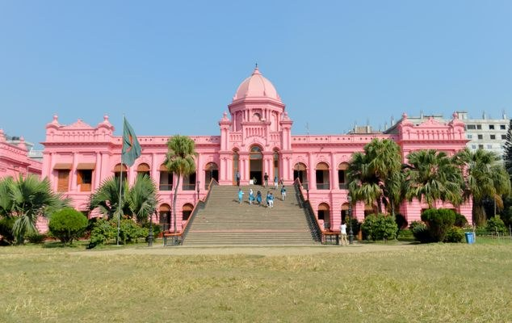

# Ahsan Manzil (Pink Palace)

> **Source:** Atlas Obscura Bangladesh  
> **URL:** <https://www.atlasobscura.com/places/ahsan-manzil-pink-palace>  
> **Type:** blog | **Language:** en  
> **Published:** Thu, 30 May 2019 07:00:00 GMT  
> **Destination:** Ahsan Manzil  

---

About
Ahsan Manzil is located in the Sadarghat area, a riverfront like no others.  The hustle and bustle of Sadarghat can be overwhelming, with boats carrying produce, laborers unloading boxes, and a wild variety of vehicles transporting the goods to their next destination. The streets are packed, the smells pungent, the colors vivid, and the sounds disorienting.
In the mayhem that is Sadarghat, the Ahsan Manzil compound is a fenced-off oasis of unexpected peace and quiet. Built between 1859 and 1872, Ahsan Manzil served as the residence of the Nawab of Dhaka.
These days, the palace is a reminder of Bangladesh's colonial past. Its ostentatious Western architecture incorporates elements of Mughal design, a popular trend among the affluent and aristocratic elite of Dhaka in the 18th and 19th centuries. After being largely abandoned upon the Newab's death, Ahsan Manzil was restored and turned into a museum in 1985.
The building is dominated by a large dome that caps an octagonal room, and a wide staircase leading to an arched portal. Along the façade of the building are porticoes that offer expansive views of the Buriganga river. Apart from its architecture, Ahsan Manzil is famous for its bright pink color.
Places
Discover your next amazing Atlas Place.
Get more unusual and extraordinary places each week with the Atlas Obscura Places newsletter.
Your newsletter subscriptions with us are subject to Atlas Obscura's
Privacy Policy
and
Terms of Use
.
Related Tags
Palaces
Museums
History
Architecture
Pink
Domes
Know Before You Go
Ahsan Manzil is located on the north bank of the Buringa River, about 650 feet east of Babubazar bridge, along Gabtoli Road.
Community Contributors
Added By
Max Cortesi
Edited By
Kerry Wolfe
Kerry Wolfe
Published
May 30, 2019
Edit this listing
Make an Edit
Add Photos
Sources
https://en.wikipedia.org/wiki/Ahsan_Manzil
https://www.lonelyplanet.com/bangladesh/dhaka/attractions/ahsan-manzil/a/poi-sig/1020230/355783

---
*Crawled 2026-06-11 07:25 | Bhromon Travel Crawler*
