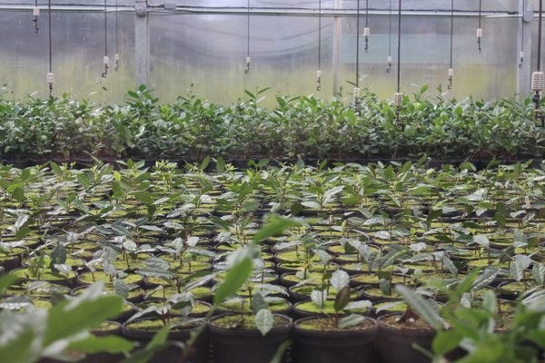

# Charleston Tea Garden

> **Source:** Atlas Obscura Bangladesh  
> **URL:** <https://www.atlasobscura.com/places/charleston-tea-plantation>  
> **Type:** blog | **Language:** en  
> **Published:** Fri, 11 Aug 2017 07:00:00 GMT  
> **Destination:** tea garden  

---

About
Whether it’s white, green, or black, all tea comes from one plant:
Camellia sinensis
. Tea is the second most popular beverage in the world (after water, of course). But since Andre Michaux, a French botanist, brought the plant to North America in the late 1700s, it wasn’t until 1888 that someone finally succeeded in producing plants that could grow tea for consumption in the
United States
.
Dr. Charles Shepherd, who owned the Pinehurst Tea Plantation in Summerville,
South Carolina
, had many years of tea triumphs. He even won first prize for his oolong tea at the 1904 World’s Fair. However, after his death in 1915, his farm was left abandoned and overgrown.
In 1960, the Thomas J. Lipton Company purchased the Pinehurst Tea Plantation and relocated the surviving tea plants to a research facility about 20 miles south of
Charleston
on Wadmalaw Island, where the Charleston Tea Garden now is. After 17 years of experimenting, which resulted in over 300 varieties of tea, Lipton concluded the climate and high cost of labor were prohibitive to successfully growing tea in the U.S.
A man named Bill Hall, whose father and grandfather were tea tasters, bought the site in 1987. After reviewing Lipton’s efforts, he developed eight varieties of his own, blending the tea with flavors including raspberry, mint, and bergamot for Earl Grey. The tea is grown organically and is harvested with a one-of-a-kind machine assembled on site. The farm turned over a new leaf when Bigelow bought it in 2003 and began distributing the tea nationally (it’s currently available at Whole Foods), and Hall continues to oversee the facility.
Visitors can walk through the factory and board a trolley to listen to a guide while seeing the tea plants. The plants bloom October to December, and the fresh leaves from the tops of the plants are harvested every 18 to 21 days from about the first week of May until late October. At the gift shop, free samples of hot and cold tea and a wide assortment of tea-related items are available.
In September 2020, the facility
changed its name
from the Charleston Tea Plantation to the Charleston Tea Garden.
Discover your next hidden gem with the Gastro Obscura
Newsletter—your guide to extraordinary food and drink.
Your newsletter subscriptions with us are subject to Atlas Obscura's
Privacy Policy
and
Terms of Use
.
Related Tags
Plants
Farms
Food
Nature
Factories
Fruit
Tea
Know Before You Go
Open seven days a week, except major holidays. Pets on a leash welcome.
Community Contributors
Added By
Adiakina
Edited By
asdonkar
,
Samir S Patel
,
sarahjoem
,
nfernandez
asdonkar
Samir S Patel
sarahjoem
nfernandez
Published
August 11, 2017
Edit this listing
Make an Edit
Add Photos
Sources
http://www.charlestonteaplantation.com/history/
http://south-carolina-plantations.com/charleston/charleston-tea.html
http://south-carolina-plantations.com/dorchester/pinehurst-tea.html
https://en.wikipedia.org/wiki/Charleston_Tea_Plantation
https://www.bigelowtea.com/Charleston-Tea-Plantation/Charleston-Tea-Plantation
http://www.npr.org/sections/thesalt/2016/08/23/488817144/america-s-only-full-time-tea-taster-talks-about-life-on-the-charleston-tea-plant
https://en.wikipedia.org/wiki/Tea_production_in_the_United_States
https://www.postandcourier.com/business/charleston-tea-attraction-no-longer-called-plantation-after-name-change/article_2ef40624-f2bf-11ea-9f89-e7384d1ba2a3.html

---
*Crawled 2026-06-11 07:26 | Bhromon Travel Crawler*
