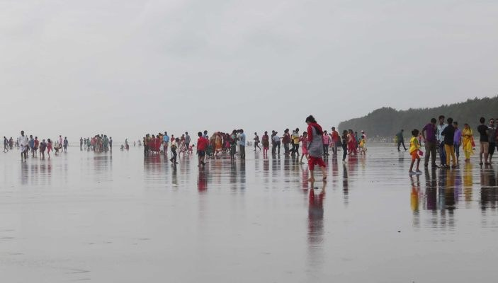

# Cox's Bazar Beach

> **Source:** Atlas Obscura Bangladesh  
> **URL:** <https://www.atlasobscura.com/places/coxs-bazar-beach>  
> **Type:** blog | **Language:** en  
> **Published:** Tue, 13 Nov 2018 08:00:00 GMT  
> **Destination:** Cox's Bazar  

---

About
Stretching a remarkable 75 miles in length, Cox’s Bazar Beach is one of the longest uninterrupted natural sand beaches in all of Bangladesh.
Most of Cox’s Bazar is 660 feet wide at high tide, and 1,300 feet wide at low tide. This Bay of Bengal beach is quite unknown to the international beach-loving crowd. But Cox’s Bazar is one of the most visited destinations in
Bangladesh
.
Along its 75 miles, different sections of Cox’s Bazar Beach have distinct names, usually referring to the flora and fauna in the area. Among the most popular sections are Laboni Beach, Humchari Beach, and Inani Beach, all doable on one-day trips from the town of Cox’s Bazar, where most accommodation is located. Further south is Teknaf Beach.
In general, the further south you go, the bluer the ocean, and the smaller the crowd. If you stay near Cox’s Bazar town, brace yourself for throngs of people. This can be frustrating if you were expecting a deserted tropical beach, but it can a great opportunity to get closer to the Bangladeshi notion of a beach holiday.
Founded in 1869, Cox’s Bazar is named after Captain Hiram Cox, superintendent of the British East India Company, which was stationed in Palongkee (the town's former name). This is an anomaly in the subcontinent, where most colonial place names have been changed, and it is probably due to the positive effect of Captain Cox’s rehabilitation work with the Arakanese refugees.
Places
Discover your next amazing Atlas Place.
Get more unusual and extraordinary places each week with the Atlas Obscura Places newsletter.
Your newsletter subscriptions with us are subject to Atlas Obscura's
Privacy Policy
and
Terms of Use
.
Related Tags
Beaches
World's Longest
Natural Wonders
Nature
Know Before You Go
The easiest and fastest of getting to Cox’s Bazar is by plane. There are daily flights to Dhaka and Chittagong. For those not afraid of sitting in the traffic for hours, buses are also available. There is not a huge supply of accommodation, but in and near Cox’s Bazar town there are both high-end and budget options, including a handful of eco-lodges.
A couple of warnings. This is not Cancun or Pattaya. Local people are extremely friendly, but you have to remember that Bangladesh is a conservative Muslim country. The attire for both men and women should be modest, even while swimming. Once you go beyond Cox’s Bazar town, you will find few (if any) facilities. If venturing south, you should plan on being self-reliant. Be careful with quicksand, especially during low tide.
Community Contributors
Added By
Max Cortesi
Edited By
weharry
,
Meg
weharry
Meg
Published
November 13, 2018
Edit this listing
Make an Edit
Add Photos
Sources
https://en.wikipedia.org/wiki/Praia_do_Cassino

---
*Crawled 2026-06-11 07:24 | Bhromon Travel Crawler*
