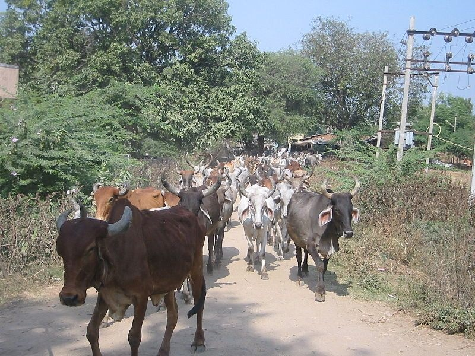

# Found: A Cow-Smuggling Tunnel Under a Tea Garden

> **Source:** Atlas Obscura Bangladesh  
> **URL:** <https://www.atlasobscura.com/articles/cow-tunnel-smuggling>  
> **Type:** blog | **Language:** en  
> **Published:** Wed, 26 Apr 2017 07:00:00 GMT  
> **Destination:** tea garden  

---

Found: A Cow-Smuggling Tunnel Under a Tea Garden
Where’s the beef?
by
Sarah Laskow
April 26, 2017
A cattle herd in India.
Yann Forget/CC BY-SA 3.0
On the India-Bangladesh border,* the
Border Security Force
discovered
a smuggling tunnel almost 90 yards long that started in a tea garden and went under the border fence to north Bengal. Its intention, they believe, was to smuggle cattle under the border.
Cattle smuggling across this border has long been a problem—the demand for
Indian beef
is high at Bangladesh’s cattle markets, and there’s money to be made by smuggling cattle over the border. The border patrol says it has cracked down on smugglers and reduce the amount of smuggling by 99 percent,
says
India Today
. But some are
skeptical of this claim
.
Most cattle aren’t smuggled through tunnels; water routes are a common way of crossing. But tunnels are particularly hard to detect: one of the only ways of finding one is through intelligence gathering.
*
Correction: The tunnel was found underneath India’s border with Bangladesh, not Pakistan.
Gastro Obscura covers the world’s most wondrous food and drink.
Sign up for our regular newsletter
.
Read next
The Art of the Dronescape
Stunning, dizzying aerial photography from Dronestagram.
cows
tunnels
subterranean sites
found
food
news

---
*Crawled 2026-06-11 07:26 | Bhromon Travel Crawler*
