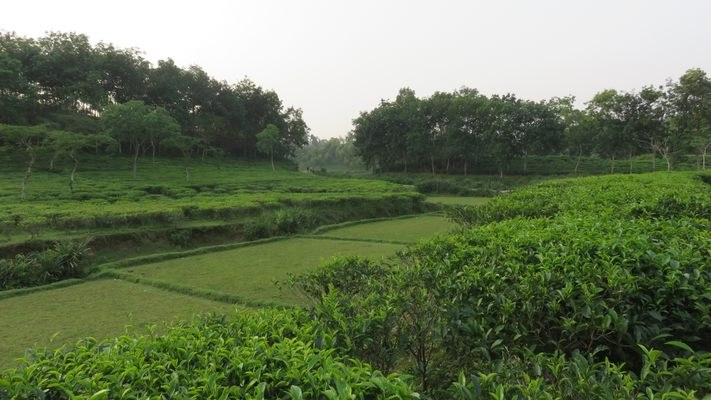

# Lakkatura Tea Garden

> **Source:** Atlas Obscura Bangladesh  
> **URL:** <https://www.atlasobscura.com/places/lakkatura-tea-garden>  
> **Type:** blog | **Language:** en  
> **Published:** Thu, 15 Nov 2018 08:00:00 GMT  
> **Destination:** Sylhet  

---

About
Sylhet, in the northeast of
Bangladesh
, is renowned for the beauty of its tea gardens, and among the lot, Lakkatura is considered the most scenic. It is also one of the largest tea gardens in the country, covering a total of 3,200 acres. This estate was officially established in 1875, and it now produces an astounding 550 tons of tea each year.
A number of dirt roads intersect the garden, some purpose-built to transport tea across and beyond the grounds. Others are simply part of a larger network of roads cutting through Lakkatura, taking visitors through hills of neatly manicured rows of tea plants. Following the latter set of roads takes you to several rural villages in and around Lakkatura estate, including makeshift villages where migrant workers live during the harvest.
The British East India Company first introduced tea cultivation in Bangladesh in 1840, but it was only in 1857 that tea became a commercial occupation. In 2012, Bangladesh produced more than 70,000 tons of tea. In spite of its small size, the South Asian country is the 12th-largest tea producer in the world, employing more than 300,000 people. The industry is supervised by the Bangladesh Tea Board and the Bangladesh Tea Research Institute.
Discover your next hidden gem with the Gastro Obscura
Newsletter—your guide to extraordinary food and drink.
Your newsletter subscriptions with us are subject to Atlas Obscura's
Privacy Policy
and
Terms of Use
.
Related Tags
Tea
Gardens
Agriculture
Landscapes
Plants
Farms
Know Before You Go
Lakkatura Tea Garden is a few minutes from the center of Sylhet. The easiest way to get to the estate is by CNG (a kind of autorickshaw used all over Bangladesh). Upon arrival at Lakkatura, you can either report to the main office, where you can hire a guide or listen to a lecture about the Lakkatura Tea Garden, or you can wander around the garden by yourself. It is not rare to come across newlyweds having their wedding pictures taken at the picturesque tea garden.
Community Contributors
Added By
Max Cortesi
Published
November 15, 2018
Edit this listing
Make an Edit
Add Photos

---
*Crawled 2026-06-11 07:24 | Bhromon Travel Crawler*
