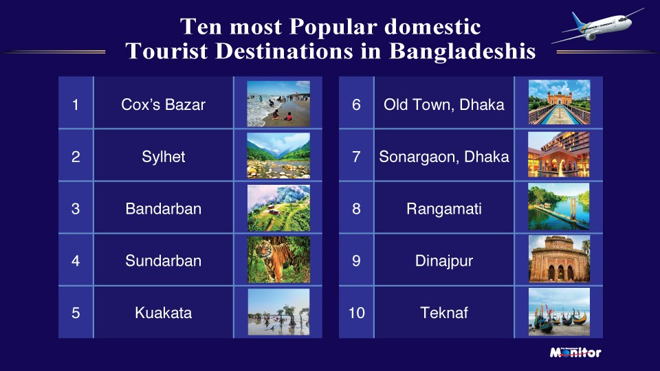

# Cox's Bazar tops domestic travel rankings, Malaysia leads as most tourist friendly overseas destination for Bangladeshi travelers

> **Source:** Google News — Bangladesh Travel  
> **URL:** <https://www.bangladeshmonitor.com.bd/en/coxs-bazar-tops-domestic-travel-rankings-malaysi>  
> **Type:** news | **Language:** en  
> **Published:** Thu, 01 Jan 2026 08:00:00 GMT  
> **Destination:** Cox's Bazar  

---

Cox's Bazar tops domestic travel rankings, Malaysia leads as most tourist friendly overseas destination for Bangladeshi travelers
A Monitor Report
Published: January 01, 2026 | 12:00 AM
3 min read
Print
Dhaka : Cox's Bazar has firmed its position as Bangladesh's most sought-after domestic tourist destination, while Malaysia has emerged as the most tourist-friendly international destination among Bangladeshi travelers, according to the results of a nationwide reader poll conducted by The Bangla-desh Monitor, the country's premier travel, tourism, and aviation publication.
The rankings were determined through an online voting exercise held between November 20 and December 20, 2025, which drew participation from 15,200 readers, reflecting strong engagement from frequent travelers, industry professionals, and tourism enthusiasts across the country.
Among domestic destinations, Cox's Bazar secured the top position by a wide margin, underscoring its continued appeal as Bangladesh's leading beach destination. Sylhet, known for its tea gardens and natural landscapes, ranked second, followed by the scenic hill district of Bandarban in third place.
The Sundarbans, the world's largest mangrove forest and a UNESCO World Heritage Site, ranked fourth, while Kuakata, famed for its panoramic sunrise and sunset views over the Bay of Bengal, placed fifth. Dhaka Old Town, celebrated for its rich heritage and culinary culture, secured sixth position. Other destinations in the top ten include Sonargaon (seventh), Rangamati (eighth), Dinajpur (ninth) and Teknaf (tenth), highlighting the growing diversity of domestic travel preferences among Bangladeshi tourists.
On the international front, Malaysia emerged as the most preferred overseas destination.  Due to its visa-friendly policies, strong air connectivity, cultural familiarity, and wide range of leisure, shopping, and medical tourism options Malaysia attracts a huge number of Bangladeshi tourists every year. Thailand ranked second, followed by the Maldives in third place, reflecting sustained interest in short-haul leisure destinations.
Sri Lanka, Singapore, and Saudi Arabia secured fourth, fifth, and sixth positions respectively, indicating balanced demand across leisure, business, and religious travel segments. Nepal, India, Bhutan, and Indonesia rounded out the top ten international destinations, ranking seventh through tenth.
Industry observers note that the results highlight evolving travel trends among Bangladeshi travelers, with a growing inclination toward regional destinations offering convenient connectivity, competitive pricing, and diverse experiences. The strong showing of nature- and heritage-based destinations also points to rising interest in experiential and sustainable tourism.
The poll was conducted as part of the Bangladesh Travel, Tourism, and Hospitality Awards (BTTHA) 2025, organized by The Bangladesh Monitor.
Tagged Under:
Spread the word
More from
Tourism
View All

---
*Crawled 2026-06-11 06:06 | Bhromon Travel Crawler*
