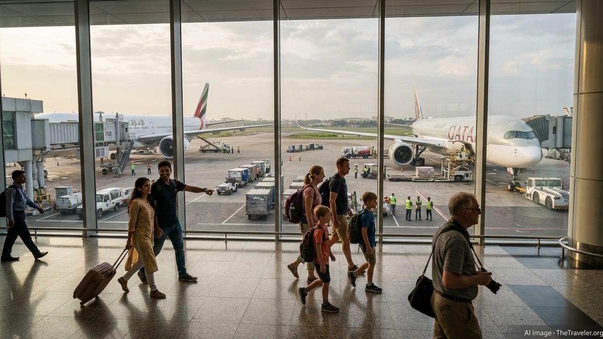

# India, UK, US Tourists Drive Bangladesh Travel Boom

> **Source:** Google News — Bangladesh Travel  
> **URL:** <https://www.thetraveler.org/india-uk-us-tourists-drive-bangladesh-travel-boom/>  
> **Type:** news | **Language:** en  
> **Published:** Tue, 17 Feb 2026 08:00:00 GMT  
> **Destination:** Bangladesh travel  

---

More news on this day
Air Giants Lift Berlin as The Dean Rewrites Hospitality
US, UK, Australia Tourists Fuel Uttar Pradesh Travel Boom
Iran–US Crisis Triggers Global Flight Chaos for Major Airlines
Bangladesh is emerging as one of South Asia’s most intriguing new tourism stories, with growing numbers of visitors from India, the United Kingdom and the United States prompting Gulf carriers Emirates and Qatar Airways to intensify their focus on Dhaka and beyond.
Bangladesh Tourism Rebounds With New International Momentum
After years of lagging behind regional competitors, Bangladesh’s tourism sector is showing its strongest rebound since the pandemic, buoyed by rising arrivals from key long-haul and regional markets. Official data from the Bangladesh Tourism Board show that foreign arrivals climbed to about 650,000 in 2023 and again in 2024, the highest level recorded since the board began compiling statistics in 2010, with 2023 alone registering 23 percent year on year growth. Sector analysts say that while business travellers and expatriate Bangladeshis still make up a large share of these visitors, the proportion of leisure tourists is finally starting to edge higher.
India has emerged as the most important single source market, contributing roughly 290,000 visitors in 2023, while arrivals from Europe and North America are small but expanding from a low base. Travellers from the United Kingdom and the United States, who traditionally bypassed Bangladesh in favour of India, Sri Lanka or the Maldives, are increasingly being drawn by a mix of cultural curiosity, diaspora links and value for money. This broader shift is taking place against the backdrop of a wider Asia Pacific recovery, with regional tourism volumes in 2024 reaching around 87 percent of pre pandemic levels and South Asia among the fastest rebounding subregions.
Yet the revival comes with caveats. Bangladesh still ranks near the bottom of the World Economic Forum’s Travel and Tourism Development Index, placed 109th out of 119 economies in the 2024 edition and last in the Asia Pacific grouping. Experts point to underdeveloped infrastructure, patchy international marketing and lingering visa frustrations as obstacles holding the country back from realising its full potential. Even so, Gulf carriers now see enough momentum and latent demand to justify renewed investment and capacity into Dhaka, sensing that they can both serve the diaspora and increasingly capture genuine holiday traffic.
India, UK and US Travellers Put Bangladesh on Their Itinerary
The backbone of Bangladesh’s tourism boom remains the Indian market. Proximity, cultural ties and a strong medical and business travel segment have long ensured steady cross border flows, and as travel normalises, a growing share of Indians are tacking short leisure breaks in Dhaka, Cox’s Bazar and the Sundarbans onto longer trips. Industry executives in Dhaka note that Indian visitors are also changing in profile, with more affluent, younger travellers seeking boutique hotels, coffee culture and heritage districts rather than simply shopping or hospital visits.
For the United Kingdom and United States, the story is more nuanced. Arrivals from these countries are still modest compared with India, but they are growing steadily, boosted by second and third generation members of the Bangladeshi diaspora rediscovering their roots, as well as adventurous backpackers and niche tour groups. Travel agents in London and New York report rising inquiries for multi country itineraries that combine Bangladesh with India or Nepal, with travellers attracted to what they perceive as a less commercial, more authentic South Asian experience. The fact that many long haul fares to Dhaka are competitively priced via Gulf hubs has made it easier to nudge curious travellers toward trying an unfamiliar destination.
Outbound trends from neighbouring countries also reinforce how South Asian tourism flows are shifting. In Nepal, for example, India, the United States, the United Kingdom and Bangladesh all feature among the top five visitor markets, underscoring a growing pattern of intra regional travel that Bangladesh is well placed to tap into. While Bangladesh still trails neighbours such as Sri Lanka and the Maldives in total visitor numbers, its rising visibility on the radar of Indian, British and American travellers points to a diversification that tourism planners have long sought.
Emirates and Qatar Airways Deepen Their Bet on Dhaka
Recognising this evolving demand, Emirates and Qatar Airways have moved aggressively in recent seasons to reinforce their positions on routes linking Bangladesh with India, Europe and North America. Both carriers already operate multiple daily services between their Gulf hubs and Dhaka, but schedule data and airline statements indicate a clear shift in emphasis from purely migrant and labour traffic to higher yielding leisure and business segments. Seasonal capacity increases around major holidays, improved connection banks for transatlantic and European flights, and refreshed onboard products on Dhaka rotations are all part of this recalibration.
Emirates has highlighted Bangladesh repeatedly in its South Asia communications, underscoring Dhaka’s role within the carrier’s global network of more than 130 destinations. The airline has been promoting Dhaka not only as an origin point for Bangladeshi travellers heading to the Middle East, Europe and North America, but increasingly as a destination in its own right for passengers starting their journeys in cities such as London, Manchester, New York and Boston. By timing its Dhaka services to connect smoothly with long haul flights from these markets, Emirates is positioning itself as a key conduit for Western tourists curious about Bangladesh but unwilling to navigate complex multi airline itineraries.
Qatar Airways is following a similar playbook. From its base in Doha, which has grown rapidly as a transfer hub for both Europe Asia and North America Asia traffic, the airline has used targeted campaigns to promote stopovers and onward journeys to South Asian destinations. Dhaka figures prominently in this strategy, benefiting from Qatar’s extensive network in the United States and the United Kingdom. With Doha welcoming more than 1.5 million visitors in the first quarter of 2025 alone, according to Qatar Tourism, the airline has growing leverage to package twin centre holidays that combine a Gulf city break with a longer stay in Bangladesh.
Hub Strategies: Connecting Dhaka to the World’s Long Haul Markets
For Emirates and Qatar Airways, the renewed focus on Bangladesh is primarily about hub economics. Neither airline relies on a large local population of high spending leisure travellers; instead, their profitability depends on funnelling passengers from dozens of origin cities through Dubai and Doha and distributing them efficiently across their networks. Dhaka’s appeal lies in its sizeable diaspora, especially in the Gulf and in the UK and US, and in its emerging status as a niche tourism destination that still offers plenty of room for growth.
By ramping up capacity on Dhaka routes and aligning schedules with key banks of long haul flights, both carriers can capture multiple flows simultaneously. An Indian tourist from Mumbai can connect via Dubai to Dhaka in one direction and via Dubai again to Europe on the way home, while a British traveller can book an open jaw ticket flying into Dhaka and out of another South Asian city, using Gulf hubs as flexible transfer points. In each case, Emirates or Qatar becomes the default choice, effectively integrating Bangladesh into a wider web of leisure travel patterns.
These hub strategies also have implications for tourism development on the ground. Better connectivity can encourage foreign hotel chains, tour operators and investors to treat Bangladesh as a viable stop on multi country circuits. Sector insiders say this is already happening, with more regional tour companies bundling Dhaka city breaks and trips to Cox’s Bazar into itineraries that include destinations like Kolkata, Kathmandu or the Maldives. For Bangladesh, the challenge will be to ensure that this connectivity translates into longer stays and higher spending, rather than quick in and out visits that leave limited local economic impact.
New Passenger Profiles and Spending Patterns in Dhaka and Beyond
Local hospitality operators in Dhaka describe a noticeable shift in the mix of foreign guests checking into their properties. While corporate travellers and aid workers still account for a large share of room nights, hoteliers report more short break stays from young Indian couples, small British tour groups and American backpackers, particularly during the cooler months between November and February. These visitors are more likely to explore Old Dhaka’s riverfront, street food and colonial era architecture, or to book side trips to archaeological sites such as Paharpur and Mahasthangarh.
Spending patterns are evolving accordingly. Data from the Bangladesh Bureau of Statistics indicate that foreign visitors allocate the largest portion of their budgets to accommodation, followed by food and beverage and shopping. With leisure travel on the rise, restaurants, cafes and boutique retailers stand to benefit, especially in neighbourhoods of Dhaka and Chattogram that have invested in more visitor friendly public spaces. At the same time, an uptick in higher income diaspora travellers from the UK and US has helped sustain premium segments, from five star hotels to upscale river cruises that market themselves to Western tour operators.
Outside the major cities, coastal and nature destinations are beginning to see the effect of this changing visitor mix. Cox’s Bazar, promoted as the world’s longest natural sea beach, has seen new resort development aimed at both domestic and regional tourists, particularly from eastern India. The Sundarbans, shared with India and home to one of the world’s largest mangrove forests, continues to attract specialised eco tourism, although seasonal closures and strict conservation rules limit visitor numbers. For Emirates and Qatar Airways, these emerging hotspots are an opportunity to advertise Bangladesh as more than just Dhaka, broadening the appeal of their Bangladesh bound routes.
Infrastructure Bottlenecks and Policy Gaps Still Weigh on Growth
Despite the upbeat narrative, Bangladesh’s tourism industry continues to operate under significant constraints. The country’s low ranking in international competitiveness indices reflects weaknesses in transport infrastructure, service quality and environmental sustainability. Industry representatives repeatedly highlight congested roads, limited domestic air connectivity and underinvestment in tourist facilities as key barriers that can quickly erode the goodwill created by better international access.
Visa policy is another recurring concern. Although Bangladesh has moved to ease entry for some categories of travellers and has discussed expanding e visa options, cumbersome procedures and inconsistent enforcement remain a deterrent, particularly for casual visitors from Western markets. On top of this, regulatory and cultural restrictions around nightlife and alcohol sales can surprise unprepared tourists from India, the UK and the US who are used to more liberal environments in rival destinations. While these factors may not deter diaspora visitors, they can shape broader perceptions of Bangladesh’s appeal as a mainstream holiday choice.
Airlines are not immune to these constraints. For Emirates and Qatar Airways, the reputation of a destination can influence how aggressively they market it and which aircraft types they deploy. If hotel stock, ground transport and visitor services fail to keep pace with rising arrivals, carriers risk disappointing customers who have high expectations based on their experiences in other parts of their networks. This is one reason why tourism stakeholders in Bangladesh are lobbying for a more integrated national strategy that aligns aviation growth with investments in on the ground infrastructure.
Gulf Carriers as De Facto Marketers of Brand Bangladesh
In the absence of large scale national marketing campaigns, Emirates and Qatar Airways are increasingly acting as de facto ambassadors for Bangladesh in key source markets. Their global advertising, loyalty programmes and co branded promotions with travel agencies give the country visibility it could not easily buy on its own. When Emirates features Dhaka or Cox’s Bazar in route maps, inflight magazines or social media promotions, it places Bangladesh alongside some of the world’s best known destinations, subtly shifting traveller perceptions.
Qatar Airways’ marketing machine operates in a similar way, especially in the United Kingdom and the United States, where aggressive fare sales, stopover programmes and partnerships with major online travel agencies reach millions of potential customers. In practice, a British traveller might first encounter the idea of visiting Bangladesh not through a tourism board advertisement, but as a suggested destination while pricing a trip to South Asia on the airline’s booking engine. Every such exposure reinforces the notion that Bangladesh is connected, accessible and part of the same global tourism circuit as more familiar hotspots.
This reliance on airline led promotion, however, carries its own risks. Aviation markets are cyclical, and route decisions can change quickly in response to economic shocks or geopolitical tensions. Bangladesh’s tourism planners are therefore under pressure to complement the efforts of Gulf carriers with their own branding, product development and market diversification. If they succeed, the current wave of interest from Indian, British and American travellers could mark the beginning of a more sustained and broad based tourism boom, rather than a short lived surge tied too closely to airline network strategies.

---
*Crawled 2026-06-11 06:11 | Bhromon Travel Crawler*
