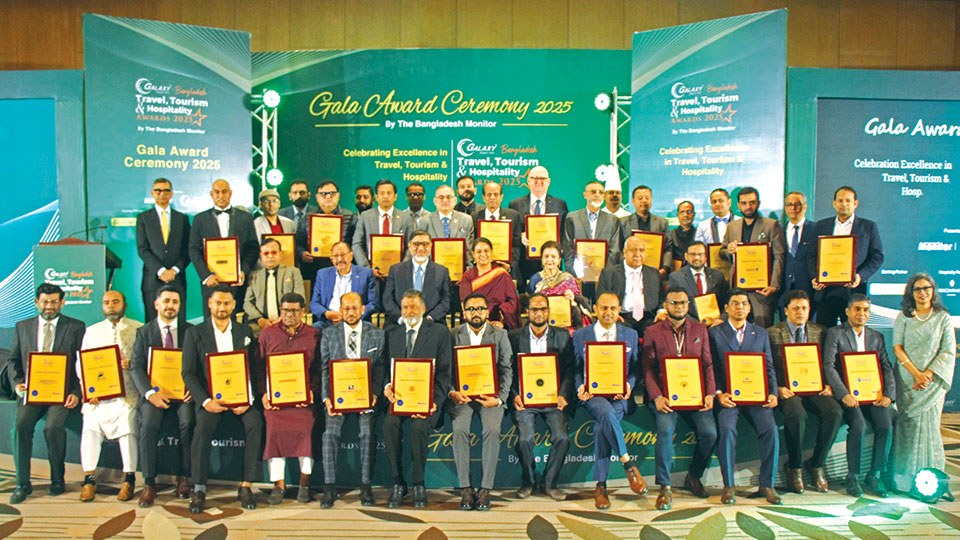

# Save nature first, then regulate tourism : Adviser calls for responsible growth at BTTHA 2025

> **Source:** Google News — Bangladesh Travel  
> **URL:** <https://www.bangladeshmonitor.com.bd/en/save-nature-first-then-regulate-tourism-adviser-calls-for-responsible-growt>  
> **Type:** news | **Language:** en  
> **Published:** Sun, 01 Feb 2026 08:00:00 GMT  
> **Destination:** Bangladesh travel  

---

Save nature first, then regulate tourism : Adviser calls for responsible growth at BTTHA 2025
A Monitor Report
Published: February 01, 2026 | 12:00 AM
5 min read
Print
Dhaka : Bangladesh's growing tourism industry must prioritize environmental protection over short-term profit if it wants to remain sustainable in the long run, said Syeda Rizwana Hasan, Adviser to the Interim Government on Environment, Forest, and Climate Affairs, while addressing the Bangladesh Travel, Tourism, and Hospitality Awards (BTTHA) 2025 on January 29.
Speaking as Chief Guest at the gala ceremony held at the InterContinental Dhaka, Rizwana Hasan cautioned that the race to experience natural beauty often ends in destroying it. Drawing from real examples, she said unregulated tourism had once severely damaged Saint Martin's Island and Sylhet's Sada Pathor, but proper regulation later helped restore their natural balance.
"In some cases, it is important to stop tourism for a while so that nature can recover. Only then can regulated tourism take place," she said, adding that Saint Martin's Island is now witnessing positive changes due to stricter controls.
Her remarks set a reflective and forward-looking tone for the second edition of the Bangladesh Travel, Tourism, and Hospitality Awards, which recognized excellence, innovation, and leadership across the country's rapidly expanding travel, tourism, and hospitality sectors.
Syeda Rizwana Hasan addressing the award ceremony
The awards ceremony was organized by The Bangladesh Monitor, a travel and tourism publication of the country. The event brought together policymakers, industry leaders, hospitality professionals, and business executives under one roof.
A total of 35 organizations and individuals were honored in 29 categories, including 27 organizations and eight individuals. The awards aimed to celebrate high standards of service, professionalism, and resilience in a sector that continues to gain importance in Bangladesh's economic and social landscape.
The most prestigious honor of the evening - the Jury's Lifetime Achievement Award - was presented to Shahid Hamid, Chairman of the PATA Bangladesh Chapter, recognizing his outstanding contribution to the hospitality industry over more than five decades.
In her speech, Rizwana Hasan also highlighted the growing tension between tourism development and environmental conservation, particularly in ecologically sensitive areas such as haors, islands, and forest regions. She stressed the need for industry stakeholders to come together and establish clear "dos and don'ts" for tourists to encourage responsible behavior.
"Tourism often happens in naturally beautiful areas. If we do not manage it properly, we risk losing the very assets that attract visitors," she said, calling for behavioral change, regulation, and long-term planning.
She also spoke about future opportunities, noting that Bangladesh has potential for eco-tourism and safari parks through public-private partnerships. Referring to safari parks in Cox's Bazar and Gazipur, she invited experienced investors with sound business models to collaborate with the Forest Department to develop and manage these facilities sustainably.
Travel, tourism, and hospitality dignitaries seen at the ceremony
Earlier, Kazi Wahidul Alam, Editor of The Bangladesh Monitor, described travel and tourism as bridges between cultures and powerful drivers of sustainable development. He said, BTTHA was created to recognize and inspire stakeholders to continuously raise service standards and professionalism.
"BTTHA is one of a kind in Bangladesh and is now widely regarded as a national recognition platform for the travel, tourism, and hospitality industries," he said.
Ahmed Yusuf Walid, President and CEO of Galaxy Bangladesh Group, highlighted the long-standing role of travel, tourism, and hospitality as key service sectors of the country. He noted that despite their contribution, these sectors often do not receive the recognition they deserve.
"This platform not only honors achievers but also gives visibility to the industry, addresses challenges and supports growth as Bangladesh moves forward," he said.
Ziaul Karim, Head of Communications and External Affairs at Eastern Bank PLC, emphasized the sector's role in driving economic growth and global connectivity. He outlined the bank's expanding portfolio of travel-focused financial solutions, designed to enhance convenience and value for travelers.
The BTTHA 2025 was officially launched on September 25, with nominations invited from across the industry. A total of 89 organizations and individuals submitted more than 150 nominations. After shortlisting by a distinguished jury board, nominations were opened for public and industry voting online, drawing participation from nearly 20,000 voters.
Supported by Galaxy Bangladesh Group as Lead Sponsor, Eastern Bank PLC as Banking Partner, InterContinental Dhaka as Hospitality Partner, and BuyTickets as Travel Partner, the BTTHA 2025 reaffirmed its role as a key platform celebrating excellence while encouraging a more responsible and sustainable future for Bangladesh's tourism industry.
Tagged Under:
Spread the word
More from
Others
View All

---
*Crawled 2026-06-11 06:06 | Bhromon Travel Crawler*
