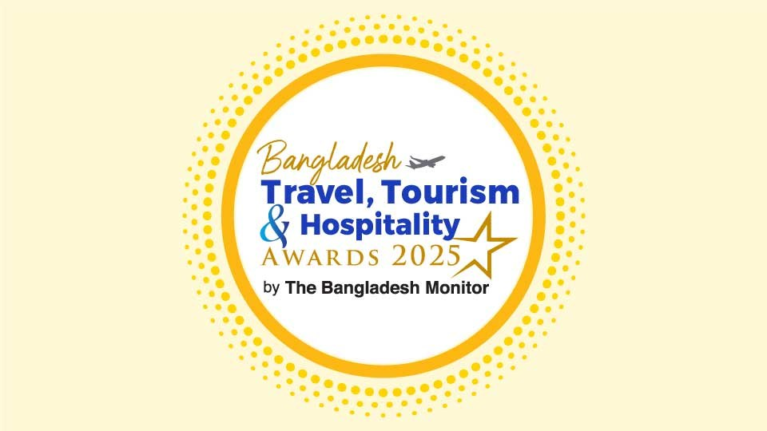

# The Bangladesh Monitor launches 2nd edition of the Bangladesh Travel, Tourism and Hospitality Awards

> **Source:** Google News — Bangladesh Travel  
> **URL:** <https://bangladeshmonitor.com.bd/en/bangladesh-travel-tourism-and-hospitality-awards-2025>  
> **Type:** news | **Language:** en  
> **Published:** Mon, 15 Sep 2025 07:00:00 GMT  
> **Destination:** Bangladesh travel  

---

Entries are invited from prospective organisations and individuals
The Bangladesh Monitor launches 2nd edition of the Bangladesh Travel, Tourism and Hospitality Awards
A Monitor Report
Published: September 15, 2025 | 12:00 AM
2 min read
Print
The Bangladesh Monitor, the country’s premier travel trade publication, has officially launched the BTTHA-2025, second edition of the Bangladesh Travel, Tourism and Hospitality Awards.
First introduced last year as Bangladesh’s pioneering award program of its kind, the
BTTHA
has been established to honor excellence, innovation, and leadership across the nation’s rapidly expanding travel, tourism, and hospitality industries. The awards shine a spotlight on the remarkable achievements of organizations and individuals who are setting new benchmarks in service quality and professionalism.
The 2025 edition will recognize a wide range of categories, including leading hospitality properties such as hotels, resorts, restaurants, tourism service providers, and tour operators. In addition, special awards will be presented to individuals for their outstanding contributions, such as Best Hotelier, Best Restaurateur, Best Entrepreneur in the Hospitality Industry, and Best Tour Guide, among others.
A distinguished Jury Board will assess all entries and prepare a shortlist of nominations across all categories. The list of nominations will be opened for public and industry voting online, ensuring greater transparency and wider engagement in the selection process.
Commenting on the initiative, Kazi Wahidul Alam, Editor of The Bangladesh Monitor, said:
“The BTTHA Awards are designed to recognise and inspire the stakeholders of Bangladesh’s tourism and hospitality sector to consistently raise standards of service and professionalism. Encouraged by the overwhelming response to the inaugural edition, we are confident that the 2025 program will generate even greater enthusiasm and participation.”
Organisations and individuals are invited to submit their nominations in the relevant categories. Full details regarding eligibility, submission guidelines, and timelines are available on the official website: www.bttha.com.bd
With its second edition, the BTTHA 2025 is set to become a landmark celebration of Bangladesh’s travel, tourism, and hospitality excellence, proudly showcasing the sector’s very best to both domestic and international audiences.
Tagged Under:
Spread the word
More from
Others
View All

---
*Crawled 2026-06-11 06:09 | Bhromon Travel Crawler*
