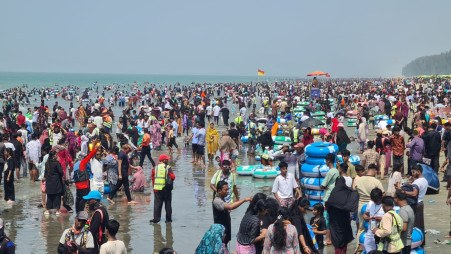

# 3.5 lakh tourists visit Cox's Bazar amid post-Eid travel boom

> **Source:** Google News — Cox Bazar  
> **URL:** <https://www.tbsnews.net/bangladesh/35-lakh-tourists-visit-coxs-bazar-amid-post-eid-travel-boom-1393066>  
> **Type:** news | **Language:** en  
> **Published:** Tue, 24 Mar 2026 11:06:18 GMT  
> **Destination:** Cox's Bazar  

---

3.5 lakh tourists visit Cox's Bazar amid post-Eid travel boom
The large influx took place between 22 and 24 March at the beach town, according to Cox’s Bazar Residential Hotel-Motel Guest House Owners Association.
TBS Report
24 March, 2026, 04:55 pm
Last modified: 24 March, 2026, 05:00 pm
Tourists flock to Cox's Bazar sea beach on Eid-ul-Fitr holiday. Photo: TBS
At least 3.5 lakh tourists visited Cox's Bazar in three days following Eid-ul-fitr, tourism stakeholders said, with visitor numbers beginning to decline from today (24 March) as the holiday period ended.
The large influx took place between 22 and 24 March at the beach town, according to Cox's Bazar Residential Hotel-Motel Guest House Owners Association.
A visit to Sugandha Point this afternoon showed that although the holidays have ended, a significant number of tourists were still present.
Keep updated, follow The Business Standard's Google news channel
From Laboni Point to Kolatoli Point, visitors were seen enjoying various activities, including riding beach bikes, horses and jet skis, while others relaxed on beach chairs or walked along the shore.
Many tourists were seen taking photographs and selfies, while others entered the sea to enjoy the water.
Tourists said they travelled to Cox's Bazar during Eid to enjoy nature and spend time away from their routine, expressing satisfaction at being able to travel without disruption.
Raihanur Rahman, a tourist from Dhaka, said, "I came to Cox's Bazar on Sunday, the day after Eid. I will return tonight (Tuesday). Coming here, I see there's no place to step on the shore. I have not seen so many people or such hustle and bustle before. It feels great to see the joy of so many people."
A group of seven friends from Sylhet also visited the beach during the Eid holidays. One of them, Rahatul Islam, said he was using a drone to capture images of the large crowd.
"I am flying the drone to see how many people are at Cox's Bazar beach. But the higher I lift the drone, the more people I see. It seems there will be close to 2 lakh people. It feels very good to take photos and videos with the drone," he said.
Abdus Sobhan, a banker who travelled from Dhaka's Mirpur with family members, said, "I came to Cox's Bazar on the day of Eid, but I didn't like it much due to the rain. Today, I see wonderful weather. We are having a lot of fun."
Photo: TBS
Abul Kashem, president of the Cox's Bazar Residential Hotel-Motel Guest House Owners Association, said that although the number of visitors began to decline from today, tourists are expected to remain in varying numbers until Friday (27 March).
Despite the large number of visitors, no accidents occurred during sea bathing, said Md Imtiaz Ahmed, project officer of the Sea Safe Lifeguard organisation.
"It is a struggle to provide security for more than a lakh tourists bathing in the sea every day, as only 27 workers are engaged in ensuring safety. Still, we tried, and we are happy to have been able to provide security," he said.
Zahed Hossain, inspector of the Tourist Police Cox's Bazar Zone, said ensuring the safety of tourists was the highest priority during the Eid holidays. Tourist Police personnel carried out round-the-clock duties across beach areas, hotel and motel zones, and entertainment centres.
He added that tourists also visited various attractions across the district, including Marine Drive, Himchhari, Dorianagar, the rocky beaches of Inani and Patuartek, the Buddhist Vihara in Ramu, Adinath Temple in Maheshkhali, Dulahazara Bangabandhu Safari Park, and the city's Burmese Market, with no untoward incidents reported.
Top News
Cox's Bazar
/
Tourism
/
Eid Holiday
/
Eid Travel

---
*Crawled 2026-06-11 09:31 | Bhromon Travel Crawler*
