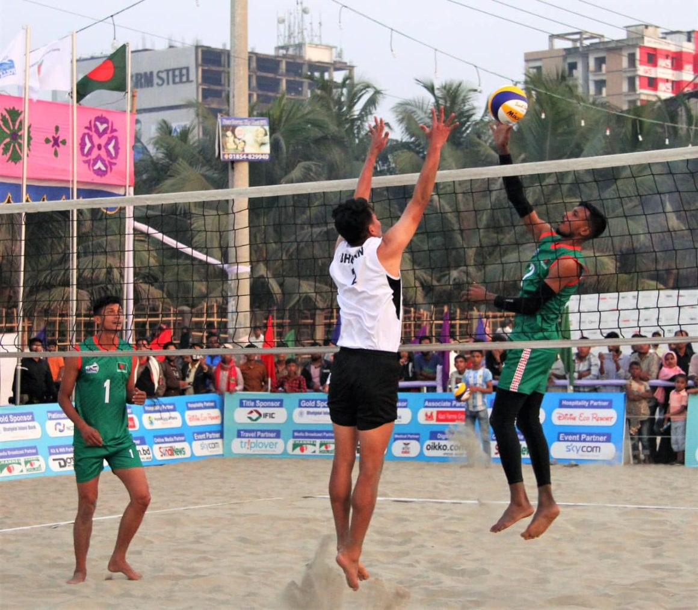

# CAVA BEACH VOLLEYBALL TOUR BANGLADESH KICKS OFF AT COX’S BAZAR BEACH

> **Source:** Google News — Cox Bazar  
> **URL:** <https://asianvolleyball.net/new/cava-beach-volleyball-tour-bangladesh-kicks-off-at-coxs-bazar-beach/>  
> **Type:** news | **Language:** en  
> **Published:** Wed, 28 Dec 2022 08:00:00 GMT  
> **Destination:** tour Bangladesh  

---

December
28
December 28, 2022
CAVA BEACH VOLLEYBALL TOUR BANGLADESH KICKS OFF AT COX’S BAZAR BEACH
By
Preechachan
In
BEACH VOLLEYBALL NEWS
Slider
Bangkok, Thailand, December 28, 2022 – Hosts Bangladesh enjoyed mixed fortunes on the opening day of the CAVA Beach Volleyball Tour Bangladesh at Cox’s Bazar Beach, with their men’s team demolishing Bhutan and women’s side going down to Uzbekistan on Tuesday.
A total of 14 teams tested their mettle in the three-day event which kicked off on Tuesday. The men’s event saw 8 teams comprising 3 from Bangladesh, 2 from Maldives and one apiece from Bhutan, Kyrgyzstan and Nepal vie for top honour, with 6 women’s teams consisting of two apiece from hosts Bangladesh and Uzbekistan and one each from Nepal and Sri Lanka fighting for the crown.
Participating teams have been split to Pool A and Pool B with four teams apiece in the men’s event and 3 teams each in the women’s competition.
Mr Atiqul Islam, President of Bangladesh Volleyball Federation, and Mr Mohamed Latheef from Maldives, President of Central Asian Volleyball Association (CAVA), jointly presided over the opening ceremony on Tuesday.
In his opening speech, Mr Atiqul Islam said Cox’s Bazar Beach is the longest beach in South Asia, and he badly needs to make the beach famous by hosting beach volleyball. He is confident that by hosting beach volleyball competitions at Cox’s Bazar, the beach can become a tourist attraction in the near future. He also thanked CAVA President for the support and trust in hosting this event.
CAVA President Mohamed Latheef welcomed all participants for CAVA Beach Volleyball Tour Cox’s Bazar. He also congratulated the seven National Federations which took part in the Beach Tour.
Mr Latheef supported the vision of Atiqul Islam to make Cox’s Bazar Beach the tourist attraction, and also said CAVA has already nominated Bangladesh Volleyball Federation to be the host of AVC Volleyball Continental Cup Phase 1 (zonal – men’s gender) to support the vision of Mr Atiqul Islam.
Meanwhile, two matches were contested on the opening day, with third seeds Mod Abdul Monsur/Md Imran Haider making the host country proud to win their first match against seventh seeds Dorji Tshering/Jigme Kuenzang after brushing off the Bhutanese duo 21-17, 21-8 in Pool B in 34 minutes. The host pairing will next go up against second seeds Maldivians Adam Naseem/Sajid Ismail on Wednesday.
In the women’s event, Uzbekistan’s sixth seeds Ezozakhon Sativoldieva/Nasiba Jamolova pulled off an upset 2-0 (21-13, 21-13) win against third seeds Most Asha/Mst Ajmira Khatun of Bangladesh in Pool B in 29 minutes. The Uzbek duo will next challenge Sri Lankans second seeds Chathurika Weerasinghe/Deepika Bandara on Wednesday.
Related links of AVC
AVC Website: click
www.asianvolleyball.net
AVC Facebook: click
www.Facebook.com/AsianVolleyballConfederation
AVC Twitter: click:
www.twitter.com/AsianVolleyball
AVC Instagram: click:
https://www.instagram.com/avcvolley/?hl=en
AVC Youtube: click: Asian Volleyball Confederation
AVC WeChat: Asian Volleyball Confederation
0
0

---
*Crawled 2026-06-11 06:17 | Bhromon Travel Crawler*
