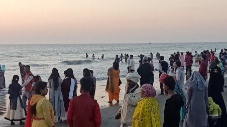

# Cox’s Bazar bustling with tourists again

> **Source:** Google News — Cox Bazar  
> **URL:** <https://www.tbsnews.net/bangladesh/coxs-bazar-bustling-tourists-again-158644>  
> **Type:** news | **Language:** en  
> **Published:** Thu, 11 Mar 2021 10:33:01 GMT  
> **Destination:** Cox's Bazar  

---

Cox’s Bazar bustling with tourists again
Hundreds of thousands of tourists flock to Cox’s Bazar during the weekly holidays
Sayeed Alamgir
16 November, 2020, 01:45 pm
Last modified: 16 November, 2020, 03:23 pm
Visitors crowd the Cox's Bazar sea beach during the ongoing peak tourism season. Photo :TBS
After a long five-month hiatus due to the Covid-19 pandemic, Cox's Bazar has been bustling with tourists again since tourism-related sites were officially reopened on a limited scale on 17 August, subject to maintaining hygiene protocols.
Crowds of tourists are flocking to the beach and nearby tourist spots on weekends and other holidays, as was seen recently during the Durga Puja holidays. The beach hotels, motels, cottages, and guest houses are at capacity from Thursday evening onwards, boosting the tourism trade even during this challenging time. If this trend continues, losses from the pandemic's first wave may be recouped.
According to Cox's Bazar Hotel-Guest House Owners' Association, there are more than 450 hotels, motels, resorts and cottages in Cox's Bazar, accommodating millions of tourists. About hundreds of thousands of tourists are flocking to Cox's Bazar during the weekly holidays. Upmarket hotels are doing well, with 100% bookings.
Rabiul Hasan, a tourist from Cumilla's Chauddagram, said Covid-19 had created a panic and it was not impossible to venture out anywhere. Now, with the second wave around the corner, he is visiting the beach for some rest, relaxation, and mental relief.
Keep updated, follow The Business Standard's Google news channel
Sea-Safe Lifeguard supervisor Mohammad Osman said tourists have been flocking to the beach almost every day since Durga Puja. However, despite regular announcements via loudspeakers, most tourists do not wear masks. Moreover, the district administration's mobile court has been fining tourists for violating health protocols in not wearing masks.
Meanwhile, relevant authorities have taken stringent measures to ensure the safety of tourists visiting the world's largest beach.
According to sources in Cox's Bazar Beach Management Committee, tourist spots have been brought under CCTV cameras to detect and prevent harassment of tourists. Tourist police have also made provisions for quick medical treatment and safe, drinking water at the beach. Lifeguards are on high alert to protect sea bathers.
Syed Morad Islam, the executive magistrate of the tourism cell of the district administration in Cox's Bazar, said he had given instructions earlier to put up price lists in hotels, motels, and restaurants to prevent harassment of tourists. Information centres (inboxes) have been set up at 11 points on the beach, including Laboni, Sugandha and Kalatali.
A hotline number (01733373126) is also available to receive tourist complaints. Several restaurants and hotels have been fined after many tourists complained of harassment via the hotline. Awareness-raising campaigns and mobile courts are currently running to prevent Covid-19 infections.
According to Cox's Bazar Additional Superintendent of Police, Rafiqul Islam, a large number of men and women police in plain clothes and tourist attire patrol the beach to prevent tourists from any kind of unwanted harassment.
Zillur Rahman, Superintendent of Police at Tourist Police Cox's Bazar Zone, said various measures have been taken to ensure tourists' safety and welfare, including a special rescue team of tourist police, eve-teasing control team, drinking-water zone, and quick medical treatment.
There are more than 50 trained lifeguards from three private lifeguard organisations.
Cox's Bazar Deputy Commissioner, Kamal Hossain said tourism is a lucrative industry and the hectic tourist season is around the corner. At the same time, the second wave of Covid-19 is already upon us. We must diligently follow the health protocols, but at the same time, we must do what we can to move the tourism industry forward.
Top News
Cox's Bazar
/
Tourists

---
*Crawled 2026-06-11 06:23 | Bhromon Travel Crawler*
