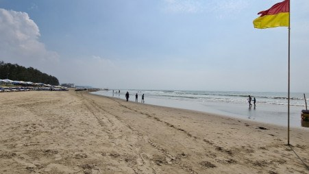

# Cox's Bazar's Sugandha to be named Bangabandhu Beach

> **Source:** Google News — Cox Bazar  
> **URL:** <https://www.tbsnews.net/bangladesh/coxs-bazars-sugandha-be-named-bangabandhu-beach-795878>  
> **Type:** news | **Language:** en  
> **Published:** Tue, 20 Feb 2024 07:31:08 GMT  
> **Destination:** Cox's Bazar  

---

Cox's Bazar's Sugandha to be named Bangabandhu Beach
The vacant area between Sugandha and Kolatoli point of the beach will be named “Bir Muktijoddha Beach”
TBS Report
20 February, 2024, 01:25 pm
Last modified: 20 February, 2024, 01:42 pm
A near empty Laboni Point of Cox's Bazar beach on 2 November amid the countrywide blockade of opposition parties. Photo: Nupa Alam/ TBS
The Ministry of Liberation War Affairs has decided to rename Cox's Bazar's Sugandha Beach to "Bangabandhu Beach".
The vacant area between Sugandha and Kolatoli Point of the sea beach will be named "Bir Muktijoddha Beach," according to a notification of the ministry issued on Monday (19 February).
The notification says the decision to change the names was taken at the 13th meeting of the Standing Committee on Liberation War Affairs of the 11th Jatiya Sangsad.
Keep updated, follow The Business Standard's Google news channel
The Deputy Commissioner and concerned others have been instructed to take necessary measures in this regard.
"We have received the notification and are taking necessary actions to implement it," said Deputy Commissioner of Cox's Bazar Mohammad Shahin Imran.
Top News
Cox's Bazar

---
*Crawled 2026-06-11 06:22 | Bhromon Travel Crawler*
