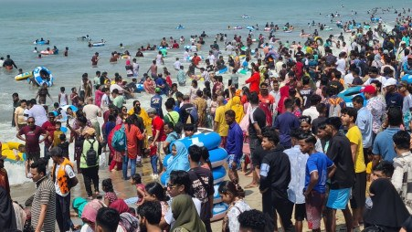

# Eid holiday rush turns Cox's Bazar beach into sea of tourists

> **Source:** Google News — Cox Bazar  
> **URL:** <https://www.tbsnews.net/bangladesh/eid-holiday-rush-turns-coxs-bazar-beach-sea-tourists-1392236>  
> **Type:** news | **Language:** en  
> **Published:** Sun, 22 Mar 2026 12:02:34 GMT  
> **Destination:** Cox's Bazar  

---

Eid holiday rush turns Cox's Bazar beach into sea of tourists
From early morning on the second day [today] of Eid, the tourist city was packed with visitors, leaving little room to walk along the beach.
TBS Report
22 March, 2026, 05:50 pm
Last modified: 22 March, 2026, 08:11 pm
Tourists from across the country gathered with family and friends, immersing themselves in the waves or enjoying time on the sandy dunes in Cox's Bazar. Photo: TBS
Cox's Bazar beach has returned to its familiar vibrant form drawing massive crowds of holidaymakers as thousands flock to the world's longest sea beach to celebrate Eid.
From early morning on the second day [today] of Eid, the tourist city was packed with visitors, leaving little room to walk along the beach. Tourists from across the country gathered with family and friends, immersing themselves in the waves or enjoying time on the sandy dunes.
Tourism officials say more than 70% of rooms across more than 550 hotels, motels, and resorts are booked. The number of tourists will increase further in the coming days of the consecutive holidays. They are happy with the desired number of tourists. Meanwhile, the tourist police officials are discussing implementing comprehensive measures to ensure the safety of arriving tourists and prevent harassment.
Keep updated, follow The Business Standard's Google news channel
As the day progressed, the influx of visitors intensified, turning the entire city into a tourist sea by noon. Many tourists were seen capturing moments on their cameras, taking selfies, or simply sitting under umbrellas, enjoying the cool sea breeze. However, for most, the main attraction remained bathing in the salty waters to unwind and refresh.
Visitors expressed felicitation at being able to celebrate Eid while also enjoying the natural beauty of Cox's Bazar.
Rabeya Rahman, a tourist from Narayanganj, said she initially expected fewer visitors during the holidays but was surprised by the overwhelming crowd. "There is hardly any space to walk. I've never seen such excitement before," she said.
A group of seven friends from Sylhet also travelled to the beach to celebrate Eid. While most of them were busy swimming and taking selfies, one of them, Rahatul Islam, was focused on flying a drone to capture aerial views. He estimated that there would be around 200,000 people. It feels great to take drone photos and videos.
Abdus Sobhan, a banker from Dhaka's Mirpur, who arrived with his family, said the weather had dampened his mood on Eid day due to rain, but Sunday's clear conditions made the trip worthwhile.
With the surge in visitors, lifeguards faced increased pressure to ensure safety. Watch towers, patrols, and public announcements were in operation, although staff shortages posed challenges. According to Sea Safe Lifeguard officials, only 27 workers are deployed to oversee the safety of over one lakh tourists, Md Imtiaz Ahmed, project officer of Sea Safe Lifeguard.
Zahed Hossain, inspector of Tourist Police Cox's Bazar Zone, said that the safety of tourists is being given top priority. Since a large number of tourists have arrived during the Eid holidays, the Tourist Police are on duty round the clock in the hotel and motel zones and entertainment centres in Baliari.
He said that in addition to Cox's Bazar beach, all the entertainment centres in the district, including Marine Drive, Himchhari, Dariyanagar, Inani and Patuartek's rocky beaches, Ramu Buddhist Monastery, Adinath Temple in Maheshkhali, Dulahazara Bangabandhu Safari Park and the city's Burmese Market, have become bustling with tourists.
Top News
Eid 2026
/
Cox's Bazar
/
Tourism

---
*Crawled 2026-06-11 09:33 | Bhromon Travel Crawler*
