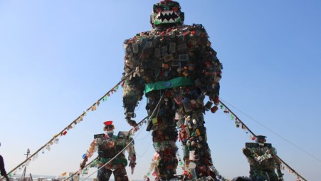

# Sky-high plastic 'robot monster' unveiled at Cox's Bazar beach to highlight plastic pollution

> **Source:** Google News — Cox Bazar  
> **URL:** <https://www.tbsnews.net/bangladesh/sky-high-plastic-robot-monster-unveiled-coxs-bazar-beach-highlight-plastic-pollution>  
> **Type:** news | **Language:** en  
> **Published:** Wed, 04 Dec 2024 08:00:00 GMT  
> **Destination:** Cox's Bazar  

---

Sky-high plastic 'robot monster' unveiled at Cox's Bazar beach to highlight plastic pollution
Rising 62 feet into the sky, the sculpture’s towering form captures the destructive power of plastic pollution.
TBS Report
04 December, 2024, 04:10 pm
Last modified: 04 December, 2024, 08:47 pm
Rising 62 feet into the sky, the plastic sculpture in Cox's Bazar captures the destructive power of plastic pollution. Photo: TBS
A towering plastic 'robot monster' has been put on display at Cox's Bazar beach to raise awareness about the dangers of plastic pollution in the sea.
The initiative, spearheaded by the Cox's Bazar District Administration and the voluntary organisation Bidyanondo Foundation, underscores the pressing need to address the growing crisis of plastic waste.
Built with a collaborative effort of artists, volunteers, and local communities, the sculpture was inaugurated today (4 December) at Sugandha and Seagull points of the beach.
Rising 62 feet into the sky, the sculpture's towering form captures the destructive power of plastic pollution.
Keep updated, follow The Business Standard's Google news channel
This initiative was born out of necessity.
Millions of tourists flock daily to Cox's Bazar and the nearby Saint Martin's Island, leaving behind trails of plastic waste that pollute the sand and waters.
Alarmed by the escalating environmental damage, the Cox's Bazar District Administration and Bidyanondo Foundation collaborated to create a powerful symbol of change.
"Plastic is destroying the sea and public life like a monster," said Deputy Commissioner Mohammad Salahuddin during the inauguration.
"This initiative of the sculpture exhibition has been taken to spread this warning among everyone," he added.
The administration has also actively engaged the local community and tourists in their efforts.
Instead of littering, people have been encouraged to deposit plastic waste at exchange centres set up along the beach.
These centres offer daily necessities such as rice, lentils, and oil to locals, while tourists can trade their plastic for books, caps, and other gifts.
The creation of the sculpture is as inspiring as its message. Led by sculptor Abir Karmakar, a team of eight artists and 20 volunteers from the Fine Arts Department of Dhaka University worked tirelessly for a month to bring the monster to life.
The creation was supported by Pop-Five Advertising Limited.
Using 10 metric tons of plastic waste collected from Cox's Bazar, Inani, and Teknaf, they combined recycled materials with wood, nails, and adhesive to construct the massive sculpture.
The centrepiece stands alongside two smaller figures, each 15 feet tall.
"This is the world's largest robot monster made of ocean plastic," claimed the artists, who hope their work will inspire a global conversation about the potential of recycling and reusing waste.
Jamal Uddin of the Bidyanondo Foundation revealed that this initiative is part of a nationwide mission to recycle 500 metric tons of plastic waste.
"This will not only reduce the government's cost in plastic waste management but also educate people on how to transform waste into wealth through recycling," he said.
For the next four months, Bidyanondo Foundation, with the support of the district administration, will continue its efforts in Cox's Bazar to reduce plastic pollution and raise awareness. The foundation has also organised awareness programmes, including street plays and musical performances, to complement the sculpture's exhibition.
Shariful Islam, a tourist from Dhaka, said, "The monster's terrifying appearance effectively illustrates the harmful impact of plastic waste. It's a creative and commendable way to raise awareness."
This is not the first time Cox's Bazar has hosted such an initiative.
In 2022, the district administration and Bidyanondo Foundation unveiled an earlier version of the plastic monster. However, the organisers emphasised that the problem has worsened since then, with pollution increasing at an alarming rate.
This year's sculpture was built on 7 November and is larger than the previous ones.
The sculpture's inauguration was attended by Deputy Commissioner Mohammad Salahuddin, who was joined by dignitaries including Additional District Magistrate Nizam Uddin Ahmed, Additional Deputy Commissioner (General) Md Yamin Hossain, Additional Superintendent of Police (Traffic) Md Jasim Uddin Chowdhury, and Mohammad Asaduzzaman from the Tourist Police of Cox's Bazar Region.
Jamal Uddin, a steering committee member of the Bidyanondp Foundation, also graced the event.
Top News
plastic
/
Plastic pollution
/
Cox's Bazar

---
*Crawled 2026-06-11 09:39 | Bhromon Travel Crawler*
