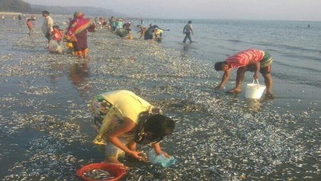

# Thousands of dead fish wash up on Cox's Bazar beach

> **Source:** Google News — Cox Bazar  
> **URL:** <https://www.tbsnews.net/bangladesh/thousands-dead-fish-wash-coxs-bazar-beach-387850>  
> **Type:** news | **Language:** en  
> **Published:** Sun, 20 Mar 2022 05:48:44 GMT  
> **Destination:** Cox's Bazar  

---

Thousands of dead fish wash up on Cox's Bazar beach
TBS Report
20 March, 2022, 11:35 am
Last modified: 20 March, 2022, 01:56 pm
Photo: TBS
Thousands of dead fish washed up on Cox's Bazar Sea beach, covering a half-kilometre area at Kalatali point.
Locals spotted the piles of dead fishes on the beach on Saturday evening, at the time of low tide.
These small fishes are locally known as "Chamila". However, no one could confirm the exact scientific name of the fish.
Keep updated, follow The Business Standard's Google news channel
Witnesses said that most of the dead fishes were washed back to the sea when the high tide began in the evening. However, these are expected to show up again at the time of low tide.
Top News
Dead Fish
/
Cox's Bazar sea beach
/
Cox's Bazar

---
*Crawled 2026-06-11 06:17 | Bhromon Travel Crawler*
