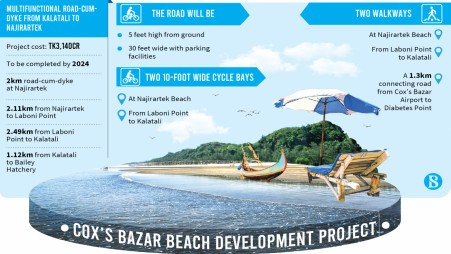

# Tk3,140 crore project planned to make Cox’s Bazar beach more tourist-friendly

> **Source:** Google News — Cox Bazar  
> **URL:** <https://www.tbsnews.net/bangladesh/infrastructure/tk3140-crore-project-planned-make-coxs-bazar-beach-more-tourist-friendly>  
> **Type:** news | **Language:** en  
> **Published:** Mon, 18 Oct 2021 09:45:32 GMT  
> **Destination:** Cox's Bazar  

---

Tk3,140 crore project planned to make Cox’s Bazar beach more tourist-friendly
Under the project, a multifunctional road cum dyke will be constructed from Kalatali to Najirartek area of the beach
Saifuddin Saif
18 October, 2021, 03:45 pm
Last modified: 18 October, 2021, 06:05 pm
To ensure international-standard facilities for domestic and foreign tourists, the government is going to implement a Tk3,140 crore project for the development of Cox's Bazar sea beach.
Under the project, a multifunctional road cum dyke, five feet high from the ground, will be constructed from Kalatali to Najirartek stretch of the beach.
Once the project is implemented, tourists can go up to the Najirartek beach – beyond Kalatali, Laboni Point and Sugandha beaches where they currently throng. Implementation of the project is also expected to bring in new private investment and create employment.
Keep updated, follow The Business Standard's Google news channel
The project proposes implementation by 2024, starting from the current financial year. The proposal from the Ministry of Water Resources has already been sent to the Planning Commission for approval.
Under the project, walkways, bicycle bays and parking lots will be constructed, and solar-powered lights will be installed to enhance the beauty of the beach. Besides, various tourist-friendly infrastructure including a children's park, washrooms, information centre, locker rooms, seating area, exhibition space, and amphitheatre will be constructed.
Apart from Kalatali, Sugandha and Laboni, other points of the Cox's Bazar beach lack adequate facilities and security, forcing tourists to gather at those points only. Foreign tourists are also rare these days at Cox's Bazar due to the lack of international standard facilities at the beach.
The project proposal said the length of the enjoyable beach can be increased if the communication system is ensured. It will also be possible to improve the security system.
Under the project, 2km of the multifunctional road cum dyke will be constructed along the Najirartek beach, while 2.49km from Laboni Point to Kalatali, 2.11km from Najirartek beach to Laboni Point and 1.12km road cum dyke will be constructed from Kalatali to Bailey Hatchery. The road will be 30 feet wide with parking facilities.
A 1.3km connecting road from Cox's Bazar Airport to Diabetes Point will also be constructed under the project.
A 2km cycle bay will be constructed at Najirartek and a 2.6km cycle bay will be constructed from Laboni Point to Kalatali Beach. The cycle bay will be 10 feet wide adjacent to the multifunctional road with parking facilities.
A 2km walking bay at Najirartek Beach and a 2.28km walking bay from Laboni Point to Kalatali will be constructed. Besides, an aquarium building will also be constructed in Najirartek.
Prabir Kumar Goswami, executive engineer of Cox's Bazar Water Development Board, said implementation of the project will ensure a sustainable and effective system to prevent the erosion of the existing beach. The natural environment will remain intact as the proposed project will have a sand replacement system at the beach. As a result, public and private infrastructures along the beach will be protected from erosion.
He said no tourism facility has developed in the Najirartek area yet. If the project is implemented, the area will become attractive for tourists. According to our survey, this will also increase private investment. The project will protect the eroded coastal areas from Kalatali to Najirartek as well as create opportunities for economic activities.
Meanwhile, Cox's Bazar Shilpo O Banik Samity President Abu Morshed Chowdhury complained that locals were not consulted before taking up the project. For this reason, there are questions about how much the project will benefit the local people.
He, however, observed that the construction of the road cum dyke up to Najirartek would increase private investment.
Bangladesh
/
Top News
Cox’s Bazar
/
Cox’s Bazar beach
/
tourist
/
foreign tourists
/
attract foreign tourists
/
Najirartek beach
/
Ministry of Water Resources

---
*Crawled 2026-06-11 06:21 | Bhromon Travel Crawler*
