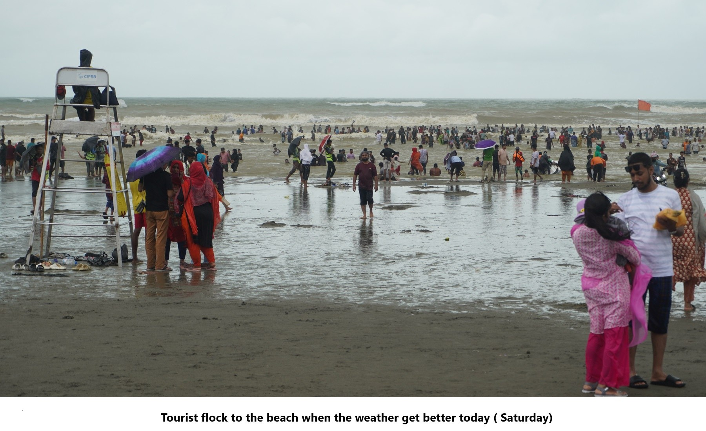

# Tourists ignore warnings and red flags at Cox’s Bazar beach

> **Source:** Google News — Cox Bazar  
> **URL:** <https://www.thedailystar.net/news/bangladesh/news/tourists-ignore-warnings-and-red-flags-coxs-bazar-beach-3704456>  
> **Type:** news | **Language:** en  
> **Published:** Mon, 16 Sep 2024 07:00:00 GMT  
> **Destination:** tourist  

---

Editor's Pick
How the FY2026-27 budget can bridge Bangladesh's climate finance gap
9 June 2026, 08:00 AM
Views
The unanswered questions of the Ganges Barrage
9 June 2026, 09:02 AM
Big Picture
How should Bangladesh's economy grow in the second half of 2020s?
8 June 2026, 11:00 AM
Views
True sustainability for ports means going beyond green
8 June 2026, 08:00 AM
Opinion
How should we read Bangladesh’s UNGA presidency against global and domestic realities?
7 June 2026, 09:00 AM
Views
Tourists ignore warnings and red flags at Cox’s Bazar beach
16 September 2024, 09:08 AM
BANGLADESH
SHARE
Mokammel Shuvo
Mokammel Shuvo
Photo:Saifullah Sifat
Despite improved weather conditions in Cox's Bazar today, the sea remains rough due to the depression in the Bay of Bengal, which caused
heavy rain
over the last few days.
With the weather clearing up, hundreds of tourists flocked to the beach, eager to enjoy their vacation. However, many are putting themselves at risk by ignoring warnings from lifeguards and disregarding red flags signalling dangerous areas.
For all latest news, follow The Daily Star's Google News channel.
Tourists are going for swims in the sea, unaware of the potential dangers, while lifeguards struggle to manage the situation with cautionary announcements and whistles. During a visit to the beach today, it was evident that only a few visitors were paying attention to these warnings.
Read more
Cox’s Bazar waterlogging: Tourists, locals relieved as water recedes
Approximately 20,000 tourists were seen at Kolatoli, Sugandha, and Laboni beaches, according to Sifullah Sifat, a supervisor at Sea Safe Lifeguard, a service that rescues people from drowning at these beaches.
Photo:Saifullah Sifat
"The sea is extremely rough today despite the weather improving," Sifat said. He explained that rainwater from nearby hotel areas and hills is draining through the beach into the Bay of Bengal, creating canals where rip currents can form. These rip currents pose a serious risk to swimmers, particularly in areas marked with red flags.
"Tourists are getting into the water in these risky areas, putting their lives in danger," he added.
Imtiaz Ahmed, project manager at Sea Safe Lifeguard, said that despite repeated warnings about the rough sea, many tourists ignore them because they are eager to swim.
"But they should listen to us for the sake of their own safety," he urged.
Read more
Depression to cause more downpours today
Currently, 27 lifeguards and additional volunteers are working daily from morning to evening, but Imtiaz said this is insufficient given the number of tourists.
So far this month, two people, including a tourist and a fisherman, have drowned at Cox's Bazar beach. Over the past six years, 47 people have lost their lives due to drowning, while around 700 tourists have been rescued from dangerous waters during that time.
A tourist named Arafat Kabir from Dhaka's Lalbagh area, visiting with his family, said, "Our first priority is to swim in the sea."
He admitted they were unaware of the dangers and suggested authorities increase manpower and equipment for tourist safety.
Tanvir Hossain, senior assistant commissioner of the Tourism Cell, mentioned that alongside the lifeguards, 38 trained beach workers employed by the district administration are also working to ensure tourist safety.
"We understand that tourists come to Cox's Bazar to enjoy the sea, but we must also ensure no lives are lost. Lifeguards and beach workers remain vigilant along the beach," he added.
WEATHER CONDITIONS IN COX'S BAZAR
TOURISTS IGNORE WARNINGS AT COX’S BAZAR BEACH
SHARE
Click to comment
Comments
Comments Policy
Related News
Case filed over mother-daughter rape in Cox's Bazar
10 hour(s) ago
Bangladesh
Mother, teenage daughter allegedly gang-raped during robbery at home in Cox’s Bazar
9 June 2026, 17:22 PM
Crime & Justice
Man held with capped langur, 12 turtles in Cox's Bazar raid
9 June 2026, 12:08 PM
Bangladesh
50 rescued from Malaysia-bound trawler off Teknaf, 9 arrested
6 June 2026, 21:01 PM
Bangladesh
Eight years on, Akramul’s widow refuses to give up fight for justice
3 June 2026, 21:50 PM
Crime & Justice

---
*Crawled 2026-06-11 06:17 | Bhromon Travel Crawler*
