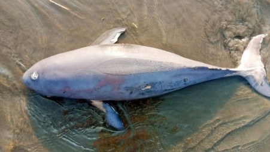

# Two dead dolphins found on Cox's Bazar beach

> **Source:** Google News — Cox Bazar  
> **URL:** <https://www.tbsnews.net/bangladesh/two-dead-dolphins-found-coxs-bazar-beach-608274>  
> **Type:** news | **Language:** en  
> **Published:** Thu, 30 Mar 2023 07:00:00 GMT  
> **Destination:** Cox's Bazar  

---

Two dead dolphins found on Cox's Bazar beach
TBS Report
30 March, 2023, 09:40 pm
Last modified: 30 March, 2023, 09:41 pm
The two dead "Irrawaddy dolphins" were found on the seashore of Cox's Bazar on Thursday.
Belal Hossain, a beach worker, said that two dolphins floated to Sugandha Point on the beach during the high tide, and the matter was informed to the authorities concerned.
The Director General of the Bangladesh Oceanographic Research Institute Sayeed Mahmood Belal Haider said that a team of scientists went to the spot and collected samples after receiving information about the dolphins.
Keep updated, follow The Business Standard's Google news channel
"The cause of the death of the dolphins could not be confirmed yet. But details will be given after the lab test," he added.
He said that the dolphins are more likely to get caught in the fishermen's nets and die.
Last year, four different species of dolphin floated into the beach in three phases.
Top News
Dolphins

---
*Crawled 2026-06-11 06:24 | Bhromon Travel Crawler*
