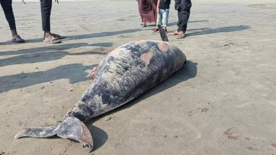

# Two dead porpoises wash ashore on Cox's Bazar beach

> **Source:** Google News — Cox Bazar  
> **URL:** <https://www.tbsnews.net/bangladesh/two-dead-porpoises-wash-ashore-coxs-bazar-beach-966076>  
> **Type:** news | **Language:** en  
> **Published:** Sun, 13 Oct 2024 07:00:00 GMT  
> **Destination:** Cox's Bazar  

---

Two dead porpoises wash ashore on Cox's Bazar beach
TBS Report
13 October, 2024, 10:10 pm
Last modified: 13 October, 2024, 10:16 pm
Indo-Pacific finless porpoise is listed as an endangered species by the International Union for Conservation of Nature (IUCN). Photo: TBS
Two dead porpoises washed ashore on the beach of Teknaf upazila in Cox's Bazar today (13 October).
"Locals saw a dead porpoise floating near Baharchhara beach in Teknaf around 2pm. An hour later, another dead porpoise washed ashore in the same place," said Bangladesh Oceanographic Research Institute (BORI) Senior Scientific Officer Tariqul Islam.
Locals later buried the carcasses in the ground, he added.
Keep updated, follow The Business Standard's Google news channel
"The marine mammal is known as the Indo-Pacific finless porpoise. The scientific name is Neophocaena phocaenoides. It is a small aquatic mammal similar to the Irrawaddy dolphin. But they don't have dorsal fins. It grows up to 5-6 feet tall. Their bodies are strong and their heads are round," Tariqul said.
The porpoise is listed as an endangered species by the International Union for Conservation of Nature (IUCN).
Shafiqur Rahman, chief scientific officer of Cox's Bazar Marine Center of Bangladesh Fisheries Research Institute, said one of the carcasses found today had injury marks.
"It was likely killed after entanglement in fishing nets, collisions with boats or other injuries. However, there is no sign of injury on the other one," he added.
He said the porpoises' lives are threatened due to noise and water pollution and construction structures including dams and harbours.
Earlier, on 30 August, a dead spinner dolphin washed up on Cox's Bazar beach. Before that, dead turtles, dolphins and porpoises washed up on the beach in March and February this year.
Top News
Porpoise
/
Cox's Bazar
/
Body wash ashore

---
*Crawled 2026-06-11 09:38 | Bhromon Travel Crawler*
