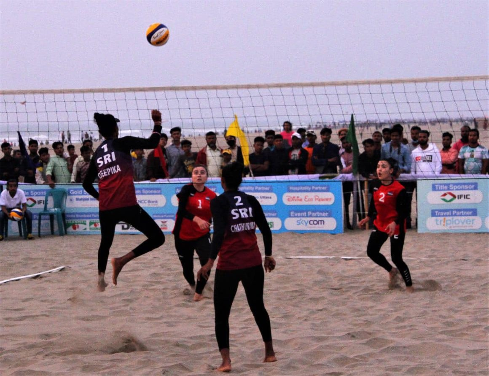

# WOMEN’S SEMIFINAL LINEUP CONFIRMED FOR CAVA BEACH VOLLEYBALL TOUR BANGLADESH AT COX’S BAZAR BEACH

> **Source:** Google News — Cox Bazar  
> **URL:** <https://asianvolleyball.net/new/womens-semifinal-lineup-confirmed-for-cava-beach-volleyball-tour-bangladesh-at-coxs-bazar-beach/>  
> **Type:** news | **Language:** en  
> **Published:** Thu, 29 Dec 2022 08:00:00 GMT  
> **Destination:** tour Bangladesh  

---

December
29
December 29, 2022
WOMEN’S SEMIFINAL LINEUP CONFIRMED FOR CAVA BEACH VOLLEYBALL TOUR BANGLADESH AT COX’S BAZAR BEACH
By
Preechachan
In
Slider
Volleyball News
Bangkok, Thailand, December 29, 2022 – Two teams from Uzbekistan and one apiece from Nepal and Sri Lanka advanced to the women’s semifinals of the 2022 Central Asian Volleyball Association (CAVA) Beach Volleyball Tour Bangladesh at Cox’s Bazar Beach on Thursday, with second seeds Chathurika Weerasinghe/Deepika Bandara from Sri Lanka fighting it out with Uzbek fourth seeds Nodira Sultanboeva/Komila Kuchkorova.
The women’s teams have reached the Thursday’s do-or-die semifinals, while the finals will also be held on the same day. In the men’s event, four matches will be contested in the Thursday morning, the last day of the pool round-robin preliminaries, followed by the semifinal encounters in the afternoon. The third-place playoff clash and final showdown will take place on Friday, the final day of the three-day event.
In the women’s event on Wednesday, Chathurika/Deepika, fifth place at this year’s Birmingham Commonwealth Games, made it two in a row in the pool round-robin preliminaries. The Sri Lankans spent 28 minutes in brushing off sixth seeds Ezozakhon Sativoldieva/Nosiba Jamolova from Uzbekistan 21-12, 21-9 in their first Pool B clash.
Chathurika/Deepika repeated the similar feat after mercilessly crushing Bangladesh’s third seeds Asha Most/Khatun Mst Ajmira in a totally one-sided affair 21-8, 21-5 in 27 minutes in their second encounter. Winning two straight matches, the Sri Lankans captured the top spot in Pool B with 4 points. Sativoldieva/Jamolova had one win against one loss to finish second in the pool, with host girls Asha/Khatun Mst Ajmira losing them all to come in third place.
With only top two teams from each pool advancing, Sri Lankans Chathurika/Deepika and Uzbekistan’s Sativoldieva/Jamolova made the cut for the Thursday’s semifinals. The host team crashed out of the competition.
As the Sri Lankans are due to take on Uzbekistan’s Sultanboeva/Kuchkorova, second place in Pool A, in the first semifinal clash, another Uzbek duo, Sativoldieva/Jamolova, will go up against Nepal’s fifth seeds Upreti Kopila/Pun Kamala in the second match.
Sultanboeva/Kuchkorova had mixed lucks in their pool play on Wednesday as they lost the first clash 16-21, 15-21 to Nepalese Upreti/Pun but bounced back in style to beat Bangladesh’s top seeds Aker Doli/Khatun Most Sabina 2-1 (21-11, 14-21, 15-3) in their second encounter.
Upreti and Pun made a clean sweep in Pool A as the Nepalese pairing had already beaten Akter/Khatun 21-8, 21-18 in their first match earlier. With two wins on the trot, Upreti and Pun topped Pool A, with Sultanboeva/Kuchkorova in second spot. However, both sides secured their semifinal berths. Bangladesh’s Akter/Khatun did not make the cut.
Meanwhile, Nepalese fifth seeds Sunar Dil Bahadur/Shrestha Man Bahadur and second seeds Naseem Adam/Sajid Ismail remained the only two unbeaten teams after the second day of the pool round-robin preliminaries in the men’s event.
On Wednesday, Sunar/Shrestha came from behind to beat fourth seeds Mohamed Ahmed/Hussain Shammail from Maldives 2-1 (17-21 21-14, 15-9) in gruelling 53 minutes in their first Pool A encounter and went on their good show to power past Bangladesh’s top seeds Biswas Horosit/Pavel 21-18, 21-19 in their second match. Biswas/Pavel earlier registered their first victory against Nur Nabi Md/Shaifuddin Md 21-8, 21-16 in the all-Bangladeshi clash.
In Pool B, Adam/Ismail overwhelmed Bhutan’s Dorji Tshering/Jigme Kuenzang in a totally lopsided battle 21-9, 21-9 in 27 minutes and marched on their fine form to beat Kyrgyzstan’s Medtbek Uulu/Zheenbek Uulu 21-12, 21-12 in 31 minutes.
Bangladesh’s third seeds Monsur Md Abul/Haider Md Imran held a 1-1 record on Wednesday as they first went down to Medetbek Uulu/Zheenbek Uulu 1-2 (18-21, 21-7, 11-15), but revived their fortunes to beat Bhutan’s Dorji/Jigme 21-17, 21-8.
The men’s pool plays continue in the Thursday’s morning, followed by the semifinals in the afternoon.
MEN’S RESULTS
MEN’S STANDING
MEN’S SCHEDULE
WOMEN’S RESULTS
WOMEN’S STANDING
WOMEN’S SCHEDULE
Related links of AVC
AVC Website: click
www.asianvolleyball.net
AVC Facebook: click
www.Facebook.com/AsianVolleyballConfederation
AVC Twitter: click:
www.twitter.com/AsianVolleyball
AVC Instagram: click:
https://www.instagram.com/avcvolley/?hl=en
AVC Youtube: click: Asian Volleyball Confederation
AVC WeChat: Asian Volleyball Confederation
0
0

---
*Crawled 2026-06-11 06:16 | Bhromon Travel Crawler*
