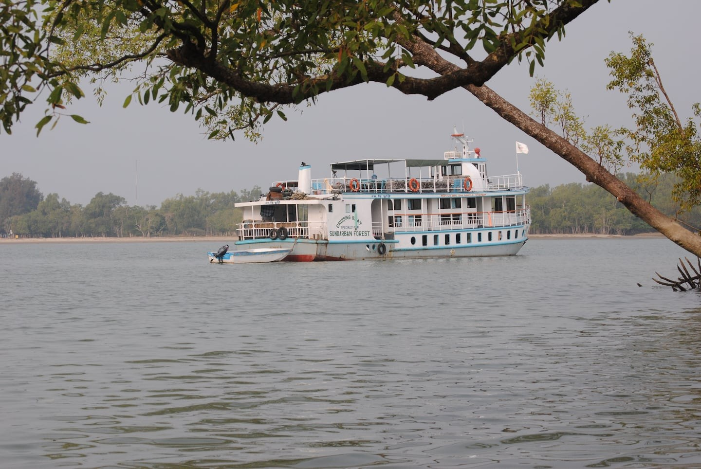

# A riverboat cruise into the mangrove forest of Bangladesh

> **Source:** Google News — Sundarbans  
> **URL:** <https://www.bostonglobe.com/lifestyle/travel/2014/02/15/riverboat-cruise-into-mangrove-forest-bangladesh/JTD8oGCar5UuqlvXdcthdM/story.html>  
> **Type:** news | **Language:** en  
> **Published:** Sat, 15 Feb 2014 08:00:00 GMT  
> **Destination:** Sundarbans  

---

KHULNA, Bangladesh — The riverboat nosed through the narrowing inlet as darkness descended. Inky masses of trees on the riverbank reached out over the water like shelves. I stood on the front deck savoring dusk and the otherworldly mangroves. Then something caught my eye. Bluish fairy lights sparkled among the leaves: fireflies, illuminating the watery corridor in an ethereal welcome to the Sundarbans.
The Sundarbans is the world’s largest contiguous block of mangrove forest, and covers southwest Bangladesh and a corner of eastern India. In Bangladesh this lush forest replete with countless creeks covers over 6,000 square miles — more than five times the size of Yosemite National Park.  It is a UNESCO World Heritage Site and the abode of swimming, man-eating tigers.
This dense forest is both menacing and fragile. Its inlets shift with the tides. Over years, silt from the rivers forms new land masses and islands, while others erode.
Get Starting Point
A guide through the most important stories of the morning, delivered Monday through Friday.
Enter Email
Sign Up
Now the delicate balance of the low-lying Sundarbans is threatened by more frequent, violent cyclones and rising water levels. Waters encroach upon the shore, devouring land where plants, animals, and people live.
As our two-deck metal vessel ventured into the night, we passed a wooden dinghy rustling with activity. Local men were harvesting huge nipa palm leaves in the dark even though creatures lurked in the forest. Locals get permits to enter the Sundarbans and harvest leaves, honey, timber, and fish. Nipa palms resemble 7-foot-tall green feathers growing out of the water and are valued for tough thatch roofing.
Later that evening, our boat cut its engine and released its heavy anchor. The wind picked up and a fine spray coated the top deck, chilling my feet — a sensation I had forgotten in the oppressive springtime heat.
The 78-foot boat fits 20 tourists in small cabins with bunk beds shrouded in mosquito nets, but we didn’t need them. Mosquitoes that swarmed near the city had vanished in the Sundarbans. And I realized I had not heard the call to prayer since morning. There were only the sounds of water lapping, frogs gulping, insects singing, and water and trees whispering together. It was a rare tranquillity in the world’s most densely populated country.
That morning I had awakened to the mournful call to prayer in a guest house in the southern port city of Khulna, the starting point for most trips to the Sundarbans. From a dirty, noisy wharf, a boatman rowed me to the ferry-like riverboat to start the three-day journey organized by Guide Tours of Dhaka, which pioneered the trips in 1989. Within minutes I heard a slurping noise. The gray hump of a dolphin arched out of the water before slipping under again.
For more than 10 hours, the riverboat chugged along, offering a front-row seat to river life: rusted trawlers dredging mud; fishing dinghies; wooden “country boats’’ packed with standing passengers and bicycles; people splashing by riverbanks and tossing cast nets into the water. Three of Asia’s biggest rivers, including the Ganges, converge in Bangladesh to form a massive delta that flows into the Bay of Bengal. The country’s lifeblood is in the arteries and veins of its rivers and waterways.
Our first day in the Sundarbans revealed the forest’s beauty. Just after dawn under a misty celadon sky, we silently paddled into a slender creek on a large rowboat for an intimate look at the mangroves on the bank. These strange trees grow in brackish water and excrete salt through  their bark, roots, and leaves.
There are dozens of mangrove species with names such as apple, blinding, and cannonball. Some have tangled networks of aerial roots that lift the tree above water like stilts. Others have roots that spike out of the mud to let trees breathe oxygen while immersed in saltwater. Roots are intricately gnarled and covered with barnacles.
Our guide, a Bangladeshi in his 20s, pointed out fresh tiger paw prints in the mud amid the roots. In nearly five years on the job, he had spotted a tiger twice. An armed forestry guard aboard our boat — required for tourist vessels to the Sundarbans — counted only six tiger sightings in 18 years. Unsurprisingly, we saw no tigers that morning, but a slick brown otter scrambled up the bank into the trees.
In the morning’s quietude, details came into sharp focus. The shore was covered with jagged leaves of sea holly. A thin snake slithered along a web of branches. Through the trees a white-spotted deer stared before disappearing into the forest.
Birds trilled and flitted about. An older Canadian passenger, an avid birder, called out their names: magpie robins, gray malkohas, green leaf birds. Furry monkeys scampered across branches forming a natural bridge above the creek. Amphibious mudskippers, with arms in push-up position, darted in and out of holes in the mud.
Later we went ashore and found a surprisingly pleasant meadow of cropped grass. A sandy trail led to blissfully deserted Jamtala Beach on the rim of the Bay of Bengal. Bleached, battered skeletons of trees dotted salt-and-pepper sand. I stepped into the warm sea and my toes sank into a soft, slimy bottom. Soon others in the group were smearing gray mud on their chests and faces like war paint.
When we arrived back at our boat green coconuts freshly cut with machetes awaited. In a spacious living room, tea and cookies appeared throughout the day, and we ate huge, fresh meals al fresco on the top deck.
On our second night, our boat turned north for our return to Khulna the next day. From the top deck, I drank in the cool breeze, the rhythmic gulping of water, the dark canopy of stars.
After a dinner of roasted fish and vegetables, I chatted with the bird-watcher, who worked in Singapore “looking for buried treasure.’’ He was a geophysicist for an oil company, so we talked about fracking, the booming but controversial new method of oil and gas extraction.
Fracking kills hopes of curbing carbon emissions that contribute to global warming, he said. With fracking’s new wealth of energy, there is little incentive to invest more in clean, renewable energy like solar or wind. He waved his hand out over the dark river toward the Sundarbans and said, “In a hundred years this will all be under water.”
Amy Yee can be reached at
amyyeewrites.com
.

---
*Crawled 2026-06-11 06:36 | Bhromon Travel Crawler*
