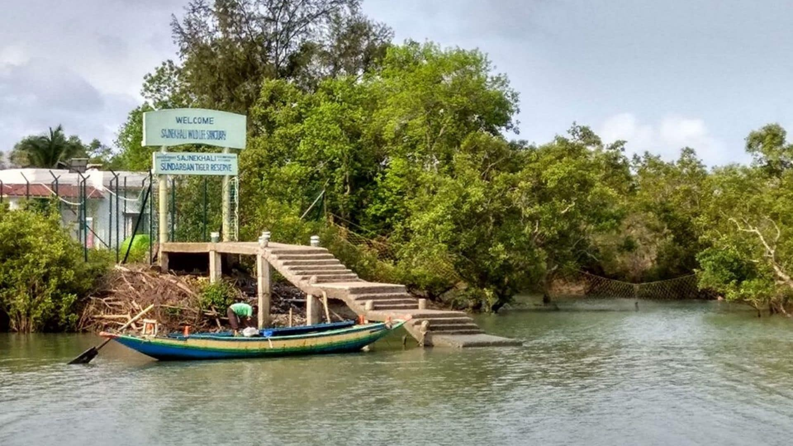

# Community-run tourism can help Sundarbans cyclone recovery

> **Source:** Google News — Sundarbans  
> **URL:** <https://dialogue.earth/en/nature/community-tourism-sundarbans/>  
> **Type:** news | **Language:** en  
> **Published:** Mon, 15 Jun 2020 07:00:00 GMT  
> **Destination:** Sundarbans  

---

Nature
Community-run tourism can help Sundarbans cyclone recovery
Governments have to build infrastructure, help residents and ease travel between countries
Share this article
×
Copy link to page
Copy link to page
×
Republish this article
We encourage you to republish Dialogue Earth articles, online or in print, under the Creative Commons license. Please read our
republishing guidelines
to get started.
One of the few concrete jetties in the Indian part of the Sundarbans, at the entrance to the Sajnekhali wildlife sanctuary [image by: CUTS]
Bipul Chatterjee,
Arnab Ganguly
June 15, 2020
January 29, 2021
The governments of West Bengal and Bangladesh are still busy providing relief to the victims of Cyclone Amphan, which devastated the Sundarbans on May 20. The loss of homes, farmland and freshwater ponds to the wind and saline wave surges has left millions impoverished.
See
:
After Cyclone Amphan, broken houses and rotting fish
While governments move to repair embankments, roads, electricity and communications infrastructure, it is time to start thinking of an alternate means of income. This is where community-run ecotourism in the world’s largest mangrove forest can play a big role.
Sustainable river-cruise tourism in the Sundarbans in both India and Bangladesh can provide significant income to residents and to some extent halt migration out of the area. It can also become a catalyst for regional development. This was a major recommendation of a study called
Sojourns in the Sundarbans – An Exploratory Study of Community-based River Tourism between India and Bangladesh
, which was conducted by the NGO CUTS International last year with support from the World Bank Group.
Community-run ecotourism in and near the Sundarbans has the potential to popularise some of the existing and new tourism routes and locations. But a number of obstacles have to be overcome before it can really work.
The Sundarbans landscape and waterscape, seen from a tourist boat [image by: CUTS]
Implementation challenges
One key challenge is the lack of infrastructure in both Indian and Bangladeshi parts of the Sundarbans. Many tourist spots have no proper jetties to enable people to get in and out of boats. Electricity supply is often intermittent and mobile phones do not work.
The second challenge is that boats currently used for cruises do not meet government-mandated regulations and standards in terms of safety and hygiene. There are hardly any hotels that would be acceptable to most international tourists. And there are very few eating places that meet appropriate hygiene standards.
The third is that there is only one immigration checkpoint between India and Bangladesh in the Sundarbans, at Hemnagar, and that is for both passenger and cargo vessels, which means a long wait most of the time.
Apart from these, our study also found that there is considerable ignorance among residents, tour operators and even local bureaucrats about what the average international tourist or a tourist from other parts of India or Bangladesh would want. This is worsened by lack of communication skills.
Solutions
Imparting communications and hospitality skills to residents and especially to tour operators is a necessary first step. This would include training them on similar initiatives that have been successful. The
Bojo-Aloguinsan project
near Cebu in the Philippines is a good model. There, the association of service providers is run by local fishers and women. As well as from facilitating river cruises, they deliver occasional lectures on ecology, conservation, mangroves, birds and also market local handicrafts. It has provided alternative livelihood opportunities and has considerably boosted the local economy in a sustainable manner.
In the Sundarbans, people will also need financial assistance so that they can develop environmentally sustainable homestays and restaurants that would meet international standards of comfort and hygiene.
Guards in the forest departments of India and Bangladesh need to be trained so that they can help tourists while preventing any damage to the ecosystem. This training is crucial for crews and management of cruise companies too.
Our study underlined that boatmen who take the tourists around are among the most economically vulnerable groups in the Sundarbans. Their operations are governed by local associations. There is a need to build the capacity of these associations to learn and enforce environment-friendly practices. This would include improving fuel efficiency and waste management.
But before that, the boatmen need far better boats, which they cannot afford to buy. There is a need to provide financial assistance for this, but that may not be enough. Bringing boat designers and manufacturers of India and Bangladesh to a knowledge-exchange programme could be a crucial step to having boats of international standards but still affordable.
The Mawa ferry point on the Padma river in Bangladesh, where tourists can hire boats like these for day trips to the Sundarbans [image by: CUTS]
As for the governments, along with providing uninterrupted electricity, mobile connectivity, more immigration checkpoints and permanent jetties, they definitely need to increase the number of toilets and appropriate waste-disposal facilities along tourist routes and especially near tourist spots. Solar power has worked well in the Sundarbans and can be a significant part of the ecotourism package.
The Sundarbans need more routes earmarked for tourism, and these routes need well-serviced disembarkation points and anchoring facilities near places of tourist attraction. New routes may also reduce pressure on existing ones. The Inland Waterways Authority of India and the Bangladesh Inland Water Transport Authority need to sit down together and work this out.
India and Bangladesh have existing memorandums of understanding to jointly develop the Sundarbans in a sustainable manner. Promoting community-run river tourism can be a major part of this, while providing livelihoods to a significant number of people.
Share
×
Copy link to page
Republish
×
Republish this article
We encourage you to republish Dialogue Earth articles, online or in print, under the Creative Commons license. Please read our
republishing guidelines
to get started.
Bipul Chatterjee
Bipul Chatterjee is executive director of CUTS International, a global think- and action-tank on trade, regulations and governance. He tweets @bc_cuts.
Arnab Ganguly
Arnab Ganguly is assistant policy analyst at CUTS International. He tweets @ArnabG9
Nature
Civil society
Rivers
The Third Pole
Tourism
Continue reading
Article
Subsidies
Coronavirus delays hope of WTO fishing subsidies deal
Article
Farming
Sugar strengthens its dominance in agriculture in El Salvador
Article
Palm oil
How to eliminate the deforestation risks of palm oil imported to China?
Article
Oil spill
Drilling continues despite burning gas well in Assam
Article
Coal
India ignores climate concerns to open up coal mines
Article
Dams
Uzbekistan dam collapse was a disaster waiting to happen
Article
Aquaculture
Ecuador clings to China to save shrimp industry from crisis
Article
Fossil fuels
China’s energy law could help address the Belt and Road’s climate impact
Explore topics
Energy
Climate
Food
Nature
Pollution
Ocean
Business
Forests
Justice
Water

---
*Crawled 2026-06-11 06:30 | Bhromon Travel Crawler*
