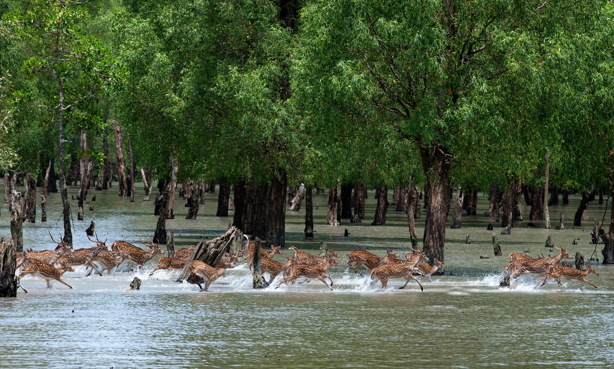

# Explore the world's largest mangrove forest

> **Source:** Google News — Sundarbans  
> **URL:** <https://www.nationalgeographic.com/travel/article/visit-the-worlds-largest-mangrove-forest-sundarbans>  
> **Type:** news | **Language:** en  
> **Published:** Wed, 13 Feb 2019 08:00:00 GMT  
> **Destination:** Sundarbans  

---

Spotted deer move through the Sundarbans in Bangladesh.
Photograph by Yousuf Tushar, LightRocket via Getty Images
TRAVEL
WORLD HERITAGE
Explore the world's largest mangrove forest
Get off the beaten path in the Bangladeshi Sundarbans.
By
Susannah Savage
Published February 13, 2019
•
5 min read
From above,
the Sundarbans
mangrove forest is an impressive labyrinth of colors and textures. The clear blues of the Bay of Bengal run into the murky waters of criss-crossing river systems lined by emerald foliage.
“Drifting down the river for a few days is like escaping into a different world,” says Sabine Roers, founder of
Chili Reisen
travel company.
The lush expanse, which straddles
India
and
Bangladesh
, is steeped in myth. Throughout history, locals have worshipped the goddess
Bonbibi
, or “lady of the forest.” According to one version of the story, Bonbibi was the daughter of a Sufi fakir, brought from Saudi Arabia to the jungles of South Asia. There, she was chosen by God to battle the creature Dokkhin Rai, who took the form of a tiger and preyed on locals. Instead of killing Dokkhin Rai, Bonbibi made a bargain that he could not attack anyone who worshipped her.
Today, some
locals still pray to Bonbibi
for protection before venturing into the forest.
17 of the world's most wild and beautiful places
1 of 17
Molokai, Hawaii
Some say Molokai is what the Hawaiian Islands looked like 50 years ago; others say this is what the world should strive to look like in the future. Untouched by mass development, this 10-mile-wide island has over a hundred miles of shoreline, hidden waterfalls, ancient ruins, and the proud native heritage of Hawaii. What it doesn’t have? Even a single traffic light.
Photograph by Peter French, Pacific Stock/Alamy Stock Photo
In addition to the
Bengal tiger
—the only one of its species adapted to a mangrove environment—the forest has a wide array of wildlife, including rare species like the Indian python and Irrawaddy dolphins. Because of its wildlife and unique ecosystem, the Sundarbans was inscribed a
UNESCO World Heritage
site in 1987.
The animals’ habitat is under threat, however. Rising sea levels are swallowing the forest, and increasing water salinity is damaging plant and marine life—this has a domino effect on larger animals. Under the strain of land loss, people are also encroaching on the animals’ habitat, tearing down trees to make space for farmland, and poaching. A 2004 census estimated around 440 tigers in the Sundarbans, and the population has steadily declined. More recent surveys estimate around
106 tigers
in the Bangladeshi region.
Conservationists, along with the government, are working to preserve the Sundarbans and its wildlife. “We must do everything possible to save the remaining population and help people and tigers to coexist,” says Raquibul Amin, Bangladesh country director for the
International Union for Conservation of Nature
. “The Bengal tiger is the national icon of Bangladesh.”
How to get there
The forest is accessible from Bangladesh and India. Visiting from the Bangladeshi side is more difficult, but rewarding, offering remote areas to explore. Many visitors fly to Jessore and take one of the airline buses to Khulna, a thriving town that sits above the entrance to the Sundarbans. Trains and overnight buses also run from Dhaka to Khulna. In India, tours leave from Kolkata.
How to visit
“Overnight trips offer the chance to get off the beaten track and enjoy the calm of the Sundarbans,” says Didarul Absar, founder of
Bangladesh Eco Tours
.
Several overnight tours and day trips into the Sundarbans operate out of Kolkata. Khulna has fewer options, but the number of operators is steadily increasing. Most all-inclusive tours take guests out on well-kitted out boats, walks through the forest, and early morning excursions to spot wildlife. Tourists can also visit as part of larger tours around Bangladesh, with transport arranged from Dhaka.
Day trips are available from Kolkata, India, and Mongla, Bangladesh, a small town downriver from Khulna—these are popular with local Bangladeshi tourists. Absar emphasizes the importance ethical tourism in the Sundarbans to protect the fragile ecosystem and support local communities. Travelers should use local tour operators who employ local people. They should also respect the wildlife and the environment: don’t litter, be mindful of noise pollution, and don’t disturb the animals.
When to go
The best time to go is during drier, cooler winter months from October to February. After February, temperatures heat up. Some locals prefer to visit between June and August, when monsoon rains awaken the luscious forest, but many tour operators do not operate in this season because of the risk of flooding and cyclones.

---
*Crawled 2026-06-11 06:28 | Bhromon Travel Crawler*
