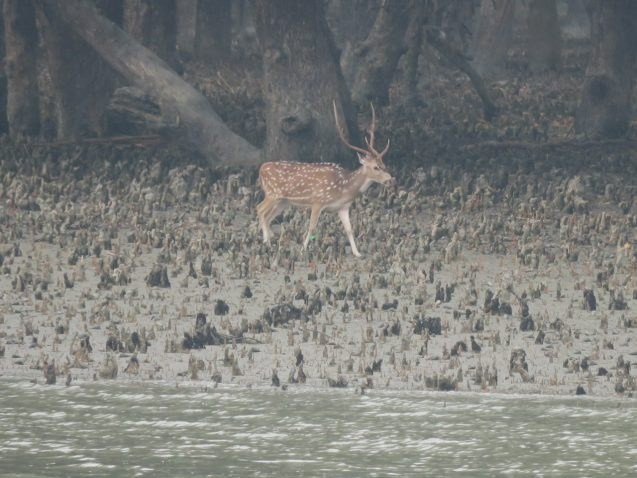

# Exploring the Sundarbans and Back to Dhaka

> **Source:** Google News — Sundarbans  
> **URL:** <https://news.climate.columbia.edu/2023/03/22/exploring-the-sundarbans-and-back-to-dhaka/>  
> **Type:** news | **Language:** en  
> **Published:** Wed, 22 Mar 2023 07:00:00 GMT  
> **Destination:** Sundarbans  

---

We are now a group of 24 people on board the M/V
Kokilmoni
, an 85-foot long Sundarbans tourist boat. The Americans consist of 10 students taking my class,
Bangladesh: Life on a Tectonically-Active Delta
, along with my TA and Carol Wilson from LSU. We also have two professors from Dhaka University and 8 students. At Khulna, we were joined by Masud Rana, Carol’s field assistant. This is my sixth time traveling with Masud.
We sailed south through the mangrove forest watching deer and monkeys along the riverbank and an occasional fresh water dolphin in the river.
We saw many spotted deer along the river banks.
We reached Katka, an excellent site for seeing the landscape and wildlife in the afternoon. We went on the first of our forest walks, with our armed guard for the tigers. We climbed the steps of the wooden dock and followed the boardwalk into the forest before continuing farther into the forest on the ground. We walked past an area where a storm had blown large amounts of sand inland, burying the pneumatophores, or aerial roots, of the mangroves, and killing them. Here in the forest we saw many spotted deer and monkeys, as well as a wild boar.
Our large group disembarking at the dock at Katka for a forest walk. The stairs are needed because of the 4-meter tides.
Bachchu, who arranges all our boat trips for us, acted as our guide through the forest.
We continued to a mound of debris from the salt-making industry that existed here hundreds of years ago. The extra three feet of elevation of the mound makes it a favorite place for tigers during high tides. We continued through the forest and passed the remains of several salt kilns. The salt makers would fill evaporation ponds at the spring high tide and leave the brine to evaporate for two weeks until the next spring high tide. Then the brine would be placed in small pots and evaporated in the kilns.
Kazi Matin and Bachchu explain the ruins of the 300-plus-year-old salt-making kilns.
A wild boar that we encountered close the the building ruined by Cyclone Sidr.
We continued to the coast. This area was devastated by Cyclone Sidr in 2007. The coastal erosion uncovered the first of the kilns. One we worked on in 2015 was underwater as it was high tide. That it is underwater is evidence of the subsidence of the coastal region. A group of scientists estimated that this site is sinking at 4.1 millimeters per year, faster than sea level is rising. Broken potshards were all around us, and it is not clear whether the kiln we studied has been destroyed or not.
Rebecca on the beach at the Bay of Bengal near a salt kiln that we worked on in 2015 that may now be gone.
Farther along the shore we saw the forestry office buildings that were also destroyed by Cyclone Sidr. This hurricane killed over 4,300 people in Bangladesh. New buildings and tourism improvements are under construction now. We returned to the
Kokilmoni
to watch the sunset. We looked out to the Bay of Bengal and Indian Ocean knowing that the next landfall is Antarctica over 6,000 miles to the south.
Arif stands on the trunk of a large tree uprooted by Cyclone Sidr in 2007.
The next morning, we repeated our silent boat ride. With a clearer morning we saw more birds and deer. After breakfast, we went on a second long forest walk. The first part of the path was along an old sandy shoreline and included a tall observation tower for viewing the forest. Walking through the forest, we saw many pugmarks, tiger tracks. We emerged to the beach and continued along it observing tracks of tigers, smaller wild cats, deer and wild boar in the sand. The boar left big holes where they rooted into the ground.
On the country boat oared by Nasir during our second silent boat ride up a tidal channel. Carol, Tisha, Kakon, Emily, Solaiman, and Masud are in the front row.
A fresh pugmark or tiger track in the mud along the river bank.
A mudskipper that we saw while going to the river bank to look at a tiger track. They are small fish that go ashore during low tide to avoid predators, holding water in their puffed out cheeks to breathe.
At Tiger Point on the far end of the beach, our country boat picked us up for a brief rest stop on the
Kokilmoni
before taking us to Egg Island. There used to be two islands here, Bird and Egg, but they have merged into one. These islands emerged from the sea less than 50 years ago. They are a great place to see the succession of from bare sand beach to grasses to shrubs, trees, marsh and mangroves. The last time I was here, there were no tigers on the island, but now there are, so the guard prevented us from going too far inland. Instead, we had a swim on the beach before heading back to the
Kokilmoni
for a late lunch.
A baby monkey we met as we went ashore for our second forest walk.
A pair of chestnut-headed bee eaters that I saw from the tall observation tower on the walk.
Regrettably, our time in the Sundarbans was coming to an end. We spent the rest of the day cruising north through the mangroves, watching the deer, monkeys, birds, boar and dolphins as the sun set over the forest. We stopped for the night near the Sharankhola Forest Station, where our guard left us. Carol and I have RSET and GNSS stations at a site about three miles north of here.
Nico, Ana, Emile and Zazoe enjoy a refreshing green coconut while heading to Egg Island.
Simon, Brendan, Rebecca, Emily and Aandishah relaxing on the boat as we head to our next stop.
The next morning, we sailed north to a village I visited back in 2015 with Chris Small. He saw in his satellite images that the tree cover all around this area was increasing. The class project group working with him will be interviewing the people to understand why. The climate change and migration group will also be conducting interviews. I stayed with the remaining group, studying last year’s record floods in Sylhet, in northeast Bangladesh. For them, this was an opportunity to learn more about rice farming in Bangladesh.
I got to steer the
Kokilmoni
for a bit while the captain looks on.
Mahfuz, Masud, Nico, Anam Carol, Zazoe and myself in front of a colorful school that doubles as a cyclone shelter. The ground floor is open for the flood water and there is a ramp for cattle.
We found that while they could grow two rice crops a year, the farmers did not use groundwater for irrigation because it is saline. They use the monsoon rains for one and the river water for the other. However, in the late winter dry season, the river water is too saline to be used. Thus, most of the fields were fallow while we visited. We did see a watermelon crop in the distance, since it requires less water and tolerates salinity better. A new higher embankment — built a few years ago as part of the CEIP-1 project that I was part of — protects them from floods. Back in 2007, Cyclone Sidr breached the older embankment and left the village in waist-deep water.
Masud translates for a farmer that my students interviewed.
A family sits on the porch or a large house on a high mud plinth. The floods during Sidr in 2007 came almost to the top of the plinth. Many families with flooded homes took refuge here. The bag in front is filled with the mustard seeds they were sorting when we arrived.
While walking around, a bicycle-powered ice cream truck came by; we bought ice cream for ourselves and all the kids following us around. We also stopped for tea and snacks before it was time to head back to the
Kokilmoni
.
On our last night aboard the
Kokilmoni
, Tisha and Kakon gave many of us henna tattoos.
After returning to the boat and having lunch, Kazi Matin needed to return to Dhaka.  A few of the students and I joined him on the speedboat ride to Morrelganj where a car met him. Then we returned to the
Kokilmoni
and continued through a natural and manmade passage to Mongla to switch back to the bus the next morning. But we first had a last dinner on the top deck and said our farewells to the 11-man crew.
A final group photo before we left the
Kokilmoni
included the crew alongside the rest of us.
For our long final day, we had an early breakfast left for Bagerhat. Here, we visited the stone 60-dome mosque and its huge fresh water pond. Both were completed by Khanjahan in the mid 1400s, one of the early settlements to convert the forest into rice fields. From there, it was only four hours to Dhaka thanks to the newly opened, 6.5 km (4 mile) long Padma Bridge. I have watched it being built over the years as I took the 1.5-3 hour long ferry crossing. As it opened last year, this was my first time across it.
The view inside the 60-dome mosque finished in 1456. The stone for the pillars had to be imported from India.
We had time to visit Dhaka University’s geology department and Curzon Hall. Curzon Hall was built to be the city hall for the 1905 partition. When protests led to the cancelation of the splitting on Bengal, it was repurposed for Dhaka University. After saying goodbye to our Bangladeshi friends, we continued on past the Shahid Minar, the memorial to those killed in 1952 during the language protests. East Pakistan at the time, Bangalis fought against Urdu and only Urdu being the language of the split country of Pakistan. It is now commemorated as the National Language Day Holiday, a celebration of the Bangla/Bengali language and the struggle towards independence.
Some kids were fascinated by Brendan’s tattoos. Here a boy is practicing his Roman alphabet skills by reading Brendan’s fingers.
We also drove past the Louis Kahn-designed parliament building before arriving at Aarong, a clothing and handicraft store that supports local artisans, for a final bout of shopping. Satisfied with several hours of gift buying, we had a fabulous dinner at the apartment of my TA Aandishah’s parents before leaving for the airport. Carol and I also said farewell here as we will stay a little longer in Dhaka for meetings.
Because of COVID, it has been many years since I brought a class of my students here. It was gratifying to see how impactful it was for both the American and Bangladeshi students. I’ll learn more during class on Thursday when we discuss the trip over our favorite photos.
The Bangladesh parliament building designed by Louis Kahn.
My class flanked by Aandishah’s parents in their apartment. We had dinner there before leaving for the airport.

---
*Crawled 2026-06-11 06:27 | Bhromon Travel Crawler*
