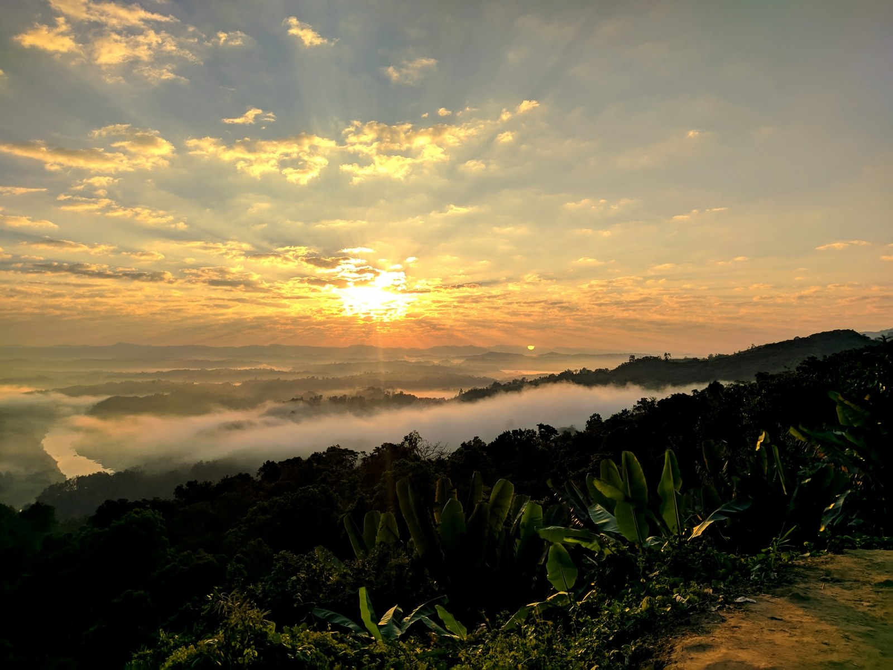

# Road trip to Sundarbans: A magical escape into nature's embrace

> **Source:** Google News — Sundarbans  
> **URL:** <https://www.thedailystar.net/life-living/travel/news/road-trip-sundarbans-magical-escape-natures-embrace-3457046>  
> **Type:** news | **Language:** en  
> **Published:** Mon, 30 Oct 2023 07:00:00 GMT  
> **Destination:** Sundarbans  

---

Editor's Pick
How the FY2026-27 budget can bridge Bangladesh's climate finance gap
9 June 2026, 08:00 AM
Views
The unanswered questions of the Ganges Barrage
9 June 2026, 09:02 AM
Big Picture
How should Bangladesh's economy grow in the second half of 2020s?
8 June 2026, 11:00 AM
Views
True sustainability for ports means going beyond green
8 June 2026, 08:00 AM
Opinion
How should we read Bangladesh’s UNGA presidency against global and domestic realities?
7 June 2026, 09:00 AM
Views
Road trip to Sundarbans: A magical escape into nature's embrace
30 October 2023, 11:16 AM
TRAVEL
SHARE
K Tanzeel Zaman
K Tanzeel Zaman
Photo: LS
The Sundarbans, a land of mangroves, tigers, and... well, mosquitoes, but let's focus on the romantic part, shall we? This time, we swapped Dhaka's ever-present rickshaws and eternal traffic jams for the mysterious lure of the great Sundarbans. Now, if you have been following our adventures, you know
our Bandarban trip
was, let's say, not exactly a model of punctuality. This time, though, we defied all Dhaka-tarian logic. We actually left on time. 5:30 AM SHARP! How, you ask? We stayed up, because we could not rely on alarms, even with a gun pointed to our heads. Looking at you, Rakib!
For all latest news, follow The Daily Star's Google News channel.
Read more
Escaping Dhaka's chaos: A tranquil road trip to Bandarban
The magic word? Professional driver. While we bleary-eyed four — Rakib, Adity, Mithila, and yours truly — struggled to keep our eyes open, our skilled driver breezed through the empty morning streets.
You might remember Rakib as our Bandarban FOMO king, right? Well, this time, his FOMO was directed towards experiencing the prolific Padma Bridge for the very first time! His plan? To stay awake and marvel at the monumental Padma Bridge. His reality? Well, let's just say his dreams crossed the bridge while he slept through it. Adity and Mithila, on the other hand, played tourists, snapping photos that did not do justice to the actual experience.
Photo: K Tanzeel Zaman
After successfully crossing the Padma Bridge, we stopped at a rest stop to freshen up.  Flashbacks of our previous journey fuelled Adity's sudden nutritional wisdom, vetoing Rakib's beefy breakfast plans. With a ban on beef, Rakib, in his best adult imitation, sulked like a four-year-old denied candy. So much for adulting!
After fuelling up (with Rakib still sulking), Mithila and I whisked everyone to a local legend — a Mango tree so old, it probably had stories of freedom fights and partition. Now, we're talking "overgrown giant" here. That tree was the Yoda of all mango trees, ancient and full of wisdom, standing tall and majestic, a silent testament to nature's endurance.
With our hearts full and our phone galleries fuller, we hit the road again. But not without a hiccup. A flat tire tried to deflate our spirits. Temporary hiccups were sorted, and we sped towards Mongla.
Upon reaching there, we switched modes from car to boat. Two choices: be the patient, frugal traveller and pay Tk 10 to share a boat, or splash out Tk 200 to get the VIP treatment.
Rakib and I exchanged knowing glances. Without uttering a word, we chose the latter. "When in Sundarbans," we said silently and bam! We were the kings of our own boat!
Photo: K Tanzeel Zaman
Arriving at Banabash Eco Village, we were greeted with a surreal landscape — mangroves, rivers, and the omnipresent aura of nature's best. Our wooden duplex cottages, with hammocks beckoning from the upper floor, seemed tailor-made for digital detoxing.
We stuffed ourselves with the local cuisine, and I mean stuffed, then conversed with locals and staff. Our quest for knowledge and friendliness was rewarded with a boat ride into the Sundarbans' hidden canals.
Photo: K Tanzeel Zaman
It felt like stepping into a Tolkien novel. Everything was serene, mystical, and yes, a bit intimidating. At one point, our boatman casually dropped the "tigers frequent these canals" bomb. Just then, a rustle from the tall grass had us contemplating life, the universe, and everything. With pride, I can tell you that we spent the entire early evening floating around the river outside the canals with no fear of large cats whatsoever!
As night fell, the air, infused with the subtle scent of salt and mangroves, seemed to carry whispers from ancient times. Lounging on the large hammock on the second floor, our eyes gleamed at the open starry sky descending upon the silhouette of the woods across us; it felt like a nod from our forefathers, reminding us that we were precisely where we were supposed to be at that moment.
Photo: Collected
It was as if the universe had written a lullaby just for us, and in that peaceful embrace, we discovered an elusive tranquillity that city life had long denied us. If Bandarban was a revelation, Sundarbans was a spiritual awakening.
The next day, heading back to Dhaka's smog-ish maze, we pondered a simple question: Why do we live where we can't see the stars, hear the forest, or sail through mystic canals? But you know what they say—once you've tasted paradise, everything else is just traffic. And there you have it—a tale so steeped in the essence of the Sundarbans that you might just feel the mud beneath your toes and hear the call of the unknown in your ears. Trust me, it's an experience that drenches you—right from your skin to your soul.
SUNDARBAN
SUNDARBAN BANGLADESH
ROAD TRIPS IN BANGLADESH
ROAD TRIPS
TRAVEL
TRAVEL & TOURISM IN BANGLADESH
TOURISM ATTRACTIONS TO FOREIGNERS
TOURISM BANGLADESH
SHARE
Click to comment
Comments
Comments Policy
Related News
How To watch every FIFA World Cup 2026 match in Bangladesh
10 June 2026, 17:13 PM
Lifehacks
Dissecting the World Cup ball: Everything you need to know
10 June 2026, 17:13 PM
Life & Living
#Perspective
/ Why even non-football fans end up caring about the FIFA World Cup
10 June 2026, 17:04 PM
Life & Living
#Perspective
/ How popular culture taught me to love
9 June 2026, 07:13 AM
Life & Living
#Arts & Crafts
/ Shakil Mridha shows why folk art defines Bangladesh’s identity
9 June 2026, 07:07 AM
Life & Living

---
*Crawled 2026-06-11 06:31 | Bhromon Travel Crawler*
