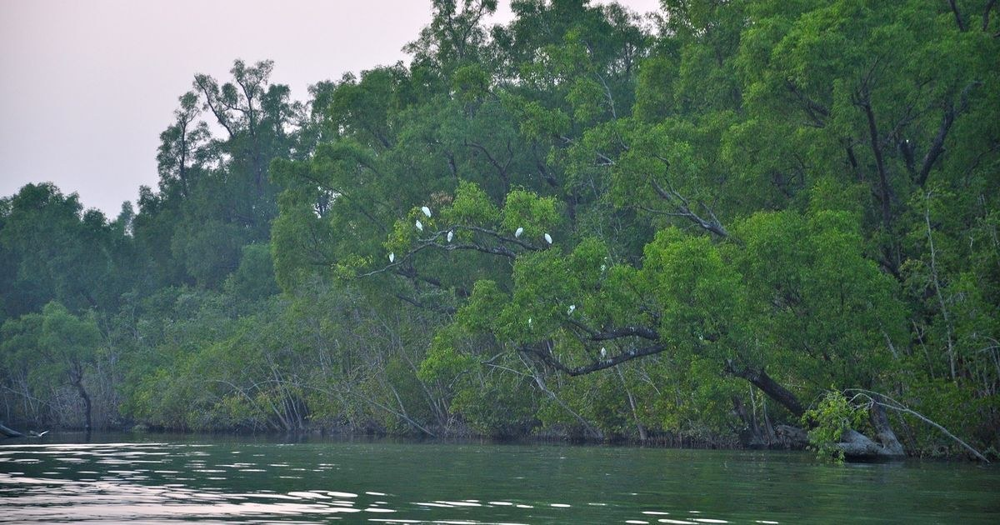

# Tourists could soon cover all of Sunderbans in one trip, cruising between India and Bangladesh

> **Source:** Google News — Sundarbans  
> **URL:** <https://scroll.in/article/827153/tourists-could-soon-cover-all-of-sunderbans-in-one-trip-cruising-between-india-and-bangladesh>  
> **Type:** news | **Language:** en  
> **Published:** Tue, 24 Jan 2017 08:00:00 GMT  
> **Destination:** mangrove  

---

Development And Environment
Tourists could soon cover all of Sunderbans in one trip, cruising between India and Bangladesh
A deal to allow cruise ships to pass between the neighbouring countries in the world’s largest mangrove forest could open the way for deeper cooperation.
Abu Bakar Siddique
Jan 24, 2017 · 08:30 pm
Share
Share on Facebook
Share on X
Share on LinkedIn
Share on BlueSky
Share on Threads
Share on Reddit
Copy Link
Email
Print
Add Scroll on Google
iOS App
Android App
Fabian Lambeck via Wikimedia Commons
The governments of Bangladesh and India are planning to sign an agreement to run cruise ships between the two countries. This will give tourists from both countries the opportunity to navigate the Sundarbans, the world’s largest mangrove forest, in a single trip.
The two countries have already signed a Memorandum of Understanding and the deal will be signed during the upcoming visit of Bangladeshi Premier Sheikh Hasina in Delhi in February, a Bangladeshi high official working in the Shipping Ministry told
thethirdpole.net
“Now we are discussing the Standard Operating Procedure, under which the cruise ships as well as the routes will be operated,” said Md Rafiqul Islam, additional secretary of the
Shipping Ministry, Bangladesh
.
Quoting from the MoU, he said the ships will take passengers to different points of the forest in Bangladesh and India, but the passengers will not be allowed to disembark from the ships during the entire tour. They have to enjoy the beauty of the forest and its flora and fauna from on board the ships, which will be operated by private companies from both countries.
Routes and destinations
The route of the entire tour, fixed from the Kolkata port in India to the Mongla port in Bangladesh, is already being used by cargo ships under the Protocol on Inland Water Transport and Trade. Bangladesh is keen to extend the route all the way to Saint Martin’s Island in Cox’s Bazar to make full use of the opportunities of water based tourism.
There are a number of details that have as yet to be negotiated before this initiative becomes a reality. “Several important matters including the port of calls in the countries as well as the number, type and frequency of the vessels are yet to be finalised,” the additional secretary said.
Water experts and environmentalists happy
Atuar Rahman, a professor of Water Resources and Management Department at Bangladesh University of Engineering and Technology, believes the initiative could precipitate deeper cooperation on water between the two countries. “Gradually, this type of cooperation will lead to running regular water vessels with passengers in both countries, which was very common in the region, once upon a time,” he said. “This will ultimately force the governments to cooperate with each other on ensuring the flow of the rivers in the region, for the sake of ensuring navigability.”
He did caution that measures to protect the forest from disturbances created by tourist vessels as well as the tourists had to be put in place. “Before signing the agreement, both the government should consider the possible threats for the forests like excessive sound pollution to avoid hurting biodiversity,” he said.
The forest and its inhabitants are already suffering from frequent shipping disasters from the transport of coal and oil along its rivers, including
the disastrous sinking of a coal laden ship in early January
.
The Sundarbans and tourism
The Sundarbans stretches for almost 10,000 square kilometres, with about 60% in Bangladesh and the rest in Indians territory. The mangrove forest is the unique habitat for a number of species including the Bengal tiger, the Gangetic and Irrawaddy dolphins, the Indian fishing cat, the Indian otter and spotted deer. It also harbours 334 species of trees, shrubs and plants and 269 species of wild animals.
The Sundarbans is very popular tourist destination for Bangladeshis, and in India, particularly for those from the Indian state of West Bengal. Nevertheless, since the forest is divided by a border between two countries, tourists can experience only part of its beauty in a single trip.
Existing protocols for navigation
Both the countries already have signed two agreements and protocols to run vessels inside the countries waterways and use coastal points for transporting goods. The
Protocol on Inland Water Transit and Trade
has been active since 1972. It permits the movement of goods by medium and large water vessels along eight specific routes between India and Bangladesh.
Protocol routes between India and Bangladesh [Source: Bangladesh Inland Water Transport Authority]
Bangladesh Inland Water Transport Authority
, with ships carrying goods such as fly ash, coal, steel coil and iron ore.
Another agreement, the
Costal Shipping Agreement
, was signed in 2015 during the official visit of Indian Prime Minister Narendra Modi to Dhaka. Under this agreement Indian and Bangladeshi ports would be able to support travel to and from India’s Northeastern states, helping Indian connectivity.
When the Bangladeshi Prime Minister visits Delhi an agreement allowing India to use Bangladesh’s two major ports Chittagong and Mongla might also be signed.
This article first appeared on
The Third Pole
.
We welcome your comments at
letters@scroll.in
.
Bangladesh
India
Sunderbans
Tourism
Get the app
ANDROID
iOS

---
*Crawled 2026-06-11 06:35 | Bhromon Travel Crawler*
