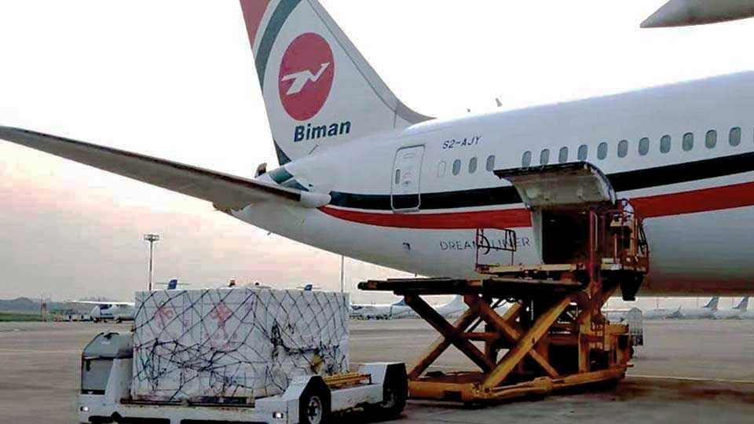

# Air cargo exports ease as Dhaka Airport upgrades screening, Sylhet adds EDS

> **Source:** Google News — Sylhet Tourism  
> **URL:** <https://www.bangladeshmonitor.com.bd/en/air-cargo-exports-ease-as-dhaka-airport-upgrades-screening-sylhet-adds-eds>  
> **Type:** news | **Language:** en  
> **Published:** Thu, 09 Oct 2025 07:00:00 GMT  
> **Destination:** Sylhet  

---

Air cargo exports ease as Dhaka Airport upgrades screening, Sylhet adds EDS
A Monitor Report
Published: October 09, 2025 | 12:00 AM
3 min read
Print
Dhaka: The government has enhanced air cargo operations by upgrading screening facilities at Hazrat Shahjalal International Airport (HSIA) in the capital and installing a new explosive detection system (EDS) at Sylhet’s Osmani International Airport, easing export bottlenecks following the suspension of India-bound transshipments in April.
According to latest reports, at HSIA, all four EDS machines have been repaired, while ground-handling charges for export cargo have been reduced by five to six cents per kilogram at both Dhaka and Sylhet airports. The move aims to strengthen screening efficiency and lower export logistics costs.
Reports cited freight forwarders saying that screening facilities at HSIA had improved significantly.
“Three of the four EDS machines at Dhaka airport are regularly in operation, and explosive detection dogs are deployed as well,” said a freight forwarder, according to reports. “Exporters are no longer facing major delays at either Dhaka or Sylhet.”
Before India suspended transshipment, exporters often routed goods by truck through Benapole to Kolkata or Delhi because of limited screening capacity in Dhaka and reduced air cargo space after several airlines cut flights. The situation began to ease after Sylhet airport installed its own EDS.
“The pressure on Dhaka airport has eased since the EDS was installed in Sylhet,” reports cited apparel exporters saying.
Air cargo rates have also stabilized. After the reduction in handling charges, airlines now charge about USD 2.80 per kilogram from Sylhet to Europe. During the peak export months of November and December, rates from Dhaka rise to between USD 3.80 and USD 4.00 per kilogram, according to Ahmed.
In comparison, shipments via India previously cost USD 2.10 – USD 2.20 per kilogram, plus an additional USD 0.15 – USD 0.20 for transport through Benapole.
Currently, an average of 450 tons of dry cargo is flown daily from Dhaka and Sylhet airports in the off-season, rising to nearly 1,200 tons during the peak period.
Reports also cited a European apparel buyer who sources garments from Bangladesh saying, air shipment facilities have “improved a lot thanks to alternative routes such as Sylhet airport,” praising the government’s swift installation of new scanning systems.
Civil Aviation Authority of Bangladesh has proposed reducing screening charges for Europe-bound cargo from eight cents to six cents, a 25 percent cut, said reports citing CAAB officials.
At HSIA, cargo flights are prioritized to support exports, added reports citing airport officials.
“In November and December, we’ll take extra measures to ensure smooth operations during the peak season,” further mentioned airport officials.
At Sylhet’s Osmani International Airport, three dry cargo consignments were handled in August, said airport officials, as per reports. The facility currently has a storage capacity of 100 tons and is prepared to expand if demand increases.
T
Tagged Under:
Spread the word
More from
Others
View All

---
*Crawled 2026-06-11 06:47 | Bhromon Travel Crawler*
