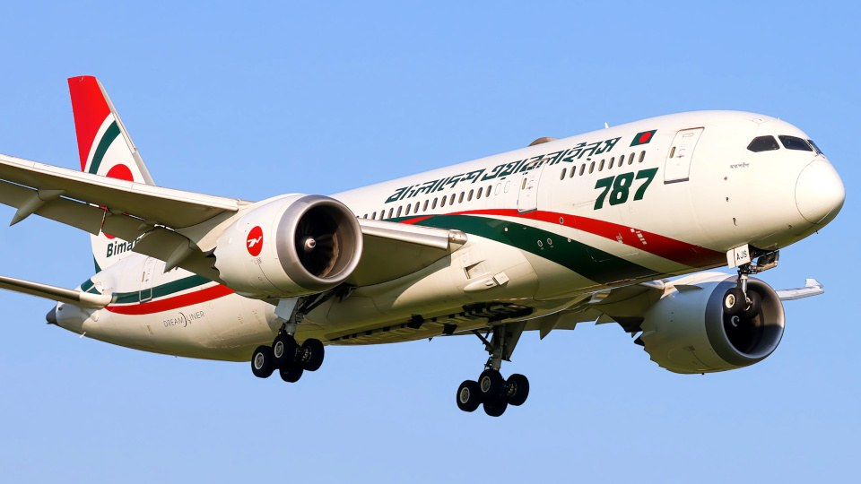

# Biman to resume Dhaka-Sylhet-Manchester route from July 1

> **Source:** Google News — Sylhet Tourism  
> **URL:** <https://www.bangladeshmonitor.com.bd/en/biman-to-resume-dhaka-sylhet-manchester-route-from-july-1>  
> **Type:** news | **Language:** en  
> **Published:** Wed, 11 Mar 2026 07:00:00 GMT  
> **Destination:** Sylhet  

---

Biman to resume Dhaka-Sylhet-Manchester route from July 1
A Monitor Report
Published: March 11, 2026 | 10:00 PM
1 min read
Print
Dhaka: Biman Bangladesh Airlines has taken steps to resume its suspended Dhaka-Sylhet-Manchester route from July 1, following the completion of this year’s Hajj operations.
In a press release issued on Wednesday, March 11, the airline said the decision was taken considering the demand of passengers and under the direction of the Ministry of Civil Aviation and Tourism.
The route will reconnect Dhaka and Sylhet with Manchester, which is home to a large Bangladeshi diaspora.
According to the statement, the initiative to relaunch the route was taken following instructions from the leadership of the Ministry of Civil Aviation and Tourism.
Biman said the flight schedule and other operational details will be announced in due course.
K
Tagged Under:
Spread the word
More from
Others
View All

---
*Crawled 2026-06-11 06:39 | Bhromon Travel Crawler*
