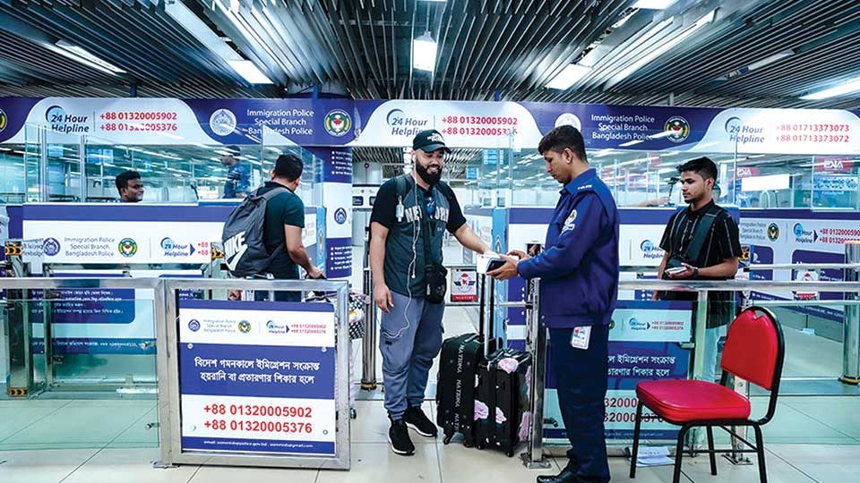

# Dhaka, Sylhet airports receive top UK ratings for aviation security

> **Source:** Google News — Sylhet Tourism  
> **URL:** <https://www.bangladeshmonitor.com.bd/en/dhaka-sylhet-airports-receive-top-uk-ratings-for-aviation-security>  
> **Type:** news | **Language:** en  
> **Published:** Thu, 16 Oct 2025 07:00:00 GMT  
> **Destination:** Sylhet  

---

Dhaka, Sylhet airports receive top UK ratings for aviation security
A Monitor Report
Published: October 16, 2025 | 12:00 AM
2 min read
Print
Dhaka : Bangladesh's aviation sector has earned rare international praise as both Hazrat Shahjalal Inter-national Airport (HSIA) in Dhaka and Osmani International Airport (OIA) in Sylhet achieved outstanding scores in a recent security audit by the United Kingdom's Department for Transport (DfT).
According to a press release issued by the Civil Aviation Authority of Bangladesh (CAAB), the DfT inspection, conducted in August, awarded HSIA an overall score of 93 percent and a perfect 100 percent for its cargo security measures. OIA performed even better in the overall category, securing 94 percent, along with 100 percent for cargo operations.
The DfT team commended CAAB for its strong preparation and operational efficiency, the statement added.
The DfT's overseas airport assessments ensure that international airports handling flights to the UK comply with stringent aviation security standards covering both passenger and cargo handling. The UK-Bangladesh inspection collaboration, in place since 2017, includes regular follow-ups to monitor adherence to these safety requirements.
CAAB described the latest results as a significant achievement, reflecting Bangladesh's steady progress toward aligning with global aviation security best practices.
The authority also recalled that in 2016, concerns about insufficient cargo screening had prompted the UK and the European Union to ban direct air cargo shipments from Dhaka. The restrictions forced exporters to reroute shipments for re-screening in third countries, causing delays and higher costs.
Since then, CAAB and airport operators have modernized infrastructure and security systems, introducing Explosive Detection Systems (EDS) and Explosive Detection Dogs (EDD), alongside extensive staff training and facility upgrades.
Tagged Under:
Spread the word
More from
Others
View All

---
*Crawled 2026-06-11 06:46 | Bhromon Travel Crawler*
