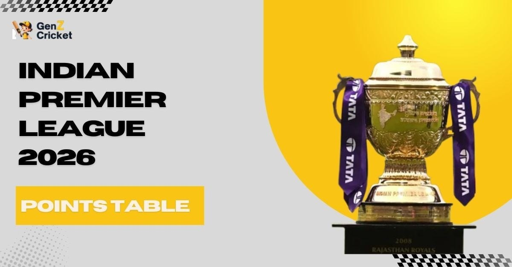

# Ireland Tour of Bangladesh 2025: Fixtures, Schedule & Updates

> **Source:** Google News — Sylhet Tourism  
> **URL:** <https://genzcricket.net/ireland-tour-of-bangladesh-2025/>  
> **Type:** news | **Language:** en  
> **Published:** Tue, 11 Nov 2025 08:00:00 GMT  
> **Destination:** Sylhet  

---

The Ireland cricket team will travel to Bangladesh for two Test matches and three T20Is starting from 11th November 2025. The tour will conclude on 2nd December after the completion of the 3rd T20I in Dhaka.
Apart from Dhaka, Sylhet and Chattogram will host matches during the tour, and Ireland will use this opportunity to gain more experience in subcontinent conditions. Bangladesh’s home advantage makes this contest a thrilling one for cricket fans around the globe.
This blog will cover the Ireland Tour of Bangladesh 2025, including fixtures, squads, and other essential details.
Ireland Tour of Bangladesh 2025 – Schedule
The tour will begin with the Test matches, which will be followed by a three-match T20I series.
Source:
cricketireland
Match
Date
Time(Local)
Venue
1st Test
11-15 November 2025
10:00 AM
Sylhet International Cricket Stadium, Sylhet
2nd Test
19-23 November 2025
10:00 AM
Shere Bangla National Stadium, Dhaka
1st T20I
27 November 2025
18:00 PM
Bir Sreshtho Flight Lieutenant Matiur Rahman Stadium, Chattogram
2nd T20I
29 November 2025
18:00 PM
Bir Sreshtho Flight Lieutenant Matiur Rahman Stadium, Chattogram
3rd T20I
02 December 2025
18:00 PM
Shere Bangla National Stadium, Dhaka
Ireland & Bangladesh – Squads
Ireland has announced their squads for both the Test matches and T20Is, whereas the home side is yet to announce there squad for the white-ball matches.
Here are the announced squads:
Ireland Squad (Test)
Andrew Balbirnie (c), Cade Carmichael, Harry Tector, Paul Stirling, Curtis Campher, Matthew Humphreys, Andy McBrine, Jordan Neill, Stephen Doheny(WK), Lorcan Tucker(WK), Gavin Hoey, Graham Hume, Barry McCarthy, Liam McCarthy, Craig Young
Bangladesh Squad (Test)
Najmul Hossain Shanto, Shadman Islam, Mahmudul Hasan Joy, Mominul Haque, Mehidy Hasan Miraz, Mushfiqur Rahim, Litton Das, Jaker Ali, Taijul Islam, Khaled Ahmed, Hasan Mahmud, Nahid Rana, Ebadot Hossain, Hasan Murad
Ireland Squad (T20Is)
Ross Adair, Benjamin Calitz, Harry Tector, Tim Tector, Paul Stirling(C), Gareth Delany, Curtis Campher, George Dockrell, Matthew Humphreys, Lorcan Tucker(WK), Mark Adair, Joshua Little, Barry McCarthy, Benjamin White, Craig Young
Both sides have added more spin options, as the conditions on Bangladeshi pitches mostly favor spinners and will give everyone an opportunity to shine.
The presence of experienced players like Andrew Balbirnie and Curtis Campher for the visitors, along with Mehidy Hasan Miraz and the return of Mahmudul Hasan Joy for the home side, makes this tour even more exciting and worth watching.
Ireland Tour of Bangladesh 2025 – Live Streaming
The Ireland Tour of Bangladesh 2025 will be available for live streaming in India on FanCode. Indian fans won’t have a regular TV broadcast.
Source:
FANCODE
They will need to subscribe through the FanCode app or website to see every ball of the action.
Related Read:
Teams Qualified for ICC T20 World Cup 2026
West Indies Tour of New Zealand
Conclusion: Ireland Cricket Team to Tour Bangladesh Starts 11th November 2025!
The Ireland Tour of Bangladesh 2025 promises to be an exciting contest, starting from 11th November with two Test matches followed by three T20Is. Fans can expect competitive cricket as both sides bring experienced players and promising talent to the field.
Bangladesh’s subcontinent conditions and spin-friendly pitches will test Ireland’s adaptability, while the home team will look to make full use of their advantage. With players like Andrew Balbirnie, Curtis Campher, Mehidy Hasan Miraz, and Mahmudul Hasan Joy, every match is set to be thrilling.
For fans in India, live streaming will be available on FanCode, allowing cricket lovers to follow every moment of the tour online and stay updated with scores, highlights, and match action.

---
*Crawled 2026-06-11 06:48 | Bhromon Travel Crawler*
