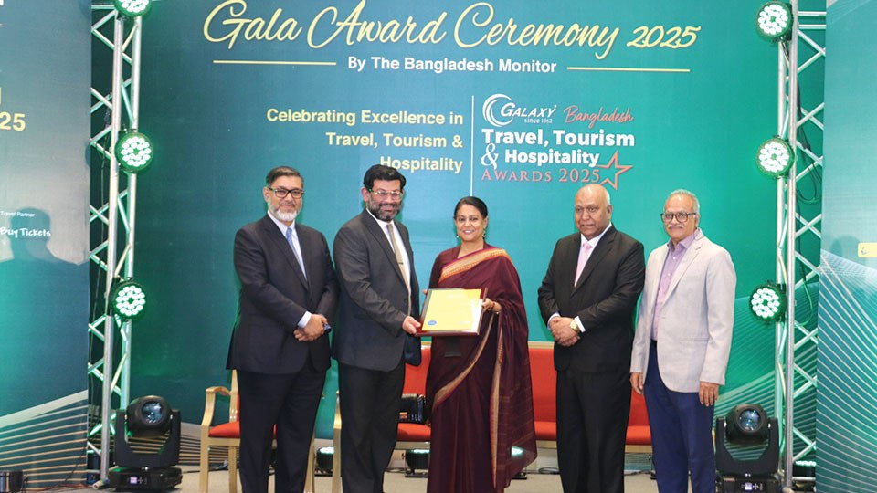

# Nasser Rahman honored as Leading Hotel Entrepreneur

> **Source:** Google News — Sylhet Tourism  
> **URL:** <https://bangladeshmonitor.com.bd/en/nasser-rahman-honored-as-leading-hotel-entrepreneur>  
> **Type:** news | **Language:** en  
> **Published:** Mon, 16 Feb 2026 08:00:00 GMT  
> **Destination:** Bangladesh travel  

---

Nasser Rahman honored as Leading Hotel Entrepreneur
A Monitor Report
Published: February 16, 2026 | 12:00 AM
2 min read
Print
Dhaka : Nasser Rahman, Founder, Chairman, and Managing Director of DuSai Resort and Spa, was honored as the Leading Hotel Entrepreneur of the year at the Bangladesh Travel, Tourism, and Hospitality Awards 2025 for redefining luxury resort hospitality in Bangladesh.
Nabil Rahman, Director, DuSai Hotel and Resorts received the award on behalf of Nasser Rahman from Syeda Rizwana Hasan, Adviser to the Interim Government on Environment, Forest and Climate Affairs; Ahmed Yusuf Walid, President and CEO of Galaxy Bangladesh Group; Kazi Wahidul Alam, Editor of The Bangladesh Monitor; and Syed Ghulam Qadir, Members of the Jury Board at InterContinental Dhaka.
Nasser Rahman is a visionary entrepreneur who has redefined luxury resort hospitality in Bangladesh through DuSai Resort and Spa. At a time when premium destination resorts were rare, he introduced an experience-driven model combining international service standards with local culture and natural beauty. Under his leadership, DuSai has become a benchmark for excellence, sustainability, and responsible tourism. His people-focused leadership, commitment to community engagement, and contribution to elevating Bangladesh's tourism image make him a deserving recipient of the award.
Tagged Under:
Spread the word
More from
Hospitality
View All

---
*Crawled 2026-06-11 06:45 | Bhromon Travel Crawler*
