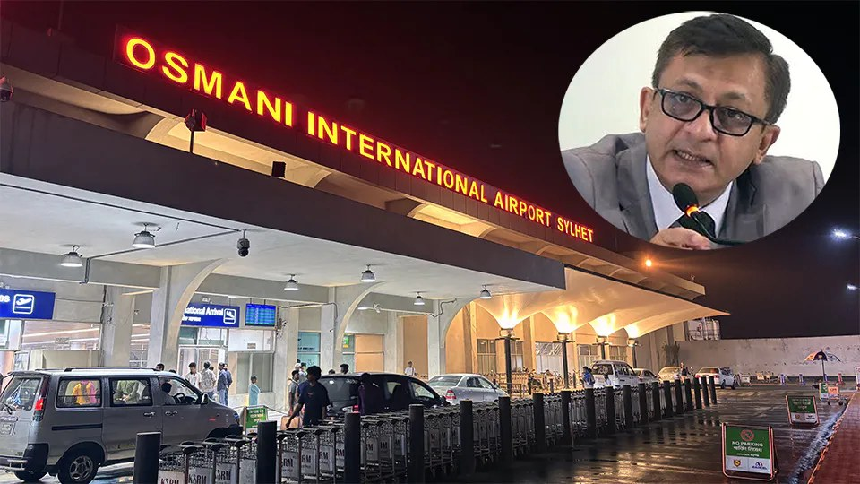

# Sylhet-Guwahati flights incoming: Commerce Minister

> **Source:** Google News — Sylhet Tourism  
> **URL:** <https://bangladeshmonitor.com.bd/en/sylhet-guwahati-flights-incoming-commerce-minister>  
> **Type:** news | **Language:** en  
> **Published:** Wed, 03 Jun 2026 07:00:00 GMT  
> **Destination:** Sylhet  

---

Sylhet-Guwahati flights incoming: Commerce Minister
A Monitor Desk Report
Updated: June 03, 2026 | 07:19 AM
1 min read
Print
Dhaka: Direct flights
between Bangladesh’s Sylhet and India’s Guwahati will be launched soon in a
move to transform Sylhet Osmani International Airport into a regional
connectivity hub.
Commerce Minister
Khandakar Abdul Muktadir said this on May 31 while addressing a discussion
organized by the Sylhet Metropolitan BNP at the Muslim Sahitya Sangsad in
Sylhet city, marking the death anniversary of former president Ziaur Rahman.
Muktadir said, the
government is working to strengthen the country's export sector through
improved air cargo services. He also said efforts are underway to address
challenges that emerged following a fire at Dhaka Airport’s storage facility.
Highlighting plans for
the modernization of Sylhet Osmani International Airport, the Minister said, efforts
are underway to enhance the airport's capacity and develop it into a regional
transport hub.
"As part of this
initiative, preparations are underway to introduce direct flights between
Sylhet and Guwahati," he mentioned.
Tagged Under:
Spread the word
More from
Airlines and Routes
View All

---
*Crawled 2026-06-11 06:46 | Bhromon Travel Crawler*
