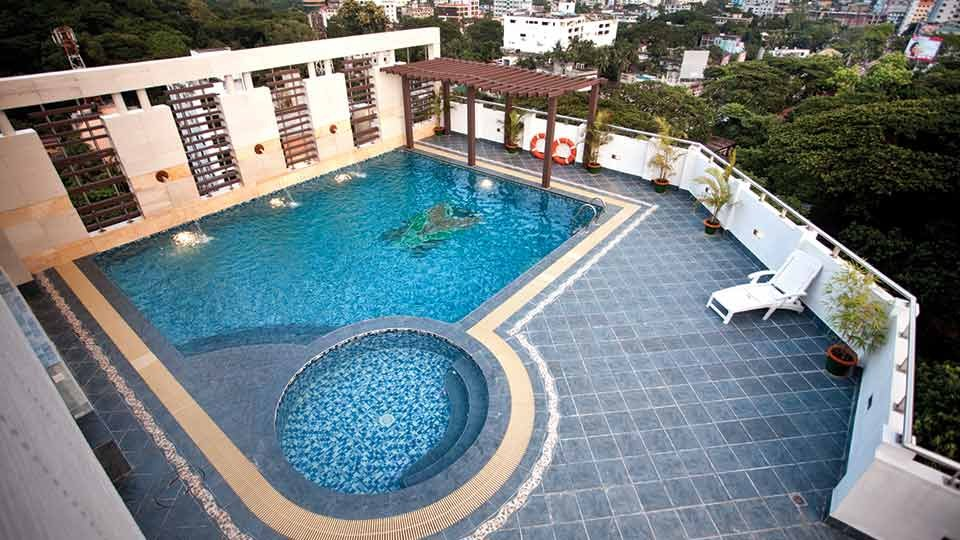

# Sylhet hospitality market booming : Hotel Star Pacific GM

> **Source:** Google News — Sylhet Tourism  
> **URL:** <https://bangladeshmonitor.com.bd/en/sylhet-hospitality-market-booming-hotel-star-pacific-gm>  
> **Type:** news | **Language:** en  
> **Published:** Wed, 01 Nov 2023 07:00:00 GMT  
> **Destination:** Sylhet  

---

Sylhet hospitality market booming : Hotel Star Pacific GM
A Monitor Report
Published: November 01, 2023 | 12:00 AM
2 min read
Print
Dhaka : The hospitality market in country's one of the most popular tourist destination Sylhet is witnessing an immense boom in the post-pandemic times. With many new hotels opening one after another while many others are in the pipeline, the number of arrivals to Sylhet as well as the occupancy rate of the hotels are increasing year-on-year and have already reached pre-pandemic levels.
Hassan-Ul Abedin, General Manager, Hotel Star Pacific, said this while talking to The Bangladesh Monitor at his office in Sylhet.
Established in 2013, 10-storied Hotel Star Pacific features 83 rooms in five categories. Furthermore, the hotel is offering 45 per cent discount on deluxe rooms. Meaning, at BDT 5200 all inclusive, guests can avail stay at Deluxe Room and enjoy complimentary services like buffet breakfast, gym and swimming pool, among others.
Compared to rooms, the hotel earns more revenue from F&B as it has one of the best pillarless banquet venue in Sylhet with a capacity of 500-800 people, claimed the Genera Manager.
Hassan-Ul Abedin, General Manager, Hotel Star Pacific
On the other hand, the hotel's swimming pool is located on the rooftop offering guests eye-catching views. During winter, the hotel organises BBQ festival and candle light dinners on the rooftop beside the swimming pool as well, which is now a popular trend across the country.
The hotel also features a 24/7 multicuisine restaurant that offers buffet dinner featuring 80+ items on weekends at BDT 1500 all inclusive.
Another popular feature of the hotel is the full-board and sightseeing packages it offers to guests that includes staycation, transportation to sites and snacks.
It may be mentioned here that, the parent company of the Hotel Star Pacific is opening another hotel on the Sylhet Airport Road named Hotel Crown Pacific with 177 rooms and 1500 banquet capacity, by 2024.
Tagged Under:
Spread the word
More from
Hospitality
View All

---
*Crawled 2026-06-11 06:47 | Bhromon Travel Crawler*
