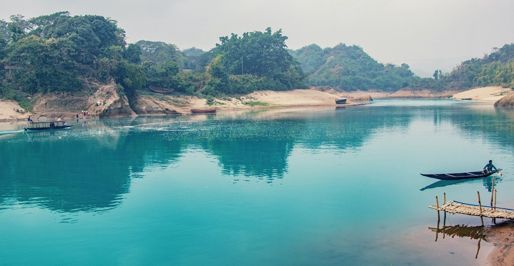

# Top 5 places to visit in Sreemangal for a memorable winter

> **Source:** Google News — Sylhet Tourism  
> **URL:** <https://www.thedailystar.net/life-living/travel/news/top-5-places-visit-sreemangal-memorable-winter-3171086>  
> **Type:** news | **Language:** en  
> **Published:** Wed, 16 Nov 2022 08:00:00 GMT  
> **Destination:** Sreemangal  

---

Editor's Pick
How the FY2026-27 budget can bridge Bangladesh's climate finance gap
9 June 2026, 08:00 AM
Views
The unanswered questions of the Ganges Barrage
9 June 2026, 09:02 AM
Big Picture
How should Bangladesh's economy grow in the second half of 2020s?
8 June 2026, 11:00 AM
Views
True sustainability for ports means going beyond green
8 June 2026, 08:00 AM
Opinion
How should we read Bangladesh’s UNGA presidency against global and domestic realities?
7 June 2026, 09:00 AM
Views
Top 5 places to visit in Sreemangal for a memorable winter
16 November 2022, 12:45 PM
TRAVEL
SHARE
A
Ayman Anika
Ayman Anika
Photo: Asef Hossain Khan
Although Sreemangal, often spelled Srimangal, is famous for the countless hillocks full of evergreen tea gardens, it is equally endowed with many charming and breath-taking tourist spots. If you are planning to spend your upcoming winter vacation in the solitude and beauty of nature—while being surrounded by lots of vast green countryside—then take a trip to Sreemangal and be in communion with nature while enjoying stunningly designed resorts.
To make your visit more pleasant and fulfilling, we bring you the top 5 places to visit in Sreemangal!
For all latest news, follow The Daily Star's Google News channel.
Read more
6 places in Bangladesh to visit in winter
Madhabkunda Waterfall
Surrounded by big boulders, lush greenery, and small streams the Madhabkunda Waterfall attracts plenty of tourists throughout the entire year. One may have to tread lightly on its slippery slopes, as it is said that the massive gallons of water pouring down from approximately 200 feet can seriously hurt a person. Regardless of its massiveness and the warnings that revolve around it, the serene water and exquisite view of Madhabkunda Waterfall can rejuvenate every weary soul.
You can visit Madhabkunda waterfall by bus, train, or by hiring any private transportation and it is about 80 kilometres away from Sylhet town.
Read more
Top 5 places to visit in Bogura
Baikka Beel
Known as a sanctuary for birds, fish, and plants, Baikka Beel is a part of the famous Hail Haor. Stunningly beautiful Baikka Beel is a shallow lake that comprises open water with growing vegetation and a native swamp forest. It is positioned halfway between Sreemangal and Moulvibazar, and be sure to know that as soon as you enter the site of the beel, you will be mesmerised by the chirping of birds. As fishing is banned in Baikka Beel, the abundant fish population attracts winter birds to flock here every year.
During the winter season, thousands of migratory birds gather here. So, it is a very popular tourist destination—especially for nature lovers, birdwatchers, and scientists. Baikka Beel is merely over a 3-hour drive from Dhaka and here, boating is allowed at certain times of the year.
Read more
Top 5 lakes to visit in Bangladesh
Madhabpur Lake
Nestled inside the Madhabpur tea estate under Kamalganj Upazila, the scenic Madhabpur Lake is filled with different types of plants and water lilies and offers us the stunning sights of diverse numbers of birds. Madhabpur Lake exhibits different disguises in different seasons and one may find this incredibly large lake resembling a mythical lagoon from a fairy tale.
Winter season brings out the enchanting beauty of Madhabpur Lake most palpably and during this particular season, the great white-bellied herons can be spotted here. You can enjoy the marvellous view of this dreamy lake by crossing the distance of sixteen kilometres from Sreemangal.
Read more
Mesmerising islands to visit in Bangladesh
Lawachara National Park
Lawachara National Park remains abuzz with people all year round and tourists from all over the country pour into the Lawachara Forest to get a glimpse of rare species of birds, monkeys, and deer that are found in this habitat. Hiking and trekking can be greatly enjoyed here but it is better if you take a local guide with you.
Photo: Asef Hossain Khan
Winter places a dewy vail upon this enchanting rain forest. A solitary walk along the muddy path of Lawachara Forest will bless you with peace and tranquillity and you will have the opportunity to view the hubbub of birds and animals from a much closer distance. Lawachara National Park is situated around 30 kilometres away from Moulvibazar and you can go there by bus or train.
Eco resorts
Lately, eco-resorts have gained immense popularity among tourists and environmentalists, and Sreemangal has become home to some of the most beautifully built and luxurious eco-resorts we have in Bangladesh.
"Eco resorts are environment friendly and as Sreemangal is filled with greenery and lush tea gardens, these resorts easily complement its natural beauty. Additionally, with the development of the tourism sector in Sreemangal, we're equally endeavouring to ensure environmental sustainability—and so, eco-resorts are drawing much attention," said Nasrin Binta Hamid, head of booking and event management of a travel group named Shopnoghuri.
According to Nasrin, Tilagaon Eco Village and Balishira Resort are worth visiting. You can explore other pleasing and luxury resorts such as the DuSai Resort & Spa and the Novem Eco Resort.
TOURISM
TRAVEL
TRAVEL IN BANGLADESH
TOURISM ATTRACTIONS TO FOREIGNERS
TOURISM BANGLADESH
TOURISM IN BANGLADESH
SREEMANGAL
SREEMANGAL RESORT OF MOULVIBAZAR
SREEMANGAL'S BAIKKA BEEL
SREEMANGAL ZOO
ECO TOURISM DESTINATIONS
MADHABPUR
LAWACHARA NATIONAL PARK
TOP 5 PLACES IN BANGLADESH
TOURIST PLACES IN BANGLADESH
TRAVEL IN SREEMANGAL
SHARE
Click to comment
Comments
Comments Policy
Related News
How To watch every FIFA World Cup 2026 match in Bangladesh
10 June 2026, 17:13 PM
Lifehacks
Dissecting the World Cup ball: Everything you need to know
10 June 2026, 17:13 PM
Life & Living
#Perspective
/ Why even non-football fans end up caring about the FIFA World Cup
10 June 2026, 17:04 PM
Life & Living
#Perspective
/ How popular culture taught me to love
9 June 2026, 07:13 AM
Life & Living
#Arts & Crafts
/ Shakil Mridha shows why folk art defines Bangladesh’s identity
9 June 2026, 07:07 AM
Life & Living

---
*Crawled 2026-06-11 06:47 | Bhromon Travel Crawler*
