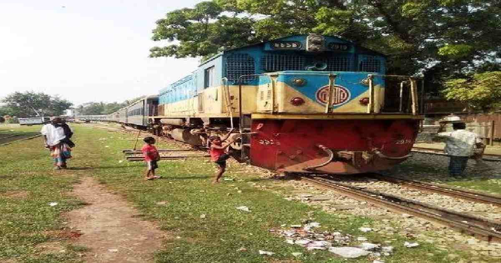

# United News of Bangladesh

> **Source:** Google News — Sylhet Tourism  
> **URL:** <https://www.unb.com.bd/category/special/long-cherished-chandpur-sylhet-intercity-train-still-a-dream/83373>  
> **Type:** news | **Language:** en  
> **Published:** Thu, 02 Dec 2021 08:00:00 GMT  
> **Destination:** Sylhet  

---

Home
Special
Home
Special
Long-cherished Chandpur-Sylhet intercity train still a dream
December 02, 2021, 08:19 AM
by
Delwar Ahmed
UNB News
Publish-
December 02, 2021, 08:19 AM
Delwar Ahmed
Update-
December 14, 2021, 10:45 AM
Inter-city train
An
inter-city train service
between
Chandpur
and
Sylhet
has long been a demand for the people of the country’s south and south-western region.
Thousands of people from the region travel through Chandpur to visit the holy shrines of Hazrat Shah Jalal and Shar Paran every day. There are also students who study in medical college and university in Sylhet. A large number of tourists also visit the north-eastern district to enjoy its natural beauty.
Day in and day out they suffer as road journey is hazardous and time-consuming.
Read
World's tallest railway bridge pier being built in Manipur as part of Jiribam-Imphal project
According to Railway officials, back in 2000 a Laksam-bound commuter train from Chandpur had several coaches attached to it for Sylhet-bound passengers. At Laksham junction, the coaches would join Jalalabad Express train. Passengers could travel to Sylhet in relative comfort and at affordable cost without much hassle.
That stopped on September 20, 2000 after Meghna River swallowed a great part of the Chandpur Boro railway station.
Though the station was later restored the railway authorities did not resume the train service to Sylhet via Laksham.
Also read: India moves to patent the over century-old logos of Darjeeling’s ‘Toy Train’
Students studying in MAG Osmani Medical College and Sylhet University, traders, devotees and tourists endure many difficulties every time they travel to Sylhet.
Even tickets to Sylhet are not issued from Chandpur rail station, said several TTEs, including station master Shoaibul Sikder.
Train
He said that launching an intercity train is very necessary for the smooth travelling between Chandpur and Sylhet. It is a burning demand now because the number of Sylhet going passengers has increased unlike ever before.
During the tenure of this government, many infrastructural developments of Chandpur-Laksam railway route and stations have been made and are still being done.
People of Barisal and Barguna also raised their demands as most passengers from there and nearby districts have to travel to Sylhet via Chandpur, where they arrive by launch.
Read
B’baria rail station resumes full-scale operation after 8 months
Chandpur railway station is just 15 minutes walking distance from Chandpur dock. The station has plenty of lights at night and no safety issues.
On the contrary, Chandpur bus terminal is three miles away. Besides bus schedules, fares, passenger waiting rooms, washrooms, and safety are in poor shape.
According to Chandpur transport owners, nine buses run daily from Chandpur to Sylhet city. The bus fare to Sylhet on non-AC bus is Tk 550 and on AC bus Tk 650.
Read
Rail operation on Padma Bridge may start from Dec 2022: Minister
But the train fare from Chandpur to Sylhet would be between Tk 250 to Tk 300, said the railway officials. Travelling by train is affordable and takes less time.
Officials claimed that it would be very profitable to launch Chandpur-Sylhet intercity train service. It would open up new horizons in business and trade, they said.
Subscribe UNB YouTube Channel
Bangladesh Railway
inter-city train service
Chandpur-Sylhet intercity train

---
*Crawled 2026-06-11 06:47 | Bhromon Travel Crawler*
