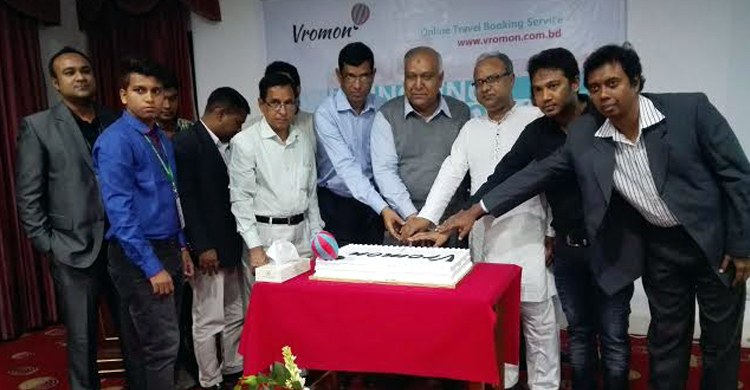

# ভ্রমণ ডটকম ডটবিডির যাত্রা শুরু

> **Source:** Google News — কক্সবাজার ভ্রমণ  
> **URL:** <https://www.jagonews24.com/technology/news/68906>  
> **Type:** news | **Language:** bn  
> **Published:** Sat, 12 Dec 2015 08:00:00 GMT  
> **Destination:** ভ্রমণপিপাসু  

---

তথ্যপ্রযুক্তি
ভ্রমণ ডটকম ডটবিডির যাত্রা শুরু
প্রকাশিত: ০৫:৫৫ পিএম, ১২ ডিসেম্বর ২০১৫
X (Twitter)
X
ভ্রমণপিপাসুদের জন্য অনলাইনে ভ্রমণের সার্বিক আয়োজন নিয়ে যাত্রা শুরু করছে ভ্রমণ ডটকম ডটবিডি। এখন থেকে এ উদ্যোগের সহায়তায় বিশ্বের যেকোনো স্থানে ভ্রমণের জন্য হোটেল বুকিং করা, টিকিট কাটা, ট্যুর প্যাকেজ নির্বাচন সবকিছুই ঘরে বসে করা যাবে। ভ্রমণের আগেই এ সংক্রান্ত সব কাজ সহজে করার সুবিধা দিতেই এমন উদ্যোগ বলে জানিয়েছেন উদ্যোক্তারা।
শনিবার রাজধানীর একটি হোটেল আনুষ্ঠানিকভাবে ভ্রমণ প্রতিষ্ঠানটির যাত্রা শুরু হয়। অনুষ্ঠানে উপস্থিত ছিলেন দ্য বাংলাদেশ মনিটরের সম্পাদক কাজী ওয়াহিদুল আলম, ন্যাশনাল হোটেল অ্যান্ড ট্যুরিজম ট্রেনিং ইনস্টিটিউটের সাবেক অধ্যক্ষ এবিএম আশরাফুল হক, ট্যুর অপারেটরস অ্যাসোসিয়েশন অব বাংলাদেশের (টোয়াব) পরিচালক মো. শাহাদাত ফিরোজ সিকদার এবং ভ্রমণ সাহিত্যের খ্যাতিমান লেখক শাকুর মজিদ।
অনুষ্ঠানে ভ্রমণ ডটকম ডটবিডির সহ-প্রতিষ্ঠাতা ও প্রধান নির্বাহী জুবায়ের বিন আমিন বলেন, বাংলাদেশের মানুষ বেড়াতে অনেক ভালোবাসে। কিন্তু ভ্রমণ করতে তাদের নানা ঝক্কি-ঝামেলা পোহাতে হয়। অনলাইন ট্রাভেল বুকিং সার্ভিস ভ্রমণ ডটকম ডটবিডির মাধ্যমে এ দেশের পর্যটকদের দেশে ও দেশের বাইরে স্বাচ্ছন্দ্য ও আনন্দময় ভ্রমণ অভিজ্ঞতা দেয়াই আমাদের লক্ষ্য।
অনুষ্ঠানে জানানো হয়, শুধু নির্দিষ্ট বুকিং বা টিকিট কাটার মধ্যেই সীমাবদ্ধ নয় ভ্রমণ ডটকম ডটবিডি। ভ্রমণে গেলে কোথায় ঘুরবেন, কোথায় খাবেন এ সম্পর্কিত তথ্যও ওয়েবসাইটে রয়েছে। এ সেবা নিয়ে যারা ভ্রমণে যাবেন তাদের সেরা রিভিউ এবং ভ্রমণের অভিজ্ঞতাও থাকবে ওয়েবসাইটটিতে।
ভ্রমণ ডটকম ডটবিডির সহ-প্রতিষ্ঠাতা ও পরিচালক মামুন জামান বলেন, দেশের মধ্যে কক্সবাজার, চট্টগ্রাম, সেন্টমার্টিন, কুয়াকাটা, সিলেট, সুন্দরবন, বান্দরবান, রাঙ্গামাটি, খাগড়াছড়ি, গাজীপুর, ঢাকাসহ বাংলাদেশের জনপ্রিয় যেকোনো স্থানে যেতে চাইলে সব ধরনের সহায়তা পাওয়া যাবে।
উদ্যোক্তারা জানান, এই মুহূর্তে ২৫০ এর অধিক হোটেল ও রিসোর্টের তথ্য নিয়ে ভ্রমণ ডটকম ডটবিডি বাংলাদেশের সবচেয়ে বড় অনলাইন হোটেল বুকিং সার্ভিস। প্রতিরাত সর্বনিম্ন ৫০০ টাকা থেকে আরম্ভ করে ৫০ হাজার টাকার মধ্যে বিভিন্ন মানের রুম রয়েছে হোটেলগুলোতে। প্রতিটি হোটেল যথাযথভাবে পরীক্ষণ করে সাইটে যুক্ত করা হয়েছে যাতে গ্রাহকরা আমরা সর্বোচ্চ সেবা নিতে পারেন। সাইটে রয়েছে তাৎক্ষণিক বুকিং ব্যবস্থা, শতভাগ নিরাপদ অনলাইন পেমেন্ট সিস্টেম এবং ভ্রমণকারীদের লেখা সেরা সব রিভিউ। এর সঙ্গে সাইটে খুব দ্রুতই যুক্ত করা হবে টিকেটিং সুবিধা। এর মাধ্যমে ভ্রমণকারীরা রেন্ট-এ-কার, বিমান, বাস, লঞ্চ, ট্রেনের টিকিট সরাসরি ভ্রমণ ডটকম ডটবিডি থেকে কিনতে পারবেন।
দেশের মধ্যে সুন্দরবন, সিলেট, পার্বত্য চট্টগ্রামসহ অন্যান্য পর্যটন স্থানে এবং দেশের বাইরে ভারত, নেপাল, ভুটান, মালদ্বীপ, থাইল্যান্ড, মালয়েশিয়া, সিঙ্গাপুর, শ্রীলঙ্কা, ভিয়েতনাম, কম্বোডিয়া, ইন্দোনেশিয়া, ফিলিপাইন, চীন, মিশর, তুরস্ক, ফ্রান্স, সুইজারল্যান্ড, মরিশাস, আন্দামান, কাশ্মীর, ইউরোপ এবং আমেরিকার ৩০০ এর অধিক ট্যুর প্যাকেজ রয়েছে সাইটটিতে। এতে করা যাবে বিভিন্ন ট্যুর প্যাকেজের তুলনা। পছন্দ অনুযায়ী বিভিন্ন দাম বা সুবিধার ভিন্নতাও থাকছে সাইটটিতে যাতে করে যে কেউ নিজের পছন্দসই ট্যুর প্যাকেজ বাছাই করতে পারেন।
ভ্রমণ লিমিটেডের এমডি জিয়াউল ইসলাম বলেন, ভ্রমণপিয়াসু যে কেউ কোথাও যাওয়ার পূর্বেই যাতে থাকার জায়গা, যোগাযোগ ব্যবস্থা, খাবার, আকর্ষণীয় জায়গার বর্ণনা, কার্যক্রম ইত্যাদি বিষয়গুলো সম্পর্কেই বিস্তারিত জেনে পরিকল্পনা করেই যেতে পারেন পছন্দসই জায়গায়। ভ্রমণ-এর ওয়েবসাইটের লিংক-
www.vromon.com.bd
আরএম/বিএ
ভ্রমণ
ডটকম
পাঠকপ্রিয় অনলাইন নিউজ পোর্টাল জাগোনিউজ২৪.কমে লিখতে পারেন আপনিও। লেখার বিষয় ফিচার, ভ্রমণ, লাইফস্টাইল, ক্যারিয়ার, তথ্যপ্রযুক্তি, ধর্ম, কৃষি ও প্রকৃতি। আজই আপনার লেখাটি পাঠিয়ে দিন
[email protected]
ঠিকানায়।

---
*Crawled 2026-06-11 07:18 | Bhromon Travel Crawler*
