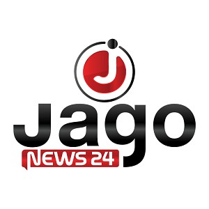

# ট্যুর অপারেটর সেবায় ভ্যাট আরোপ পর্যটন শিল্প বিকাশের অন্তরায়

> **Source:** Google News — বাংলাদেশ ভ্রমণ  
> **URL:** <https://www.jagonews24.com/travel/news/952038>  
> **Type:** news | **Language:** bn  
> **Published:** Sat, 29 Jun 2024 07:00:00 GMT  
> **Destination:** পর্যটন  

---

ভ্রমণ
ট্যুর অপারেটর সেবায় ভ্যাট আরোপ পর্যটন শিল্প বিকাশের অন্তরায়
নিজস্ব প্রতিবেদক
নিজস্ব প্রতিবেদক
প্রকাশিত: ০৪:৪৭ পিএম, ২৯ জুন ২০২৪
X (Twitter)
X
ট্যুর অপারেটরস অ্যাসোসিয়েশনের গোলটেবিল আলোচনা
২০২৪-২৫ অর্থবছরের বাজেটে পর্যটন খাতে ট্যুর অপারেটরদের সেবায় নতুন করে ভ্যাট বসানোর প্রস্তাব করা হয়েছে। যা পর্যটন শিল্প বিকাশের অন্তরায়। কেননা এতে ভ্রমণ-ব্যয় বেড়ে যাবে এবং বিকাশমান পর্যটনখাত ক্ষতিগ্রস্ত হবে।
শনিবার (২৯ জুন) রাজধানীর মহাখালীতে হোটেল অবকাশের কনফারেন্স হলে ট্যুর অপারেটরস অ্যাসোসিয়েশন অব বাংলাদেশের (টোয়াব) উদ্যোগে এক গোলটেবিল আলোচনায় এসব কথা বলেন বক্তারা।
গোলটেবিল আলোচনায় সভাপতিত্ব করেন টোয়াবের প্রেসিডেন্ট মো. রাফেউজ্জামান। তিনি বলেন, পর্যটন শিল্প সরাসরি দেশের জিডিপিতে অবদান রাখছে, বহির্বিশ্বে বাংলাদেশের ব্র্যান্ডিং করছে এবং স্থানীয় আর্থ-সামাজিক উন্নয়নে প্রভাব ফেলছে। পর্যটন খাতে ভ্যাট আরোপ করা হলে আমাদের প্যাকেজের খরচ বেড়ে যাবে। এতে দেশীয় বা অভ্যন্তরীণ পর্যটক চলে যাবেন প্রতিবেশী দেশগুলোতে আর বিদেশি পর্যটকরা আগ্রহ হারাবেন বাংলাদেশ ভ্রমণে। সবচেয়ে আশঙ্কার বিষয় দেশে পর্যটন খাতে বড় বড় যেসব বিনিয়োগ হচ্ছে তা বন্ধ হবার উপক্রম হবে, যার প্রভাব পড়বে অর্থনীতিতে। পর্যটন খাত মাত্র কিছুদিন আগেই করোনা মহামারির ক্ষতি কাটিয়ে উঠতে শুরু করেছে। এই সিদ্ধান্তের ফলে পর্যটন শিল্প ব্যাপকভাবে ক্ষতিগ্রস্ত হবে। পর্যটন শিল্পের স্বার্থে ট্যুর অপারেটরদের সেবার ওপর ভ্যাট আরোপের প্রস্তাব রহিত করার দাবি জানান তিনি।
আরও পড়ুন
সম্ভাবনা সত্ত্বেও ব্র্যান্ডিংয়ের অভাবে পর্যটন শিল্প পিছিয়ে
গোলটেবিল আলোচনায় বাংলাদেশ পর্যটন করপোরেশনের সাবেক চেয়ারম্যান আখতারুজ জামান খান কবির, বাংলাদেশ ট্যুরিজম বোর্ডের সাবেক সিইও জাবেদ আহমেদ, বিডি ইনবাউন্ডের ফাউন্ডার প্রেসিডেন্ট রেজাউল ইকরাম, ট্যুরিজম ডেভেলপার্স অ্যাসোসিয়েশন অব বাংলাদেশের (টিডাব) চেয়ারম্যান আসলাম খান, অ্যাসোসিয়েশন অব ট্রাভেল এজেন্ট অব বাংলাদেশের (আটাব) জেনারেল সেক্রেটারি আফসিয়া জান্নাত সালেহ, এ্যাভিয়েশন ও ট্যুরিজম জার্নালিস্ট ফোরামের (এটিজেএফবি) প্রেসিডেন্ট তানজিম আনোয়ার ও সাবেক সভাপতি নাদিরা কিরণ, টোয়াবের সদ্য বিদায়ী প্রেসিডেন্ট শিবলুল আজম কোরেশী প্রমুখ বক্তব্য রাখেন।
এমএমএ/এমআইটি/এমএস
পর্যটন-শিল্প
ভ্রমণ
পর্যটন-কেন্দ্র
পর্যটক
বাজেট
পাঠকপ্রিয় অনলাইন নিউজ পোর্টাল জাগোনিউজ২৪.কমে লিখতে পারেন আপনিও। লেখার বিষয় ফিচার, ভ্রমণ, লাইফস্টাইল, ক্যারিয়ার, তথ্যপ্রযুক্তি, ধর্ম, কৃষি ও প্রকৃতি। আজই আপনার লেখাটি পাঠিয়ে দিন
[email protected]
ঠিকানায়।

---
*Crawled 2026-06-11 07:08 | Bhromon Travel Crawler*
