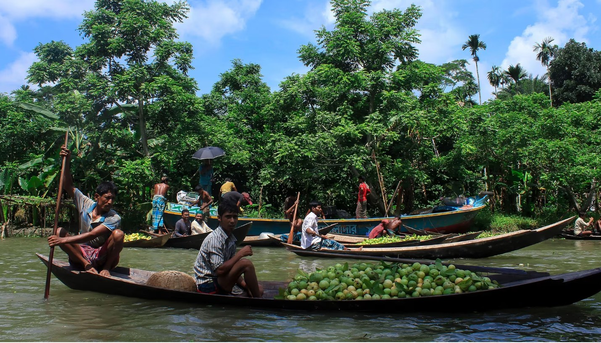

# বাঘ, চা বাগান আর সমুদ্র সৈকত আছে — তাপরও পর্যটনে বাংলাদেশ কেন পিছিয়ে?

> **Source:** Google News — বাংলাদেশ ভ্রমণ  
> **URL:** <https://dailysangram.com/lifestyle/CM7dM5Rrwmim/>  
> **Type:** news | **Language:** bn  
> **Published:** Wed, 25 Mar 2026 07:00:00 GMT  
> **Destination:** পর্যটন  

---

জীবনযাপন
বাঘ, চা বাগান আর সমুদ্র সৈকত আছে — তাপরও পর্যটনে বাংলাদেশ কেন পিছিয়ে?
এখানে রয়েছে সুবিশাল ম্যানগ্রোভ বন, চা বাগানে ঢাকা পাহাড় এবং রেকর্ড সৃষ্টিকারী সমুদ্র সৈকত, কিন্তু অধিকাংশ পর্যটকের কাছে বাংলাদেশ এখনও মানচিত্রের একটি ফাঁকা জায়গা।
অনলাইন ডেস্ক
প্রকাশ : বুধবার, ২৫ মার্চ ২০২৬, ১৭:৪০
আপডেট : বুধবার, ২৫ মার্চ ২০২৬, ১৮:০২
গঙ্গা নদীর ব-দ্বীপে অবস্থিত নদী তীরবর্তী শহর বরিশাল বাংলাদেশের বহু অনাবিষ্কৃত আকর্ষণের মধ্যে অন্যতম। মুহাম্মদ আমদাদ হোসেন/অ্যামেজিং এরিয়াল/অ্যালমি স্টক ফটো
গঙ্গা নদীর ব-দ্বীপের তীরবর্তী শহর বরিশাল বাংলাদেশের বহু অনাবিষ্কৃত আকর্ষণের মধ্যে অন্যতম।
এখানে রয়েছে সুবিশাল ম্যানগ্রোভ বন, চা বাগানে ঢাকা পাহাড় এবং রেকর্ড সৃষ্টিকারী সমুদ্র সৈকত, কিন্তু অধিকাংশ পর্যটকের কাছে বাংলাদেশ এখনও মানচিত্রের একটি ফাঁকা জায়গা।
বাংলাদেশ পর্যটন বোর্ডের তথ্য অনুযায়ী, ২০২৪ সালে এই দক্ষিণ এশীয় দেশটিতে মাত্র সাড়ে ছয় লাখ আন্তর্জাতিক পর্যটক এসেছিলেন — যা ভারত ও শ্রীলঙ্কার মতো প্রতিবেশী দেশগুলোর পর্যটক সংখ্যার তুলনায় নগণ্য।
১৭ কোটিরও বেশি জনসংখ্যার একটি দেশ হিসেবে এর প্রাকৃতিক সম্পদ এবং শহুরে আকর্ষণ থাকা সত্ত্বেও, বাংলাদেশ এখন পর্যন্ত একটি মূলধারার ভ্রমণ গন্তব্য হিসেবে উঠে আসতে সংগ্রাম করে আসছে।
২০১৭ সাল থেকে বাংলাদেশে কর্মরত একটি ট্যুর কোম্পানি ‘নেটিভ আই ট্র্যাভেল’-এর পরিচালক জিম ও’ব্রায়েন বলেন, “আমার মনে হয়, দেশটির সাথে প্রাকৃতিক দুর্যোগের একটি অবচেতন সংযোগ রয়েছে। আমরা সবসময় ভুল কারণেই দেশটির কথা শুনি।”
স্থানীয় ট্যুর অপারেটররা বলেন, এই ধারণাগুলো দেশটির বৈচিত্র্য এবং ভ্রমণকারীরা যে অভিজ্ঞতাগুলো ক্রমবর্ধমানভাবে খোঁজেন, উভয়কেই আড়াল করে রাখে।
‘বেঙ্গল এক্সপিডিশন ট্যুরস’-এর প্রতিষ্ঠাতা ফাহাদ আহমেদ চান পর্যটকরা ঢাকা ঘুরে দেখুক, যেখানে বিশ্বের অন্যতম ঘনবসতিপূর্ণ এই শহরে ২ কোটি ৪০ লক্ষ মানুষ বাস করে ও কাজ করে।
তিনি আরও উল্লেখ করেন শ্রীমঙ্গলের ঢেউ খেলানো পাহাড়গুলোর কথা, যেখানে চা বাগান উত্তর দিকে হিমালয়ের দিকে বিস্তৃত, এবং কক্সবাজারের কথা, যার ৭৫ মাইল দীর্ঘ সাদা বালুকে প্রায়শই বিশ্বের দীর্ঘতম প্রাকৃতিক সমুদ্র সৈকত হিসেবে বর্ণনা করা হয়।
“পর্যটকরা স্থানীয় অভিজ্ঞতা পেতে চান; তারা বাংলাদেশের আসল স্থানীয় জীবন দেখতে চান,” আহমেদ বলেন। “এখানকার পর্যটন এখনও বিকাশমান, কিন্তু এর অনেক সম্ভাবনা রয়েছে।”
বেশিরভাগ দেশের নাগরিকদের জন্য অন-অ্যারাইভাল ভিসার ব্যবস্থা, ঢাকায় নতুন হোটেল চালু হওয়া এবং আরও বেশি আন্তর্জাতিক ট্যুর অপারেটর তাদের ভ্রমণসূচিতে বাংলাদেশকে যুক্ত করার ফলে আহমেদ বিশ্বাস করেন যে, দেশটি ভ্রমণ করা আরও সহজ হয়ে উঠছে — যদিও এর আকর্ষণ বিক্রি করা এখনও সহজ হয়নি।
বাংলাদেশ সম্পর্কে নেতিবাচক ধারণা
১৩ মে, ২০২৫ তারিখে ঢাকার বুড়িগঙ্গা নদীর তীরে একটি শিপব্রেকিং ইয়ার্ডে একজন শ্রমিক ডিকমিশনড জাহাজ ভেঙে ফেলছেন। এমডি আবু সুফিয়ান জুয়েল/নূরফটো/গেটি ইমেজ
ব্রিটিশ পর্যটক আনন্দ প্যাটেল, ভুটান ভ্রমণের অংশ হিসেবে অ্যাডভেঞ্চার ট্যুর কোম্পানি লুপাইন ট্র্যাভেলের সাথে নভেম্বর ২০২৫-এ বাংলাদেশ ভ্রমণ করেন। যদিও এটি তার পছন্দের তালিকার শীর্ষে ছিল না, তিনি একটি নতুন দেশ ঘুরে দেখার সুযোগটি লুফে নেন।
তিনি সিএনএন ট্র্যাভেলকে বলেন, “আমি যখন লোকেদের বললাম যে আমি সেখানে যাচ্ছি, তখন একজন তো বলেই ফেলল: ‘কেন? লোকেরা তো বাংলাদেশ ছেড়েই এখানে আসে!’”
“পশ্চিমে বাংলাদেশের পরিচিতি হলো একটি উৎপাদনকারী দেশ হিসেবে — বিশেষ করে বস্ত্রশিল্পে — এবং কেবল বন্যা বা গণঅভ্যুত্থানের সময়ই এটি খবরের শিরোনাম হয়। এটি একটি নেতিবাচক দৃষ্টিভঙ্গি। ফলে, একটি গন্তব্যস্থল হিসেবে দেশটি তেমন পরিচিতি পায় না।”
ঢাকায় পৌঁছানোর পর, প্যাটেল ছয় ঘণ্টার বাসযাত্রায় গঙ্গা নদীর ব-দ্বীপের নদী তীরবর্তী শহর বরিশালের উদ্দেশ্যে দক্ষিণে যাত্রা করেন।
তিনি স্মরণ করে বলেন, “আমি অন্য যা দেখেছি তার থেকে এটি কোনো পর্যটন-কেন্দ্রিক প্রদর্শনী ছিল না, বরং এটি ছিল একটি অত্যন্ত খাঁটি স্থানীয় বাজার, যেখানে ফল ও ফসলে বোঝাই ছোট ছোট নৌকা, কৃষকেরা তাদের উৎপাদিত ফসল বিক্রি করছিলেন এবং হকাররা সদ্য তৈরি খাবার বিক্রি করছিলেন।”
“নৌকায় করে সেখানে যাওয়ার যাত্রাটি ছিল মনোরম; নদীপথে খামার ও জঙ্গলের মধ্যে দিয়ে এগিয়ে চলা, আর নদীর তীরে থাকা মানুষদের দিকে হাত নাড়ানো। সত্যিই একটি চমৎকার দিন ছিল।”
গ্যারি জয়েস, একজন আইরিশ পর্যটক যিনি প্রায় একই সময়ে একটি লুপাইন ট্যুরে যোগ দিয়েছিলেন, প্রতিবেশী দেশ ভারতে থাকার পর থেকেই বাংলাদেশ ভ্রমণের দীর্ঘদিনের ইচ্ছা পোষণ করছিলেন।
ঢাকায় পৌঁছানোর পর তিনি বলেন, “আমরা পুরান শহরে থেকেছিলাম।”
“ফলে শুরু থেকেই রাস্তার বিশৃঙ্খলার সাথে আমাদের পরিচয় হয়। আমার প্রথম ধারণা হয়েছিল, এটি এমন এক শহর যা কখনো ঘুমায় না। চারিদিক থেকে দৃশ্য আর কোলাহল আপনাকে ঘিরে ধরে। এক দারুণ সূচনা।”
জয়েস নৌকাযোগে গঙ্গা পার হয়ে ঢাকার জাহাজ ভাঙা ও মেরামতের কারখানা পরিদর্শন করেন, পরিত্যক্ত সাবেক রাজধানী পানাম ঘুরে দেখেন এবং ব-দ্বীপের মধ্যে দিয়ে স্থানীয় ফেরিতে ভ্রমণ করেন।
তিনি বলেন, “ভ্রমণের প্রতিটি দিকই ছিল এক দারুণ অভিজ্ঞতা। আমার জন্য সবচেয়ে আকর্ষণীয় ছিল ছবি তোলার সুযোগগুলো, বিশেষ করে ভাসমান বাজার এবং ঢাকার পুরান শহরে।”
প্যাটেলের মতো জয়েসও বিশ্বাস করেন যে বাংলাদেশকে ব্যাপকভাবে ভুল বোঝা হয়।
তিনি বলেন, “আমার মনে হয়, অতীতে বাংলাদেশকে নিয়ে কিছু নেতিবাচক প্রচার হয়েছে। কিন্তু এখানকার চমৎকার খাবার, বন্ধুত্বপূর্ণ মানুষ এবং ঘোরার মতো প্রচুর সুন্দর জায়গা থাকায়, যারা সৈকতে বসে থাকতে পছন্দ করেন না, সেইসব ভ্রমণকারীদের জন্য এটি অনেক কিছু দিতে পারে।”
‘ট্রেন সার্ফিং’ এবং বস্ত্র বাজার
ঢাকার কমলাপুর রেলওয়ে স্টেশন দিয়ে যাওয়ার সময় একটি ছেলে ট্রেনের ছাদে চড়ে আছে।
ঢাকা-ভিত্তিক ‘ঢাকা ট্যুর গাইডস’-এর পরিচালক কাউসার আহমেদ মিলন বলেন, দেশের ভাবমূর্তির সমস্যা একটি বড় বাধা হয়ে রয়েছে।
তিনি সিএনএন-কে বলেন, “মানুষ বাংলাদেশকে একটি তৃতীয় বিশ্বের দেশ হিসেবে দেখে, যে এটি একটি অসংগঠিত দেশ এবং ভ্রমণের জন্য ভালো জায়গা নয়। কিন্তু যখন পর্যটকরা বাংলাদেশে আসেন, তাদের ইতিবাচক অভিজ্ঞতা হয়। এখানকার মানুষ বন্ধুত্বপূর্ণ এবং অতিথিপরায়ণ। আমরা একটি দরিদ্র দেশ হওয়া সত্ত্বেও...”
বাংলাদেশের ইতিহাস উত্থান-পতনে পরিপূর্ণ। দেশটি ১৯৪৭ সালে ভারত বিভাজনের মধ্য দিয়ে আত্মপ্রকাশ করে, ১৯৭১ সালে পাকিস্তানের কাছ থেকে স্বাধীনতার জন্য লড়াই করে এবং গত ৫০ বছরে ৭ লক্ষেরও বেশি মানুষের প্রাণ কেড়ে নেওয়া বিধ্বংসী ঘূর্ণিঝড়ের শিকার হয়েছে। সমুদ্রপৃষ্ঠের উচ্চতা বৃদ্ধি, দূষিত জলপথ এবং দারিদ্র্য এখনও দেশের জন্য এক বড় চ্যালেঞ্জ।
মিলন বলেন, অনলাইনে দেশের যে নেতিবাচক চিত্র তারা দেখেন, তাতেই কিছু পর্যটক আকৃষ্ট হন।
তিনি বলেন, “অনেক ব্লগার এবং ইউটিউবার আছেন যারা বাংলাদেশের নেতিবাচক দিক তুলে ধরে ভিউ থেকে অর্থ উপার্জনের চেষ্টা করেন। তারা ঢাকার ‘গার্বেজ সিটি’ দেখতে বা ট্রেনের ছাদে চড়তে চান।”
“এখানকার মানুষ বন্ধুত্বপূর্ণ এবং অতিথিপরায়ণ। আমরা একটি দরিদ্র দেশ হওয়া সত্ত্বেও আমাদের মানসিকতা ইতিবাচক।”
বলছিলেন ঢাকা ট্যুর গাইড কাউসার আহমেদ মিলন।
অনলাইনে অতিরিক্ত ভিড়যুক্ত পরিবহন ব্যবস্থার ভিডিও—যার মধ্যে অবৈধ কিন্তু বহুল প্রচলিত “ট্রেন সার্ফিং”ও রয়েছে—সহজেই খুঁজে পাওয়া যায়। মিলন বলেন, তিনি পর্যটকদের স্থানীয় আইনকানুন মেনে চলতে উৎসাহিত করেন এবং পরিবেশ-বান্ধব পর্যটন, গ্রামীণ হোমস্টে ও প্রকৃতির প্রচারে আগ্রহী।
তবে, বেঙ্গল এক্সপেডিশন ট্যুরস-এর আহমেদ মনে করেন, বিদেশিদের দেশটিকে বুঝতে হলে অপ্রচলিত স্থান ভ্রমণ অপরিহার্য। যদিও তিনি ট্রেনের ছাদে চড়া সমর্থন করেন না, তবে তিনি তার ভ্রমণ তালিকায় টেক্সটাইল বাজার—বাংলাদেশ বিশ্বের দ্বিতীয় বৃহত্তম পোশাক রপ্তানিকারক দেশ—এবং ঢাকা ও চট্টগ্রামের জাহাজ নির্মাণ ও ভাঙার কারখানা অন্তর্ভুক্ত করেছেন।
মার্কিন শ্রম দপ্তর জানিয়েছে যে, বাংলাদেশের ৫-১৪ বছর বয়সী ২৭ লাখেরও বেশি শিশু অপ্রাপ্তবয়স্ক শ্রমে নিযুক্ত, যার বেশিরভাগই পোশাক শিল্পে। আহমেদ জাহাজ নির্মাণ কারখানার শ্রমকে বিপজ্জনক ও স্বল্প পারিশ্রমিকের কাজ হিসেবে বর্ণনা করেন এবং বলেন যে পর্যটন এই ক্ষেত্রে বিকল্প তৈরি করতে সাহায্য করতে পারে।
তিনি বলেন, “পর্যটন বাড়লে আমাদের অর্থনীতিও বাড়বে। যাদের চাকরি নেই, তারা পর্যটন শিল্পে কাজ করতে পারবে। যত বেশি মানুষ বাংলাদেশ ভ্রমণ করবে, তত বেশি স্থানীয় মানুষ উপকৃত হবে।”
শ্রীমঙ্গলের একটি চা বাগান সিনহুয়া নিউজ এজেন্সি/গেটি ইমেজেস
ঢাকার বাইরে, গাইডরা পর্যটকদের বাংলাদেশের গ্রামীণ জীবনযাত্রা উপভোগ করতে উৎসাহিত করেন। ইউনেস্কো বিশ্ব ঐতিহ্যবাহী স্থান ও জাতীয় উদ্যান হিসেবে তালিকাভুক্ত বিশাল ম্যানগ্রোভ বন সুন্দরবনে রয়েছে ব্যাকওয়াটার সাফারি, যেখানে পর্যটকরা বিরল বেঙ্গল টাইগারের সন্ধান করতে পারেন।
এর জলপথ বরাবর, কমিউনিটি-ভিত্তিক পর্যটন উদ্যোগগুলো স্থানীয়দের গাইড হিসেবে বা ইকো-রিসোর্টে কাজ করে কৃষিকাজের আয়ের পরিপূরক উপার্জনের সুযোগ করে দেয়।
বাংলাদেশের সুদূর উত্তরে চা-চাষের অঞ্চল শ্রীমঙ্গলে, একটি অগ্রণী ক্ষুদ্রঋণ উদ্যোগের সহায়তায় কমিউনিটি পর্যটন প্রকল্পগুলো স্থানীয়দের হোমস্টে হোস্ট এবং ট্রেকিং গাইড হতে উৎসাহিত করে।
তবে, রাজনৈতিক ও নিরাপত্তাজনিত অস্থিতিশীলতা উদ্বেগের কারণ হয়ে রয়েছে। লুপাইন ট্র্যাভেলের প্রতিষ্ঠাতা ডিলান হ্যারিস বলেন, এই অস্থিরতা পর্যটকদের নিরুৎসাহিত করতে পারে।
তিনি বলেন, “মাঝে মাঝে, বিশেষ করে নির্বাচনের সময়, নাগরিক অস্থিরতা দেখা দিতে পারে।”
আমাদের দৃষ্টিকোণ থেকে, আমরা এই সময়েও ট্যুর পরিচালনা চালিয়ে যেতে পারি; সমস্যাগুলো প্রায়শই বিচ্ছিন্ন এবং পর্যটন পথের যেকোনো স্থান থেকে অনেক দূরে। তবে, এটি কিছু পর্যটকের মধ্যে উদ্বেগ সৃষ্টি করে, যা সম্পূর্ণ বোধগম্য।
হ্যারিস সাবেক প্রধানমন্ত্রী শেখ হাসিনার সাম্প্রতিক ট্রাইব্যুনালের সাথে সম্পর্কিত নিরাপত্তা উদ্বেগের দিকেও ইঙ্গিত করেন। ২০২৪ সালের বিপ্লবের সময় ছাত্র বিক্ষোভকারীদের হত্যার নির্দেশ দেওয়ার অভিযোগে তিনি অভিযুক্ত হয়েছিলেন, যে বিপ্লবের ফলে তার সরকারের পতন ঘটে। মানবতাবিরোধী অপরাধে দোষী সাব্যস্ত হওয়ার পর ২০২৫ সালের নভেম্বরে তাকে মৃত্যুদণ্ড দেওয়া হয় এবং তিনি ২০২৪ সালের আগস্ট থেকে ভারতে স্বেচ্ছানির্বাসনে বসবাস করছেন।
ডিসেম্বরের সহিংস বিক্ষোভের পর ফেব্রুয়ারিতে জাতীয় নির্বাচনের আগেও উদ্বেগ বেড়েছে।
বঙ্গোপসাগরে অবস্থিত কক্সবাজার বিশ্বের দীর্ঘতম প্রাকৃতিক সমুদ্র সৈকত। মোঃ জাকির হোসেন/আইস্টক এডিটোরিয়াল/গেটি ইমেজেস
বাংলাদেশের জন্য সতর্কতামূলক স্তর ভিন্ন ভিন্ন, যা ভ্রমণকারীদের জন্য বিভ্রান্তিকর হতে পারে বলে হ্যারিস মনে করেন।
যুক্তরাজ্যের ফরেন অ্যান্ড কমনওয়েলথ ডেভেলপমেন্ট অফিস মিয়ানমার সীমান্তের নিকটবর্তী পার্বত্য চট্টগ্রামে ভ্রমণের বিরুদ্ধে সতর্ক করেছে, অন্যদিকে মার্কিন পররাষ্ট্র দপ্তর বাংলাদেশকে লেভেল ৩-এ রেখেছে এবং ভ্রমণকারীদের “নাগরিক অস্থিরতা, অপরাধ ও সন্ত্রাসবাদের কারণে ভ্রমণ পুনর্বিবেচনা করার” আহ্বান জানিয়েছে।
নেটিভ আই ট্র্যাভেলের ও’ব্রায়েন বলেন, এই সতর্কতাগুলো তার গ্রাহকদের নিরুৎসাহিত করে না। তিনি বলেন, তারা “অনেক ভ্রমণ করেছেন এবং তাদের বয়সও কিছুটা বেশি।” তারা ইতোমধ্যেই এশিয়ার প্রধান পর্যটন কেন্দ্রগুলোতে ভ্রমণ করেছেন, গতানুগতিক পথের বাইরে নতুন কিছু খুঁজছেন এবং একটি সাধারণ মানের পর্যটন পরিকাঠামোর জন্য প্রস্তুত।
তিনি বলেন, “আমরা আশা করি আরও বেশি মানুষ বাংলাদেশের আকর্ষণগুলো আবিষ্কার করতে শুরু করবে, কিন্তু এটি যে ভারত বা শ্রীলঙ্কার মতো একটি প্রধান পর্যটন কেন্দ্র হয়ে উঠবে, তা বলা কঠিন।”
তবে, এটি এখন আরও দুঃসাহসী ভ্রমণকারীদের ভ্রমণসূচিতে কিছুটা জায়গা করে নিচ্ছে, যারা এর কিছু নেতিবাচক দিককে উপেক্ষা করে গণপর্যটনের প্রভাবমুক্ত একটি দেশ দেখার অংশ হিসেবে মেনে নিতে প্রস্তুত।
আহমেদও এতে একমত — এবং বলেন যে এটি হয়তো খারাপ কিছু নয়।
তিনি বলেন, “যদি আমি আমার অকপট মতামত দিই, আমরা গণপর্যটন চাই না।”
“আমরা এমন মানুষ চাই যারা সত্যিই বাংলাদেশ ভ্রমণ করতে চায়, যারা আমাদের মানুষের সাথে মিশতে এবং আমাদের গ্রামাঞ্চল দেখতে চায়। যদি শ্রীলঙ্কায় আসা পর্যটকদের সমান সংখ্যায় এখানেও পর্যটক আসে...”
সূত্র: সিএনএন
ডিএস/এমএএইচ

---
*Crawled 2026-06-11 06:51 | Bhromon Travel Crawler*
