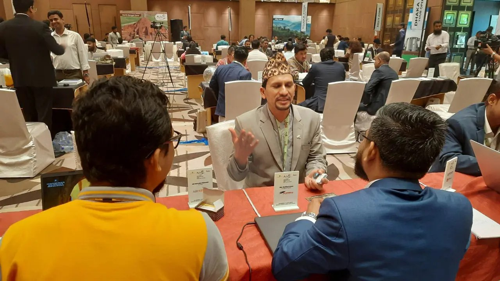

# বাংলাদেশ ভ্রমণে উৎসাহিত করতে রাজধানীতে বিটুবি এক্সচেঞ্জ প্রোগ্রাম

> **Source:** Google News — বাংলাদেশ ভ্রমণ  
> **URL:** <https://www.dhakapost.com/national/196879>  
> **Type:** news | **Language:** bn  
> **Published:** Sat, 27 May 2023 07:00:00 GMT  

---

৪ দেশের ট্যুর অপারেটরদের নিয়ে মিটিং
বাংলাদেশ ভ্রমণে উৎসাহিত করতে রাজধানীতে বিটুবি এক্সচেঞ্জ প্রোগ্রাম
নিজস্ব প্রতিবেদক
২৭ মে ২০২৩, ১৩:৪৬
রাজধানীতে শুরু হয়েছে মুজিব’স বাংলাদেশ ট্যুরিজম প্রোমোশন অ্যান্ড বিটুবি এক্সচেঞ্জ প্রোগ্রাম। এতে বাংলাদেশের ট্যুরিজম সম্পর্কিত ১২৫ স্টেকহোল্ডারের সঙ্গে অংশ নিয়েছে এশিয়ার চারটি দেশের ৯৭ ট্যুর অপারেটর।
বিজ্ঞাপন
শনিবার (২৭ মে) সকাল সাড়ে ১০টায় হোটেল ইন্টারকন্টিনেন্টাল ঢাকার গ্র্যান্ড বলরুমে এ বিজনেস টু বিজনেস (বিটুবি) মিটিং শুরু হয়। এটি বিকেল ৪টা পর্যন্ত বিরতিহীনভাবে চলবে। এর আগে সকালে দেশে আসা ভারত, শ্রীলঙ্কা, নেপাল ও ভুটানের ৯৭ ট্যুর অপারেটরকে বাংলাদেশের বিষয়ে কান্ট্রি প্রেজেন্টেশন দেওয়া হয়।
মিটিংয়ে অংশগ্রহণকারী বাংলাদেশি স্টেকহোল্ডারদের সঙ্গে কথা বলে জানা যায়, বিদেশ থেকে আসা ট্যুর অপারেটররা বাংলাদেশকে জানার পাশাপাশি তাদের দেশ সম্পর্কে জানাচ্ছেন ও সেখানে যেতে আহ্বান করছেন। যেহেতু এ আয়োজন বাংলাদেশকে প্রেজেন্ট করতে ও আমাদের দেশ ভ্রমণে উৎসাহিত করতে, আমরা সেই কাজটিই করছি।
বিটুবি মিটিং নিয়ে এয়ার অ্যাস্ট্রার মার্কেটিং ও সেলসের সিনিয়র এক্সিকিউটিভ মো. মাসুদুর রহমান ঢাকা পোস্টকে বলেন, বিদেশি ট্যুর অপারেটররা আমাদের এয়ারক্রাফটগুলো কোন রুটে চলছে, ভাড়া কেমন এসব জানতে আসছেন। তাদের ভাষ্য মতে, পরে তারা আমাদের দেশে এলে আমাদের এয়ারক্রাফটে ভ্রমণ করবেন।
বিজ্ঞাপন
শেরাটন ঢাকার ক্যাটারিং সেলস এক্সিকিউটিভ শারমিন সুলতানা ঢাকা পোস্টকে বলেন, আমাদের পর্যটন খাতে করোনা একটি বড় ধাক্কা দিয়েছিল। আমরা এখন সেটি মোটামুটি কাটিয়ে উঠতে পেরেছি। এখানে বিদেশি ট্যুর অপারেটররা আমাদের হোটেল সম্পর্কে জানছেন। আমরা ভালো সাড়া পাচ্ছি।
ইন্টারকন্টিনেন্টাল ঢাকার অ্যাসিস্ট্যান্ট কমিউনিকেশন ম্যানেজার সৈয়দা ফাইজা ফারিয়া ঢাকা পোস্টকে বলেন, বিদেশি ট্যুর অপারেটররা আমাদের হোটেলেই উঠেছেন। পাশাপাশি আমরা বিটুবি মিটিংয়ে অংশগ্রহণ করেছি। এখানে তারা আমাদের সম্পর্কে আরও জানছেন। আমাদের দেশ ভ্রমণে তাদের উৎসাহিত করছি।
ইয়োর বাংলা ট্যুরের সিইও তানভীরুল আরফিন লিংকন ঢাকা পোস্টকে বলেন, ভালো সাড়া পাচ্ছি বিদেশি ট্যুর অপারেটরদের কাছ থাকে। তবে তারা আমাদের প্রভাবিত করার চেষ্টা করছে তাদের দেশ ভ্রমণে। কিন্তু আমরা তো এখানে আমাদের দেশ সম্পর্কে জানাতে বসেছি এবং সেটিই করছি।
বিজ্ঞাপন
যমুনা লাইসিউর অ্যান্ড হলিডে ট্যুরসের সিইও এসএম সেলিম ঢাকা পোস্টকে বলেন, বিদেশ থেকে আসা ট্যুর অপারেটররা বাংলাদেশকে জানার পাশাপাশি তাদের দেশ সম্পর্কে জানাচ্ছেন। বেশির ভাগই আমাদেরকে সেখানে যেতে আহ্বান করছেন। কিন্তু যেহেতু এই আয়োজনের মূল উদ্দেশ্য বাংলাদেশকে প্রেজেন্ট করা এবং তাদেরকে আমাদের দেশ ভ্রমণে উৎসাহিত করা, আমরা তা করার চেষ্টা করছি।
বাংলাদেশ ট্যুরিজম বোর্ড এবং বেসামরিক বিমান পরিবহন ও পর্যটন মন্ত্রণালয় আয়োজিত মুজিব’স বাংলাদেশ ট্যুরিজম প্রোমোশন অ্যান্ড বিটুবি এক্সচেঞ্জ প্রোগ্রামে নেপাল থেকে ১২ জন, ভুটান থেকে ১৪ জন, শ্রীলঙ্কা থেকে ১৯ জন এবং ভারত থেকে ৫২ জন ট্যুর অপারেটর অংশগ্রহণ করেছে। ভারতের অধিকাংশ অপারেটরই পশ্চিমবঙ্গ, আসাম, মেঘালয়, নাগাল্যান্ড, মনিপুর, ত্রিপুরা, মিজোরাম এবং অরুণাচলের।
ট্যুরিজম স্টেকহোল্ডারদের সুষম অংশগ্রহণ নিশ্চিত করতে ঢাকায় ব্যবসারত স্টেকহোল্ডারদের পাশাপাশি বাংলাদেশের অঞ্চলভিত্তিক ট্যুরিজম স্টেকহোল্ডারদের এ আয়োজনে অন্তর্ভুক্ত করা হয়েছে। বিদেশি স্টেকহোল্ডারদের সঙ্গে নেটওয়ার্কিংয়ের পাশাপাশি দেশীয় স্টেকহোল্ডারদের নিজেদের মধ্যে বন্ধন সুদৃঢ় করতে এবং অঞ্চলভিত্তিক নেটওয়ার্ক গড়ে তুলতেই এ আয়োজন করা হয়েছে বলে জানিয়েছেন সংশ্লিষ্টরা।
এতে বাংলাদেশি স্টেকহোল্ডারদের মধ্যে ৪৬টি হোটেল ও রিসোর্ট, চারটি দেশীয় এয়ারলাইন্স, ১০টি ট্যুরিস্ট ভেসেল এবং ৬৫টি ট্যুর অপারেটর ও ট্যুর গাইড প্রতিষ্ঠান অংশগ্রহণ করেছে।
/এমএইচএন/এসএসএইচ/

---
*Crawled 2026-06-11 07:08 | Bhromon Travel Crawler*
