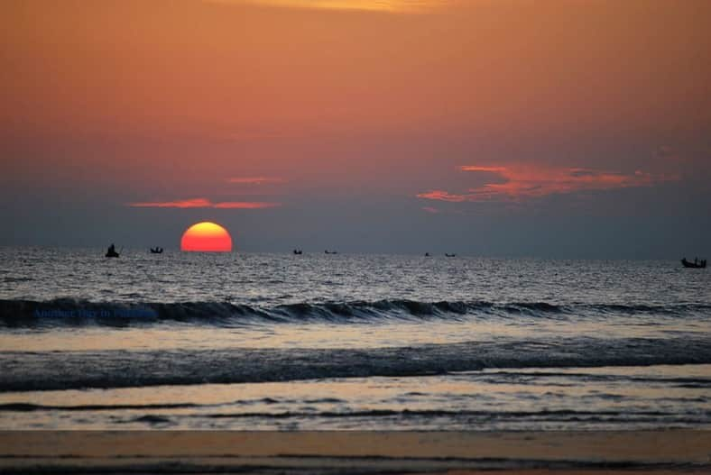

# বাংলাদেশের জনপ্রিয় ৫ পর্যটন কেন্দ্র

> **Source:** Google News — বাংলাদেশ ভ্রমণ  
> **URL:** <https://inews.zoombangla.com/5-popular-tourist-centers-of-bangladesh/>  
> **Type:** news | **Language:** bn  
> **Published:** Fri, 04 Oct 2024 07:00:00 GMT  
> **Destination:** পর্যটন  

---

জুমবাংলা ডেস্ক :
সুন্দরভাবে বেঁচে থাকার জন্য শরীরের সাথে সাথে মনের খোরাকও পূরণ করা অত্যন্ত জরুরি। প্রতিটি মানুষেরই স্বাভাবিকভাবে একটি বাঁধাধরা নিয়মের মধ্যে জীবন-যাপন করতে হয়। একইভাবে চলমান ব্যস্ততায় বিরক্তি চলে আসা অবান্তর নয়। তাই সুযোগ পেলেই সাধ্যমতো কোনো পর্যটনকেন্দ্রে ঘুরে আসা অঅবশ্যক। বলা হয়, ইতালীয় জেনোয়ার অভিযাত্রী ক্রিস্টোফার কলম্বাস ভ্রমণে না বের হলে কোনোদিন হয়তো আমেরিকার আবিষ্কারই হতো না। এই কথাতেই বেশ গভীরভাবে বোঝা যায়, পর্যটনের মাহাত্ম্য কতখানি।
Advertisement
ভ্রমণ পিপাসু সেই মানুষদের উদ্দেশ্য করেই সারাবিশ্বে পর্যটন দিবস পালন করার সিদ্ধান্ত নেওয়া হয়। ২৭ সেপ্টেম্বর পালন করা হয় বিশ্ব পর্যটন দিবস। নিত্যদিনের একঘেয়েমী জীবনধারার বেড়াজাল ছিঁড়ে জীবনে কিছুটা শান্তির পরশ এনে দিতে পারে ভ্রমণ। ভ্রমণ পিপাসু মানুষজন তাই ছুটে চলে দেশ বিদেশে। কেউ বা সারাটা জীবন বিভিন্ন পর্যটন কেন্দ্রে ঘুরে ঘুরেই কাটিয়ে দেন।
আমাদের এই সুজলা-সুফলা ছোট দেশেও বিভিন্ন দর্শনীয় পর্যটনকেন্দ্র রয়েছে। ছোট-বড় ছুটির দিনে বিভিন্ন পর্যটনকেন্দ্রে ভ্রমণ করতেও পছন্দ করেন অনেকে। নিচে সাধ্যের মধ্যে কিছু পর্যটনকেন্দ্রের কথা উল্লেখ করা হলো-
১. কুয়াকাটা: দক্ষিণ বঙ্গের সবচেয়ে জনপ্রিয় পর্যটন স্থান হলো কুয়াকাটা। পটুয়াখালী জেলার সমুদ্রসংলগ্ন কলাপাড়া উপজেলায় এই পর্যটনকেন্দ্র গড়ে উঠেছে। খুব কম খরচেই এখানে সমুদ্রবিলাশ করা যায়। সারাবছর এখানে বিভিন্ন অঞ্চলের পর্যটকদের জনসমাগম লেগেই থাকে। ধারণা করা হয়, ১৮ শতকে আরাকানিরা বার্মা থেকে এই অঞ্চলে বাস করতে আসেন। তখন তারা পানীয় জলের সন্ধানে অনেকগুলো কূপ বা কুয়া খনন করায় এই অঞ্চলের নাম হয় কুয়াকাটা। কুয়াকাটা একমাত্র সমুদ্রতীরবর্তী স্থান, যেখানে সূর্যোদয় এবং সূর্যাস্ত উভয় দেখা যায়।
২. সুন্দরবন: বাংলার দক্ষিণে বঙ্গোপসাগরের উপকূল অঞ্চলে সৃষ্টি হওয়া বিশ্বের বৃহত্তম ব-দ্বীপ হলো সুন্দরবন। পদ্মা-মেঘনা-ব্রহ্মপুত্র এই নদীত্রয়ের অববাহিকায় সৃষ্ট ব-দ্বীপের শতকরা ৬৬ ভাগ বাংলাদেশের অংশ। এখানে অনেকেই ভ্রমণ এবং রোমাঞ্চের জন্য আসেন। দেশের একমাত্র বনাঞ্চল এবং বন্য পশুর দেখা পাওয়ার স্থান আমাদের সুন্দরবন। তাই পর্যটন কেন্দ্র হিসেবে সুন্দরবনের জনপ্রিয়তা অনেক।
৩. সীতাকুণ্ড:  চট্টগ্রামের পার্বত্য অঞ্চলে গড়ে উঠেছে পর্যটনকেন্দ্র সীতাকুণ্ড। এখানে জনপ্রিয় ভ্রমণের বিষয়বস্তু হলো ইকোপার্ক, চন্দ্রনাথ পাহাড় ও মন্দির। এছাড়াও সীতাকুণ্ডের ঝরনা পর্যটকদের অন্যতম আকর্ষণ এবং চন্দ্রনাথ পাহাড় ট্রেকিংয়ের জন্য জনপ্রিয়।
৪. জাফলং: সিলেট বিভাগে অনেকগুলো দর্শনীয় স্থানের মধ্যে জাফলং অন্যতম। এখানে বেশ কঠিন শিলার সন্ধান পাওয়া যায়। মেঘালয়ের পাহাড় ঘেঁষা জাফলংয়ের জনপ্রিয়তা মূলত এর ঝর্ণা, পাথর, ও স্বচ্ছ পানির নদী। এখানকার চা-বাগান এবং খাসিয়া আদিবাসীদের সংস্কৃতিও পর্যটকদের জন্য বিশেষ আকর্ষণের কারণ।
৫. কক্সবাজার: বাংলাদেশের সবচেয়ে জনপ্রিয় ব্যবসায়িক পর্যটন কেন্দ্র হলো কক্সবাজার। এখানে বিদেশী পর্যটকদের সমাগম সবচেয়ে বেশি। সমুদ্রের তীরে একটু শান্তির ছোঁয়া পেতে ভ্রমণ পিপাসু মানুষের দল কক্সবাজারে ভিড় করেন।
f
X
in
m
wa
link
@
tg
Zoom Bangla News
inews.zoombangla.com
Follow
Follow iNews Zoombangla On Google
Open the Google follow page and tap the checkmark option to receive more updates from iNews Zoombangla in your Google news feed.
জুমবাংলা নিউজ সবার আগে পেতে
Follow
করুন
জুমবাংলা গুগল নিউজ
,
জুমবাংলা টুইটার
,
জুমবাংলা ফেসবুক
,
জুমবাংলা টেলিগ্রাম
এবং সাবস্ক্রাইব করুন
জুমবাংলা ইউটিউব চ্যানেলে
।

---
*Crawled 2026-06-11 07:09 | Bhromon Travel Crawler*
