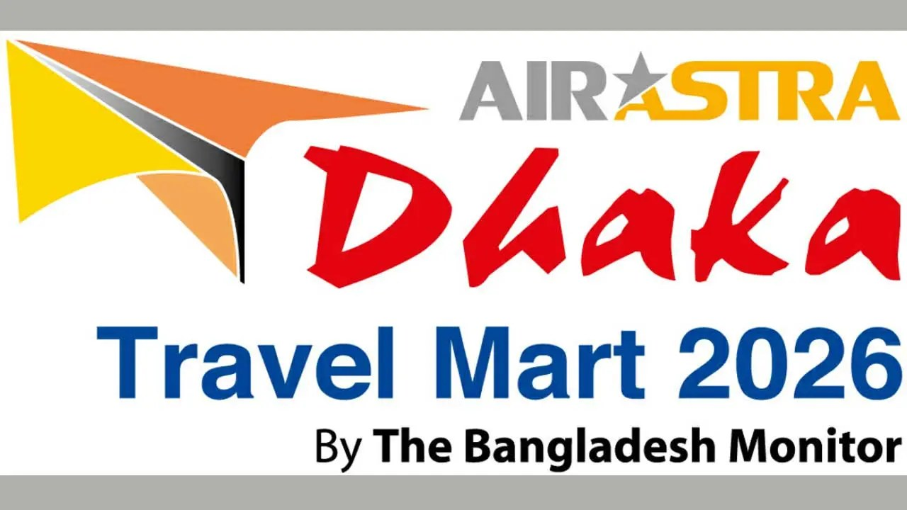

# বৃহস্পতিবার থেকে ঢাকায় শুরু হচ্ছে আন্তর্জাতিক পর্যটন মেলা

> **Source:** Google News — বাংলাদেশ ভ্রমণ  
> **URL:** <https://www.dhakapost.com/aviation/443326>  
> **Type:** news | **Language:** bn  
> **Published:** Wed, 08 Apr 2026 07:00:00 GMT  
> **Destination:** পর্যটন  

---

বৃহস্পতিবার থেকে ঢাকায় শুরু হচ্ছে আন্তর্জাতিক পর্যটন মেলা
জ্যেষ্ঠ প্রতিবেদক
৮ এপ্রিল ২০২৬, ১২:৫৮
বৃহস্পতিবার (৯ এপ্রিল) থেকে রাজধানীর প্যান প্যাসিফিক সোনারগাঁও হোটেলের বলরুমে থেকে শুরু হচ্ছে তিনদিনের আন্তর্জাতিক পর্যটন মেলা।
বিজ্ঞাপন
‘এয়ার অ্যাস্ট্রা ঢাকা ট্রাভেল মার্ট ২০২৬’ শীর্ষক পর্যটন মেলার ২১তম আসরটি আয়োজন করেছে শীর্ষস্থানীয় ভ্রমণ ও পর্যটন বিষয়ক প্রকাশনা দি বাংলাদেশ মনিটর, টাইটেল স্পন্সর হিসেবে রয়েছে বেসরকারি এয়ারলাইন্স এয়ার অ্যাস্ট্রা।
মেলার আনুষ্ঠানিক উদ্বোধন করবেন বেসামরিক বিমান পরিবহন ও পর্যটন মন্ত্রী আফরোজা খানম রিতা। বেসামরিক বিমান পরিবহন ও পর্যটন প্রতিমন্ত্রী এম রাশিদুজ্জামান মিল্লাত এবং এম নাছের রহমান অনুষ্ঠানে উপস্থিত থাকবেন।
মেলায় নেপাল, থাইল্যান্ড, মালয়েশিয়া, সিঙ্গাপুর, সৌদি আরব, তুরস্ক, ভিয়েতনাম, চীন ও আয়োজক বাংলাদেশের ৫০টিরও বেশি প্রতিষ্ঠান অংশগ্রহণ করবে। ১০টি প্যাভিলিয়ন ও ৮০টির বেশি বুথে বিভিন্ন প্রতিষ্ঠান তাদের পণ্য ও সেবা প্রদর্শন করবে। অংশগ্রহণকারী প্রতিস্থানগুলো দর্শনার্থীদের জন্য দেশি-বিদেশি বিমান টিকিট, ট্যুর প্যাকেজ, হোটেল ও রিসোর্ট বুকিং, মেডিকেল ট্যুরিজম প্যাকেজসহ বিভিন্ন সেবায় আকর্ষণীয় মূল্যছাড় অফার করবে।
বিজ্ঞাপন
১১ এপ্রিল পর্যন্ত প্রতিদিন সকাল ১০টা থেকে রাত ৮টা পর্যন্ত দর্শনার্থীদের জন্য মেলাটি উন্মুক্ত থাকবে। দর্শনার্থীদের জন্য প্রবেশমূল্য ৫০ টাকা। প্রবেশ টিকিটের ওপর র‍্যাফেল ড্রতে পুরস্কার হিসেবে দর্শনার্থীর জন্য থাকবে আকর্ষণীয় পুরস্কার।
ইউ-এস বাংলা এয়ারলাইন্স, মিউচুয়াল ট্রাস্ট ব্যাংক, পিএলসি, শীর্ষস্থানীয় জিডিএস প্রতিষ্ঠান সেবার এবং অনলাইন ট্রাভেল এজেন্সি বাইটিকিটস মেলার পার্টনার হিসেবে আয়োজনে সহযোগিতা করছে।
এআর/জেডএস

---
*Crawled 2026-06-11 06:52 | Bhromon Travel Crawler*
