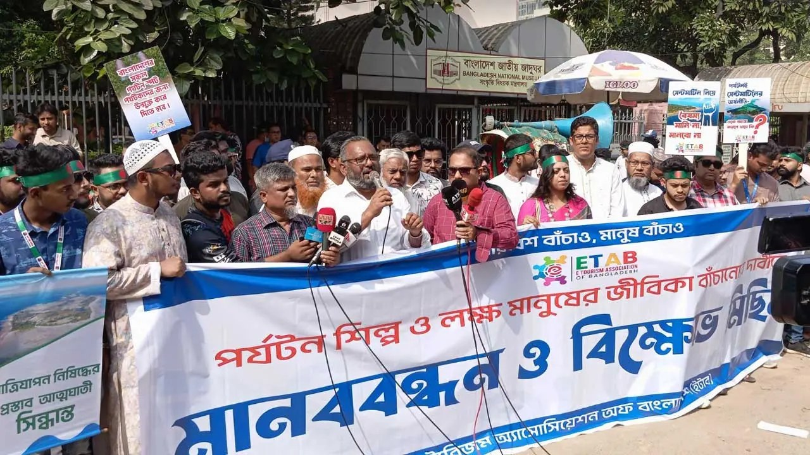

# সেন্টমার্টিনে ভ্রমণ বিষয়ে সিদ্ধান্ত প্রত্যাহারের দাবি

> **Source:** Google News — বাংলাদেশ ভ্রমণ  
> **URL:** <https://www.dhakapost.com/national/318519>  
> **Type:** news | **Language:** bn  
> **Published:** Mon, 28 Oct 2024 07:00:00 GMT  
> **Destination:** পর্যটন  

---

সেন্টমার্টিনে ভ্রমণ বিষয়ে সিদ্ধান্ত প্রত্যাহারের দাবি
নিজস্ব প্রতিবেদক
২৮ অক্টোবর ২০২৪, ১৬:৪৩
সেন্টমার্টিন দ্বীপে ভ্রমণ বিষয়ে সরকারি সিদ্ধান্ত প্রত্যাহারের দাবি জানিয়েছে সেন্টমার্টিন দ্বীপ পরিবেশ ও পর্যটন রক্ষা-উন্নয়ন জোট। আগামী দুই দিনের মধ্যে এই সিদ্ধান্ত প্রত্যাহার করা না হলে কঠোর কর্মসূচির হুঁশিয়ারি জানিয়েছে জোটটি।
বিজ্ঞাপন
সোমবার (২৮ অক্টোবর) রাজধানীর শাহবাগে জাতীয় জাদুঘরের সামনে আয়োজিত মানববন্ধন থেকে এ হুঁশিয়ারি জানান ট্যুর অপারেটর অ্যাসোসিয়েশন অব বাংলাদেশের (টোয়াব) সভাপতি মো. রাফেউজ্জামান।
তিনি বলেন, আমাদের প্রবল আপত্তি সত্ত্বেও সেন্টমার্টিনে রাত্রিযাপন ও পর্যটক যাতায়াত সীমিত করার আত্মঘাতী সিদ্ধান্ত নিয়েছে সরকার। সরকারের পক্ষ থেকে বলা হয়, নভেম্বর মাসে সেন্টমার্টিনে কোনো পর্যটক রাত্রিযাপন করতে পারবে না। আর ডিসেম্বর ও জানুয়ারি মাসে দিনে ২০০০ পর্যটক সেন্টমার্টিন ভ্রমণ করতে পারবেন এবং রাত্রিযাপন করতে পারবেন। ফেব্রুয়ারি মাসে সেন্টমার্টিনে সরকার পর্যটক যাতায়াত বন্ধ রাখবে। এতে পর্যটন শিল্প ব্যাপকভাবে ক্ষতিগ্রস্ত হবে এবং সাধারণ উদ্যোক্তারা সর্বস্বান্ত হয়ে যাবে। সেন্টমার্টিনে প্রায় ১০ হাজার মানুষ বাস করে। এরা সবাই পর্যটনের ওপর নির্ভরশীল। সেন্টমার্টিনে পর্যটন সীমিত করা হলে অথবা বন্ধ করা হলে এরা সবাই বেকার হয়ে যাবে। সেই সঙ্গে উদ্যোক্তাদের আর্থিক বিনিয়োগ মারাত্মক ঝুঁকির মুখে পড়বে। তাই সরকারের এ ধরনের সিদ্ধান্তের প্রতিবাদ জানাচ্ছি। একইসঙ্গে আগামী দুই কর্মদিবসের মধ্যে এ সিদ্ধান্ত প্রত্যাহার করে পর্যটকদের জন্য সেন্টমার্টিন দ্বীপ ভ্রমণকে নির্বিঘ্ন ঘোষণা করার জোরালো দাবি জানাচ্ছি।
আরও পড়ুন
সেন্টমার্টিনে পর্যটক সীমিত করার সিদ্ধান্ত
বিজ্ঞাপন
রাফেউজ্জামান বলেন, আমরা সেন্টমার্টিনের পরিবেশ ও জীববৈচিত্র্য রক্ষা করতে চাই, তবে পর্যটন বন্ধ করে দিয়ে নয়। বরং পরিবেশের অনুকূলে সবপ্রয়োজনীয় পদক্ষেপ গ্রহণ করে। দাবি আদায়ে ঐতিহাসিক শাহবাগে আমাদের রাজপথের কর্মসূচি শুরু হলো। দুই দিনের মধ্যে দাবি আদায় না হলে কঠোর কর্মসূচি দেওয়া হবে।
সেন্টমার্টিন দ্বীপ পরিবেশ ও পর্যটন রক্ষা-উন্নয়ন জোটের চেয়্যারম্যান শিবলুল আজম কোরেশি বলেন, সেন্টমার্টিন দ্বীপে পরিবেশের ভারসাম্য রক্ষা ও সিঙ্গেল ইউজ প্লাস্টিক ব্যবহার কঠোরভাবে বন্ধ করে রাত্রিযাপনসহ যাবতীয় বিধি-নিষেধ ব্যতিরেকে পর্যটন চালু রাখা এবং টেকনাফ থেকে সেন্টমার্টিন ভ্রমণে বিকল্প পথ তৈরি করতে হবে। সেন্টমার্টিন দ্বীপের পরিবেশসহ জীববৈচিত্র্য সংরক্ষণ এবং পর্যটনের বিরূপ প্রভাব মোকাবিলা করে পর্যটন উন্নয়ন নিশ্চিত করতে হবে। দ্বীপে নোনাপানি মিঠাপানিতে পরিণত করার নিমিত্তে ওয়াটার ট্রিটমেন্ট প্লান্ট স্থাপন করতে হবে। পচনশীল বর্জ্য ট্রিটমেন্টের মাধ্যমে বায়োগ্যাসে পরিণত করার ব্যবস্থা গ্রহণ করতে হবে। দ্বীপে জেনারেটর ব্যবহার বন্ধ করে পরিবেশবান্ধব সোলার প্লান্ট স্থাপন করতে হবে এবং ইট, বালু, সিমেন্ট, রড ব্যবহার করে স্থায়ী স্থাপনা নিয়ন্ত্রণ করতে হবে।
মানবন্ধনে আরও বক্তব্য রাখেন ই-ট্যাব সভাপতি ইমরানুল আলম, সেন্টমার্টিন দ্বীপ পরিবেশ ও পর্যটন রক্ষা-উন্নয়ন জোটের প্রচার সম্পাদক মো. হাবিবুর রহমান। এছাড়া আরও উপস্থিত ছিলেন টোয়াব, ট্যুর অপারেটর অ্যাসোসিয়েশন অব কক্সবাজার, সেন্টমার্টিনস দ্বীপ পরিবেশ ও পর্যটন রক্ষা-উন্নয়ন জোটের নেতা, ই-ট্যুরিজম অ্যাসোসিয়েশন অব বাংলাদেশ, ট্যুর অপারেটর অ্যাসোসিয়েশন অব কুয়াকাটা, সেন্টমার্টিন হোটেল মালিক সমিতি, ট্যুর অপারেটর অ্যাসোসিয়েশন অব সেন্টমার্টিন, সেন্টমার্টিন দোকান মালিক সমিতি, বোট মালিক সমবায় সমিতি, মৎস্যজীবী মালিক সমিতি, বাংলাদেশ স্লিপার এসি বাস মালিক সমিতি, জাহাজ মালিকদের সংগঠন সি-ক্রুজ অপারেটরস ওনার্স অ্যাসোসিয়েশন অব বাংলাদেশের নেতারা।
বিজ্ঞাপন
এমএইচএন/জেডএস

---
*Crawled 2026-06-11 07:06 | Bhromon Travel Crawler*
