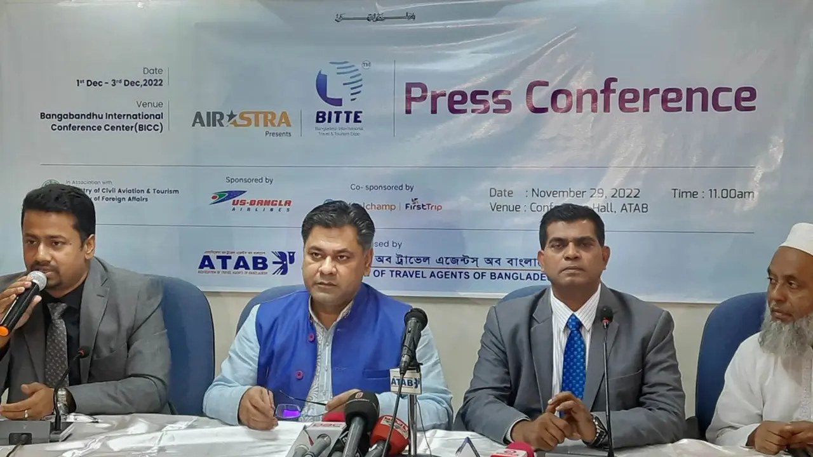

# ১ ডিসেম্বর শুরু হচ্ছে আন্তর্জাতিক ট্যুরিজম এক্সপো

> **Source:** Google News — বাংলাদেশ ভ্রমণ  
> **URL:** <https://www.dhakapost.com/economy/157115>  
> **Type:** news | **Language:** bn  
> **Published:** Tue, 29 Nov 2022 08:00:00 GMT  

---

১ ডিসেম্বর শুরু হচ্ছে আন্তর্জাতিক ট্যুরিজম এক্সপো
জ্যেষ্ঠ প্রতিবেদক
২৯ নভেম্বর ২০২২, ১৬:৪৬
প্রথমবারের মতো রাজধানী ঢাকার বঙ্গবন্ধু ইন্টারন্যাশনাল কনফারেন্স সেন্টারে (বিআইসিসি) তিন দিনব্যাপী আন্তর্জাতিক মানের ট্যুরিজম এক্সপোর আয়োজন করেছে অ্যাসোসিয়েশন অব ট্রাভেল এজেন্টস অব বাংলাদেশ (আটাব)।
বিজ্ঞাপন
আগামী ১ থেকে ৩ ডিসেম্বর এক্সপোটি অনুষ্ঠিত হবে। যা চলবে প্রতিদিন সকাল ১০টা থেকে সন্ধ্যা ৭টা পর্যন্ত। ট্যুরিজম এক্সপোর টাইটেল স্পন্সর এয়ার অ্যাস্ট্রা এবং স্পন্সর ইউএস-বাংলা এয়ারলাইন্স।
মঙ্গলবার (২৯ নভেম্বর) রাজধানীর পল্টনের কেন্দ্রীয় কার্যালয়ে ট্যুরিজম মেলা উপলক্ষে আয়োজিত সংবাদ মিডিয়া ব্রিফিং এ তথ্য জানান আটাবের সভাপতি এস এন মঞ্জুর মোর্শেদ (মাহবুব)।
এসময় উপস্থিত ছিলেন আটাবের মহাসচিব আবদুস সালাম আরেফ, এয়ার অ্যাস্ট্রার জেনারেল ম্যানেজার মোজাম্মেল হক এবং ইউএস-বাংলা এয়ারলাইন্সের জেনারেল ম্যানেজার (পাবলিক রিলেশন) কামরুল ইসলাম, আটাবের সহ-সভাপতি আফসিয়া জান্নাত সালেহ, যুগ্মমহাসচিব আবদুল হামিদ, উপ-মহাসচিব গোলাম মাহমুদ ভুইয়া মানিক, অর্থসচিব আব্দুর রাজ্জাক প্রমুখ।
বিজ্ঞাপন
আটাব ‘বাংলাদেশ ইন্টারন্যাশনাল ট্রাভেলস অ্যান্ড ট্যুরিজম এক্সপো’ (বিআইটিটিই) আয়োজন করছে বলে জানান আটাবের সভাপতি। মেলায় উদ্বোধনী অনুষ্ঠানে উপস্থিত থাকবেন পর্যটন প্রতিমন্ত্রী, ধর্ম প্রতিমন্ত্রী এবং বিভিন্ন মন্ত্রণালয়ের সচিব, বাংলাদেশ ট্যুরিজম বোর্ডের সিইও এবং পর্যটন কর্পোরেশনের চেয়ারম্যান।
তিনি আরও জানান, ট্যুরিজম এক্সপোতে বাংলাদেশ ছাড়া ভারত, মালেশিয়া, ভুটান, নেপাল, মালদ্বীপ, ওমান, শ্রীলংকা, তুরস্ক, আজারবাইজান, দক্ষিণ কোরিয়া, ভিয়েতনাম, সিঙ্গাপুর, সংযুক্ত আরব আমিরাতসহ মোট ১৫টি দেশ অংশ্রহণ করবে।
সংবাদ সম্মেলনে লিখিত বক্তব্যে মহাসচিব আবদুস সালাম আরেফ জানান, আটাব ভ্রমণ ও পর্যটন খাতে বিগত ৪৫ বছর ধরে নিরলসভাবে কাজ করে যাচ্ছে। এরই ধারাবাহিকতায় আন্তর্জাতিকমানের ট্যুরিজম এক্সপোর আয়োজন করছে তারা।
এক্সপোতে বেসামরিক বিমান পরিবহন ও পর্যটন মন্ত্রণালয়ের সঙ্গে সম্পৃক্ত কিছু কার্যক্রম যেমন- প্রোডাক্ট ব্র্যান্ডিং, বিদেশি মুদ্রা অর্জনে দেশের পর্যটন সেবার মান উন্নয়ন ও বিক্রির বাজার সৃষ্টি, সাংস্কৃতিক অনুষ্ঠান, ফ্যাম ট্যুর, পর্যটন শিল্পের প্রচার-প্রসার, ঐতিহ্যবাহী খাদ্য প্রদর্শন, বিভিন্ন দেশের অ্যাম্বাসি, হাইকমিশনগুলোর সাথে সু-সম্পর্ক স্থাপন, ট্রাভেল এজেন্সি, ট্যুর অপারেটর, এয়ারলাইন্সগুলোর মধ্যে দৃঢ় ব্যবসায়িক সম্পর্ক গড়ে তোলা, দেশে পর্যটন সচেতনতা বৃদ্ধি, বিভিন্ন সেমিনার, গোল টেবিল আলোচনা, কর্মশালা, বিটুবি সেশন, পর্যটন সেবাগুলো দেশি-বিদেশি প্রতিষ্ঠান ও ব্যক্তিদের কাছে সুন্দরভাবে উপস্থাপন করার জন্য বেসামরিক বিমান পরিবহন ও পর্যটন মন্ত্রণালয় এবং পররাষ্ট্র মন্ত্রণালয়ের সহযোগী হিসেবে বাংলাদেশে আন্তর্জাতিক মানের ট্রাভেল অ্যান্ড ট্যুরিজম প্রদর্শনীর পরিকল্পনার কথা উপস্থাপন করেন।
বিজ্ঞাপন
সংবাদ সম্মেলনে আটাবের মহাসচিব জানান, বিদেশি প্রতিষ্ঠানের পাশাপাশি দেশের এয়ারলাইন্স, হসপিটাল, ট্যুরিজম বোর্ড, ট্রাভেল এজেন্সি, ট্যুর অপারেটর, হোটেল, রিসোর্ট, ক্রুজ লাইনার, ডেস্টিনেশন ম্যানেজমেন্ট কোম্পানি এবং অন্যান্য ট্রাভেল ও ট্যুরিজম খাত সংশ্লিষ্ট সেবা দানকারী প্রতিষ্ঠান Air Astra BITTE এ প্রদর্শক হিসেবে অংশগ্রহণ করছে। এক্সপোতে অংশগ্রহণের মাধ্যমে ট্রাভেল এজেন্ট ও ট্যুর অপারেটরদের মধ্যে ব্যবসায়িক সংযোগ সম্পর্ক তৈরী হবে এবং দেশের জনসাধারণ বিশ্বব্যাপী ভ্রমণের তথ্য, প্যাকেজ ও এয়ার টিকিট সম্পর্কে জানতে পারবেন।
এতে বলা হয়, মেলায় সেমিনারটি অনুষ্ঠিত হবে ৩ দিন ৩টি বিষয়ে-
- প্রথম দিন 'ইনভেস্টমেন্ট অপরচুনিটি ইন বাংলাদেশ ট্যুরিজম সেক্টর',
- দ্বিতীয় দিন 'এভিয়েশন অ্যান্ড ট্যুরিজম অপরচুনিটি, কানেক্টিং বাংলাদেশ টু দ্য ওয়ার্ল্ড' এবং
- তৃতীয় দিন 'দ্য ইমপ্যাক্ট অব ফোর্থ ইন্ডাস্ট্রিয়াল রিভেলেশন ইন ট্যুরিজম ইন্ডাস্ট্রি' শীর্ষক সেমিনার অনুষ্ঠিত হবে।
সংবাদ সম্মেলনে এক্সপোর স্পন্সর ইউএস-বাংলা এয়ারলাইন্সের জেনারেল ম্যানেজার (পাবলিক রিলেশন) কামরুল ইসলাম জানান, মেলা উপলক্ষ্যে দেশে ভ্রমন করলে ১৫ শতাংশ আর বিদেশে ভ্রমনের টিকেটে ১০ শতাংশ ছাড় দেওয়া হবে।
এছাড়াও ঢাকা থেকে কলকাতা, অথবা ঢাকা থেকে চেন্নাই যেকোনো জায়গায় গেলে আমাদের টিকিট কিংবা বডিং কার্ড ইস্যু করলে ভারতের অ্যাপোলো হাপাতালে ১ শতাংশ ছাড় পাবেন। আগামী মাস থেকে মালদ্বীপে ৬টি ফ্লাইট করা হবে বলে জানান তিনি।
টাইটেল স্পন্সর এয়ার অ্যাস্ট্রার জেনারেল ম্যানেজার মোজাম্মেল হক জানান, যাত্রীদের কথা বিবেচনা করে আমরা সর্বনিম্ন ভাড়া নির্ধারণ করেছি। আমরা কক্সবাজারে তিনটি ও চট্টগ্রামে দুটি ফ্লাইট নিয়ে যাত্রা শুরু করেছি। আগামী ১ ডিসেম্বর থেকে কক্সবাজার-চট্টগ্রামে ৪টি এবং সিলেটে দুটি করে ফ্লাইট চালু হবে।
তিনি আরও জানান, বর্তমানে দুটি বিমান রয়েছে। আগামী ১০ থেকে ১৫ দিনের মধ্যে একটি তারপর জানুয়ারিতে আরও একটি বিমান আসবে। তখন দেশের বরিশাল ছাড়াও অনান্য জায়গায় ফ্লাইট চালু করবো। মেলা উপলক্ষ্যে এয়ার অ্যাস্ট্রায় ভ্রমন করলে টিকিটে ২০ শতাংশ ছাড় দেওয়া হবে।
এক্সপোটি যে যে উদ্দেশে আয়োজন করা হয়েছে সেগুলো হচ্ছে-
- ট্যুরিজমের সাথে সম্পৃক্ত এসডিজির লক্ষ্যমাত্রা অর্জনের করণীয় বিষয়ে বিভিন্ন সেমিনার।
- আলোচনা অনুষ্ঠান ও কার্যক্রম পরিচালনা।
- মেলায় বাংলাদেশ বিনিয়োগ উন্নয়ন কর্তৃপক্ষের সম্পৃক্ততায় পর্যটন খাতে বিনিয়োগ উন্নয়নের সুযোগ তৈরি।
- দেশের অর্থনীতির প্রবৃদ্ধি অর্জনে সহায়ক ভূমিকা।
- দেশে পর্যটনের প্রচার প্রসার।
- বাংলাদেশের বৈচিত্রময় পর্যটন খাত ও সেবাগুলো বিশ্ববাজারে উপস্থাপনের সুযোগ সৃষ্টি।
- দেশি-বিদেশি ট্রাভেল এজেন্সি ও অপারেটেরদের মধ্য বিজনেস টু বিজনেস সম্পর্ক সমৃদ্ধ করা।
- ইনবাউন্ড ট্যুরিজমকে এগিয়ে নিতে দেশের জনপ্রিয় পর্যটন কেন্দ্রগুলোকে তুলে ধরা।
- বৈদেশিক মুদ্রা অর্জনে পর্যটন খাতের ব্যবসায়িক কার্যক্রম পরিচালনা করতে সহায়তা দেওয়া।
- খাত সংশ্লিষ্টদের সাথে সুষ্ঠু বাণিজ্যিক সম্পর্ক স্থাপন।
- ট্রাভেল এজেন্সি ও ট্যুর অপারেটরদের পর্যটন সেবা উপাদানগুলো যেমন- এয়ার টিকিটিং, হোটেল বুকিং, ট্যুর প্যাকেজ, ইভেন্ট ম্যানেজমেন্ট, রেস্তোরাঁয় ঐতিহ্যবাহী খাবার ও অন্যান্য সেবা দেশি-বিদেশি পর্যটকদের কাছে তুলে ধরা।
- দেশি বিদেশি পর্যটক সংশ্লিষ্ট আন্তর্জাতিক সংস্থা, সংগঠন, ব্যক্তি ও প্রতিষ্ঠানের কাছে বাংলাদেশের ইতিবাচক পর্যটন উপস্থান করা।
- বাংলাদেশের ভ্রমণ ও পর্যটন খাতকে এগিয়ে নিতে কী ধরনের নীতিমালা প্রণয়ন ও বাস্তবায়ন করার জন্য প্রদর্শনী ও বিভিন্ন সেমিনার, গোলটেবিল আলোচনা, কর্মশালা, বিটুবি সেশন ইত্যাদি আয়োজন করা।
- ডিজিটাল বিপণন ব্যবস্থা প্রবর্তনের মাধ্যমে দেশের ট্রাভেল ও ট্যুর সেবা বিশ্ববাজারে পৌঁছে দেওয়া।
- সাংস্কৃতিক উপাদানগুলোকে তুলে ধরার জন্য বিভিন্ন ধরনের সাংস্কৃতিক অনুষ্ঠান করা এবং বিদেশে কূটনীতিক, প্রতিনিধি, রাষ্টদূত, হাইকমিশনার, ট্রাভেল এজেন্ট ট্যুর অপারেটরসহ দেশ পরিচিতির জন্য ফ্যাম ট্যুরের আয়োজন করা।
এমআই/এফকে

---
*Crawled 2026-06-11 07:09 | Bhromon Travel Crawler*
